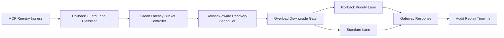

# APIM MCP Reentry Rollback Guard Lane Latency Bucket FAQ (Cycle 2146)

## 1) Three-minute decision
- **Core issue:** without rollback guardrails after reentry bursts, latency-bucket anomalies propagate across tenant recovery lanes.
- **Recommendation:** deploy a closed loop of rollback guard lanes, latency-bucket allocation, tiered downgrade gates, and audit replay.
- **Goal:** keep tenant fairness while bounding recovery time and rollback blast radius.

## 2) Q1 / Q2 / Q3
### Q1: Why add a rollback guard lane?
1) rate limiting alone cannot stop policy drift propagation,
2) rollback lanes isolate suspicious sessions and prioritize safe rollback,
3) combined with latency buckets, capacity, validity, order, and rollback boundaries are governed together.

### Q2: How should production layering work?
- **Rollback guard layer:** classify tenant/policy-version into rollback or standard lanes,
- **Allocation layer:** issue lane-scoped bucket credit and renewal windows,
- **Reclaim layer:** reclaim overdraft leases with anti-oscillation windows,
- **Downgrade layer:** trigger tiered downgrade and human review during peaks.

### Q3: What is the go-live bar?
- unfenced drift rate keeps declining,
- rollback-lane variance remains stable and traceable,
- recovery gain (percentage points) stays reproducible across windows.

## 3) Reference architecture

## 4) Decision matrix
| Dimension | Unified latency bucket | Rollback Guard Lane + Latency Bucket (Recommended) |
|---|---:|---:|
| Anomaly propagation control | Medium | High |
| Cross-tenant jitter suppression | Medium | High |
| Rollback explainability | Medium | High |
| Peak downgrade stability | Medium | High |
| Implementation complexity | Medium | Medium-High |

## 5) Evidence and reproducibility
- Evidence files:
  - `workshops/azure-agent-infra/evidence/cycle-2146-benchmark.json`
  - `workshops/azure-agent-infra/evidence/cycle-2146-latency.csv`
  - `workshops/azure-agent-infra/evidence/cycle-2146-throughput.csv`
  - `workshops/azure-agent-infra/evidence/cycle-2146-cost.csv`
- Contract keys:
  - `percentage_contract.unfenced_reentry_rollbackguardlane_drift_rate`
  - `percentage_contract.reentry_rollbackguardlane_variance_rate`
  - `percentage_contract.reentry_rollbackguardlane_recovery_gain_pts`
- Labels: `measured / synthetic / anonymized_reported`.

## 6) Production checklist
- [ ] Rollback lane classification is tenant-class replayable.
- [ ] Bucket grant/renew/reclaim is rollback-lane consistent.
- [ ] Rollback-priority lanes stay starvation-free during peak downgrade.
- [ ] Audit trails bind policy version, rollback class, and recovery path.
- [ ] FAQ/H5/SVG/7-card/evidence stay cycle-topic consistent.
