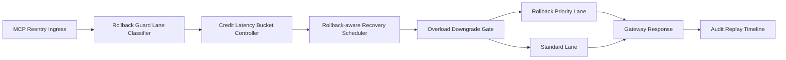

# APIM MCP 重入回滚护栏延迟桶公平选型 FAQ（Cycle 2146）

## 1) 3 分钟结论
- **核心问题：** 重入峰值后如果缺少回滚护栏，延迟桶异常会在多租户恢复链路中持续扩散。
- **推荐方案：** “回滚护栏车道 + 延迟桶配给 + 分级降档 + 审计回放”闭环治理。
- **目标：** 在保证租户公平的前提下，将异常恢复时间和回滚影响面稳定在可控范围。

## 2) Q1 / Q2 / Q3
### Q1：为什么要增加 rollback guard lane？
1) 单纯限流无法阻断异常配置在恢复链路中的传播；
2) 回滚护栏可以把可疑会话导入隔离车道并优先触发回滚；
3) 与延迟桶耦合后可同时管理额度、时效、顺序和回滚边界。

### Q2：生产分层怎么做？
- **回滚护栏层：** 按租户和策略版本判定是否进入回滚车道；
- **配给层：** 回滚车道和标准车道分别发放延迟桶额度与续租窗口；
- **回收层：** 对超额租约执行窗口化回收并抑制抖振；
- **降档层：** 峰值期间触发分级降档与人工复核队列。

### Q3：上线判据是什么？
- 无护栏漂移率持续下降；
- 回滚车道方差率稳定且可追踪；
- 恢复收益（percentage points）在多窗口可复现。

## 3) 架构图

## 4) 选型矩阵
| 维度 | 统一延迟桶 | Rollback Guard Lane + Latency Bucket（推荐） |
|---|---:|---:|
| 异常传播控制 | 中 | 高 |
| 跨租户抖振抑制 | 中 | 高 |
| 回滚可解释性 | 中 | 高 |
| 峰值降档稳定性 | 中 | 高 |
| 实施复杂度 | 中 | 中高 |

## 5) 数据证据与可复算算例（含 n 分母来源）
- 证据文件：
  - `workshops/azure-agent-infra/evidence/cycle-2146-benchmark.json`
  - `workshops/azure-agent-infra/evidence/cycle-2146-latency.csv`
  - `workshops/azure-agent-infra/evidence/cycle-2146-throughput.csv`
  - `workshops/azure-agent-infra/evidence/cycle-2146-cost.csv`
- 合同键：
  - `percentage_contract.unfenced_reentry_rollbackguardlane_drift_rate`
  - `percentage_contract.reentry_rollbackguardlane_variance_rate`
  - `percentage_contract.reentry_rollbackguardlane_recovery_gain_pts`
- 标签：`measured / synthetic / anonymized_reported`。

## 6) 生产检查清单
- [ ] rollback 护栏映射规则可按租户等级重放。
- [ ] 延迟桶授予/续租/回收与回滚护栏一致。
- [ ] 峰值降档时回滚优先车道无饥饿。
- [ ] 审计链路可关联策略版本、回滚等级与恢复轨迹。
- [ ] FAQ/H5/SVG/7-card/evidence 的 cycle/topic 一致。
