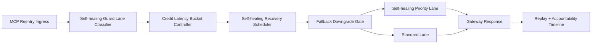

# APIM MCP Reentry Self-healing Guard Lane Latency Bucket FAQ (Cycle 2177)

## 1) Three-minute decision
- **Core issue:** when reentry peaks overlap policy oscillation, unstable self-healing paths amplify fairness jitter and rollback spread.
- **Recommendation:** adopt a closed loop of self-healing guard lanes, latency-bucket credit allocation, fallback downgrade gates, and replay audit.
- **Goal:** preserve multi-tenant fairness while shortening recovery windows and constraining blast radius.

## 2) Q1 / Q2 / Q3
### Q1: Why introduce a self-healing guard lane?
1) unified throttling cannot segment by self-healing capability class,
2) self-healing lanes isolate high-volatility traffic during policy transitions,
3) with latency buckets, credit burn, recovery ordering, and failure radius are jointly bounded.

### Q2: How should production layering be deployed?
- **Self-healing guard layer:** map tenant tier + recovery signature into lanes,
- **Credit allocation layer:** grant/renew/reclaim lane-scoped latency-bucket credits,
- **Suppression layer:** reclaim burst overdrafts and block propagation,
- **Degrade layer:** trigger fallback downgrade at peak with replayable accountability evidence.

### Q3: What is the release bar?
- unfenced self-healing drift trends down continuously,
- lane variance remains stable and explainable,
- recovery gain (percentage points) is reproducible across windows.

## 3) Reference architecture

## 4) Decision matrix
| Dimension | Unified latency bucket | Self-healing Guard Lane + Latency Bucket (Recommended) |
|---|---:|---:|
| Self-healing drift control | Medium | High |
| Cross-tenant propagation suppression | Medium | High |
| Replay accountability | Medium | High |
| Peak downgrade stability | Medium | High |
| Implementation complexity | Medium | Medium-High |

## 5) Evidence and reproducibility
- Evidence files:
  - `workshops/azure-agent-infra/evidence/cycle-2177-benchmark.json`
  - `workshops/azure-agent-infra/evidence/cycle-2177-latency.csv`
  - `workshops/azure-agent-infra/evidence/cycle-2177-throughput.csv`
  - `workshops/azure-agent-infra/evidence/cycle-2177-cost.csv`
- Contract keys:
  - `percentage_contract.unfenced_reentry_selfhealingguardlane_drift_rate`
  - `percentage_contract.reentry_selfhealingguardlane_variance_rate`
  - `percentage_contract.reentry_selfhealingguardlane_recovery_gain_pts`
- Labels: `measured / synthetic / anonymized_reported`.

## 6) Production checklist
- [ ] Self-healing-lane mapping is tenant-tier replayable.
- [ ] Bucket grant/renew/reclaim is self-healing-lane consistent.
- [ ] Self-healing-priority lanes remain starvation-free during peak downgrade.
- [ ] Audit trails bind policy version, recovery signature, and execution path.
- [ ] FAQ/H5/SVG/7-card/evidence stay cycle-topic consistent.
