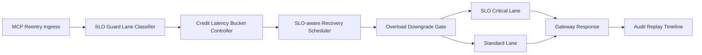

# APIM MCP Reentry SLO Guard Lane Latency Bucket FAQ (Cycle 2144)

## 1) Three-minute decision
- **Core issue:** without an SLO guard lane, peak reentry drives unstable recovery order in latency buckets.
- **Recommendation:** use a closed loop of SLO-guarded lanes, latency-bucket allocation, peak downgrade gates, and replayable audits.
- **Goal:** keep tenant fairness while meeting critical-path SLO and preserving explainability.

## 2) Q1 / Q2 / Q3
### Q1: Why introduce an SLO guard lane?
1) a shared queue amplifies low-priority occupancy during bursts,
2) SLO lanes protect critical recovery latency targets,
3) combined with latency buckets, capacity, validity, and order are jointly controlled.

### Q2: How should production layering work?
- **SLO lane layer:** map tenant/session class to recovery lanes,
- **Allocation layer:** issue lane-scoped bucket credit and renewal windows,
- **Reclaim layer:** reclaim overdraft leases with anti-oscillation windows,
- **Downgrade layer:** trigger policy downgrade + human confirmation at saturation.

### Q3: What is the go-live bar?
- unfenced drift rate keeps declining,
- lane variance is stable and replayable,
- recovery gain (percentage points) stays reproducible across windows.

## 3) Reference architecture

## 4) Decision matrix
| Dimension | Unified latency bucket | SLO Guard Lane + Latency Bucket (Recommended) |
|---|---:|---:|
| Critical-path SLO attainment | Medium | High |
| Cross-tenant jitter suppression | Medium | High |
| Audit explainability | Medium | High |
| Peak downgrade stability | Medium | High |
| Implementation complexity | Medium | Medium-High |

## 5) Evidence and reproducibility
- Evidence files:
  - `workshops/azure-agent-infra/evidence/cycle-2144-benchmark.json`
  - `workshops/azure-agent-infra/evidence/cycle-2144-latency.csv`
  - `workshops/azure-agent-infra/evidence/cycle-2144-throughput.csv`
  - `workshops/azure-agent-infra/evidence/cycle-2144-cost.csv`
- Contract keys:
  - `percentage_contract.unfenced_reentry_sloguardlane_drift_rate`
  - `percentage_contract.reentry_sloguardlane_variance_rate`
  - `percentage_contract.reentry_sloguardlane_recovery_gain_pts`
- Labels: `measured / synthetic / anonymized_reported`.

## 6) Production checklist
- [ ] SLO lane classification is tenant-class replayable.
- [ ] Bucket grant/renew/reclaim is SLO-lane consistent.
- [ ] Critical lanes stay starvation-free during peak downgrade.
- [ ] Audit trails bind policy version, SLO class, and recovery path.
- [ ] FAQ/H5/SVG/7-card/evidence stay cycle-topic consistent.
