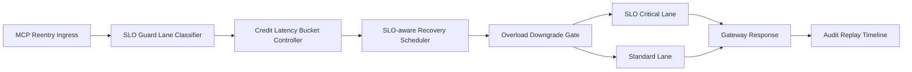

# APIM MCP 重入 SLO 护栏延迟桶公平选型 FAQ（Cycle 2144）

## 1) 3 分钟结论
- **核心问题：** 重入突发时缺少 SLO 护栏会让延迟桶恢复顺序在峰值窗口失稳。
- **推荐方案：** “SLO 护栏分流 + 延迟桶配给 + 峰值降档 + 审计回放”闭环。
- **目标：** 在租户公平前提下，让关键恢复链路满足 SLO 并保持可解释。

## 2) Q1 / Q2 / Q3
### Q1：为什么要引入 SLO guard lane？
1) 单一队列在峰值下会放大低优先级占用；
2) SLO 护栏让关键会话先满足恢复时延目标；
3) 与延迟桶结合可同时约束额度、时效与恢复顺序。

### Q2：生产分层如何落地？
- **SLO 护栏层：** 按租户级别与会话等级映射恢复车道；
- **配给层：** 在车道内发放延迟桶额度与续租窗口；
- **回收层：** 对超额租约做窗口化回收与抖振抑制；
- **降档层：** 峰值时触发策略降档与人工确认闸门。

### Q3：上线判据是什么？
- 无护栏漂移率持续下降；
- 车道方差率稳定且可回放；
- 恢复收益（percentage points）连续窗口可复现。

## 3) 架构图

## 4) 选型矩阵
| 维度 | 统一延迟桶 | SLO Guard Lane + Latency Bucket（推荐） |
|---|---:|---:|
| 关键链路 SLO 达成率 | 中 | 高 |
| 跨租户抖振抑制 | 中 | 高 |
| 审计可解释性 | 中 | 高 |
| 峰值降档稳定性 | 中 | 高 |
| 实施复杂度 | 中 | 中高 |

## 5) 数据证据与可复算算例（含 n 分母来源）
- 证据文件：
  - `workshops/azure-agent-infra/evidence/cycle-2144-benchmark.json`
  - `workshops/azure-agent-infra/evidence/cycle-2144-latency.csv`
  - `workshops/azure-agent-infra/evidence/cycle-2144-throughput.csv`
  - `workshops/azure-agent-infra/evidence/cycle-2144-cost.csv`
- 合同键：
  - `percentage_contract.unfenced_reentry_sloguardlane_drift_rate`
  - `percentage_contract.reentry_sloguardlane_variance_rate`
  - `percentage_contract.reentry_sloguardlane_recovery_gain_pts`
- 标签：`measured / synthetic / anonymized_reported`。

## 6) 生产检查清单
- [ ] SLO 护栏映射规则可按租户级别重放。
- [ ] 延迟桶授予/续租/回收与 SLO 护栏一致。
- [ ] 峰值降档时关键车道无饥饿。
- [ ] 审计链路可关联策略版本、SLO 等级与恢复轨迹。
- [ ] FAQ/H5/SVG/7-card/evidence 的 cycle/topic 一致。
