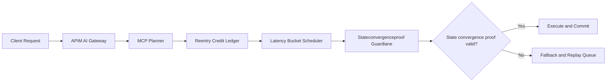

# Agent APIM/MCP 重入信用与延迟桶状态收敛证明护栏选型 FAQ（Cycle 2294）

## 1) 场景与约束
本轮聚焦 stateconvergenceproof guardlane（状态收敛证明护栏）：在 APIM AI Gateway、MCP 工具编排、重入信用账本与延迟桶调度链路中，要求系统在突发、重试与回放阶段保持状态收敛可验证。

## 2) Q1 / Q2 / Q3
Q1：状态收敛证明护栏与账本一致性证明护栏差异？
A1：账本一致性聚焦账目一致，状态收敛证明聚焦多阶段执行最终收敛到同一目标状态。

Q2：为何状态收敛证明必须绑定重入信用账本？
A2：重入信用决定重试时序，缺失收敛证明会使同一请求在多次重试后落入不同终态。

Q3：如何控制状态收敛证明校验开销？
A3：热路径仅校验 convergence_hash 与 fallback_token，冷路径离线重放完整状态机。

## 3) 选型建议（Good fit / Not for）
Good fit：多租户 SaaS Agent Gateway、Browser/CUA 集群、高合规零信任执行环境。
Not for：一次性脚本任务、无需收敛证明的临时实验、无租户公平约束的单机流程。

## 4) 可复现实验范围
实验数据见 `evidence/cycle-2294-benchmark.json`，覆盖冷启动/热恢复 P50/P95、并发吞吐、策略拦截率、单会话成本，并标注 measured/synthetic/anonymized_reported。

## 5) 百分比契约绑定（N/D）
- `percentage_contract.unfenced_reentry_stateconvergenceproofguardlane_drift_rate`
- `percentage_contract.reentry_stateconvergenceproofguardlane_variance_rate`
- `percentage_contract.reentry_stateconvergenceproofguardlane_recovery_gain_pts`

以上键绑定本 FAQ 与 cycle-2294 证据，`production_validation=not_measured`。

## 6) 上线检查单
1. APIM 与 MCP 输出 convergence_hash 与 fallback_reason。
2. 重入信用写入记录 fallback_token 与 trace_id。
3. 延迟桶调度结果附加收敛投票哈希。
4. 预算耗尽请求进入降级与回放队列。
5. 回放工具支持按 trace_id 重建状态机收敛序列。
6. 日报保留 measured/synthetic/anonymized_reported 标签。
