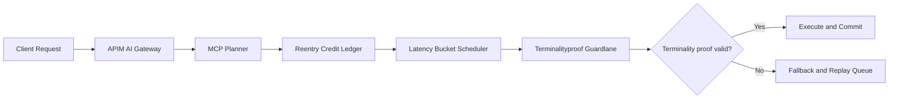

# Agent APIM/MCP Reentry Credit and Latency Bucket Terminality-Proof Guardlane FAQ (Cycle 2295)

## 1) Context and constraints
This cycle focuses on terminalityproof guardlane design. APIM AI Gateway, MCP orchestration, reentry-credit ledgers, and latency-bucket scheduling must keep terminal states verifiable under burst and retry pressure.

## 2) Q1 / Q2 / Q3
Q1: How is terminality-proof guardlane different from state-convergence-proof guardlane?
A1: Convergence-proof validates process convergence; terminality-proof validates compliance-qualified final state determination.

Q2: Why must this guardlane include reentry-credit ledgers?
A2: Reentry credit controls final execution quota, so missing terminality proof causes mismatch between final ledgers and execution snapshots.

Q3: How can terminality-proof checks stay efficient?
A3: Hot path checks terminality_hash and fallback_token, while cold path replays terminal-state adjudication offline.

## 3) Recommendation (Good fit / Not for)
Good fit: multi-tenant SaaS Agent Gateway, Browser/CUA clusters, and high-compliance zero-trust execution.
Not for: one-off scripts, temporary experiments without terminality-proof requirements, and single-node flows without tenant fairness constraints.

## 4) Reproducible benchmark scope
Evidence is in `evidence/cycle-2295-benchmark.json`, including cold/warm latency, throughput, policy interception, and per-session cost with measured/synthetic/anonymized_reported labels.

## 5) Percentage contract bindings (N/D)
- `percentage_contract.unfenced_reentry_terminalityproofguardlane_drift_rate`
- `percentage_contract.reentry_terminalityproofguardlane_variance_rate`
- `percentage_contract.reentry_terminalityproofguardlane_recovery_gain_pts`

These keys bind this FAQ to cycle-2295 evidence with `production_validation=not_measured`.

## 6) Production checklist
1. APIM and MCP emit terminality_hash and fallback_reason.
2. Reentry-credit writes include fallback_token and trace_id.
3. Latency-bucket decisions carry terminality-vote hash.
4. Budget-exhausted requests route to fallback and replay queues.
5. Replay tooling reconstructs terminal-state adjudication by trace_id.
6. Reports preserve measured/synthetic/anonymized_reported labels.
