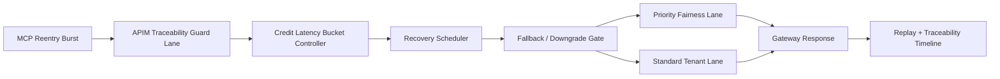

# APIM MCP Reentry Credit Latency Bucket Traceability Guard Lane FAQ (Cycle 2208)

## 1) Three-minute conclusion
- **Core problem:** Rate limiting without traceability guard lanes disconnects fairness control from audit replay.
- **Recommended pattern:** Use a **traceability guard lane + credit latency bucket + replay audit loop**.
- **Target outcome:** Better fairness stability and accountability under multi-tenant constraints.

## 2) Q1 / Q2 / Q3
### Q1: Why is a traceability guard lane mandatory?
1) Side-channel logs cannot drive real-time reclaim actions;
2) Guard-lane mode links policy version, tenant watermark, and fallback actions;
3) Replay can deterministically recompute outcomes from evidence.

### Q2: How should production layering work?
- **Ingress:** APIM Gateway routes by tenant and policy version into traceability lanes;
- **Control:** latency bucket grant/renew/reclaim writes unified traces;
- **Suppression:** burst windows apply graded degradation;
- **Audit:** replayable evidence supports compliance and finance sign-off.

### Q3: What are go-live gates?
- Unfenced reentry drift keeps declining;
- Guard-lane variance converges within target bands;
- Recovery gain (percentage points) is reproducible from evidence files.

## 3) Architecture

## 4) Selection matrix
| Dimension | Latency bucket only | Traceability guard lane + latency bucket (Recommended) |
|---|---:|---:|
| Fairness jitter convergence | Medium | High |
| Evidence traceability | Low | High |
| Cross-tenant containment | Medium | High |
| Fallback explainability | Medium | High |
| Implementation complexity | Low | Medium-high |

## 5) Evidence and reproducible arithmetic (with n denominators)
- Evidence files:
  - `workshops/azure-agent-infra/evidence/cycle-2208-benchmark.json`
  - `workshops/azure-agent-infra/evidence/cycle-2208-latency.csv`
  - `workshops/azure-agent-infra/evidence/cycle-2208-throughput.csv`
  - `workshops/azure-agent-infra/evidence/cycle-2208-cost.csv`
- Contract keys:
  - `percentage_contract.unfenced_reentry_traceabilityguardlane_drift_rate`
  - `percentage_contract.reentry_traceabilityguardlane_variance_rate`
  - `percentage_contract.reentry_traceabilityguardlane_recovery_gain_pts`
- Labels: `measured / synthetic / anonymized_reported`.

## 6) Production checklist
- [ ] Guard-lane mapping is replayable by policy version.
- [ ] Grant/renew/reclaim events align with trace timeline.
- [ ] Priority lane avoids starvation during downgrade windows.
- [ ] Audit evidence links tenant, policy, and execution path.
- [ ] FAQ/H5/SVG/7-card/evidence cycle+topic remain consistent.
