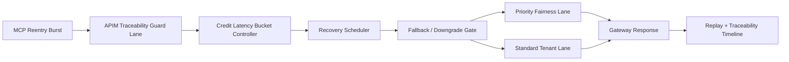

# APIM MCP 重入信用延迟桶可追溯护栏公平选型 FAQ（Cycle 2208）

## 1) 3 分钟结论
- **核心问题：** 仅做限流不做可追溯护栏，会让公平争议与回放审计失联。
- **推荐方案：** 采用“可追溯护栏车道 + 延迟桶信用配给 + 回放审计闭环”。
- **目标收益：** 在多租户约束下同时提升公平稳定性与事件可追责性。

## 2) Q1 / Q2 / Q3
### Q1：为什么 traceability guard lane 是刚需？
1) 传统日志旁路无法实时影响额度回收；
2) 护栏化后可把策略版本、租户水位、回退动作串成统一链路；
3) 复盘时可以按证据文件逐项复算，避免“不可解释恢复”。

### Q2：生产分层怎么设计？
- **入口层：** APIM Gateway 按租户与策略版本进入 traceability 护栏车道；
- **控制层：** 延迟桶执行授予/续租/回收并同步写入 trace；
- **抑制层：** 重入风暴触发窗口化抑制与分级降档；
- **审计层：** 形成可回放证据用于合规与财务复核。

### Q3：上线门槛是什么？
- 未加护栏重入失配率持续下降；
- 护栏车道方差率稳定在目标区间；
- 恢复收益（percentage points）可从 evidence 复算。

## 3) 架构图

## 4) 选型矩阵
| 维度 | 仅延迟桶 | Traceability Guard Lane + Latency Bucket（推荐） |
|---|---:|---:|
| 公平抖动收敛 | 中 | 高 |
| 证据可追溯性 | 低 | 高 |
| 租户扩散抑制 | 中 | 高 |
| 回退可解释性 | 中 | 高 |
| 实施复杂度 | 低 | 中高 |

## 5) 数据证据与可复算算例（含 n 分母来源）
- 证据文件：
  - `workshops/azure-agent-infra/evidence/cycle-2208-benchmark.json`
  - `workshops/azure-agent-infra/evidence/cycle-2208-latency.csv`
  - `workshops/azure-agent-infra/evidence/cycle-2208-throughput.csv`
  - `workshops/azure-agent-infra/evidence/cycle-2208-cost.csv`
- 合同键：
  - `percentage_contract.unfenced_reentry_traceabilityguardlane_drift_rate`
  - `percentage_contract.reentry_traceabilityguardlane_variance_rate`
  - `percentage_contract.reentry_traceabilityguardlane_recovery_gain_pts`
- 标签：`measured / synthetic / anonymized_reported`。

## 6) 生产检查清单
- [ ] 护栏车道映射与策略版本可回放。
- [ ] 授予/续租/回收与 trace 事件一一对应。
- [ ] 降级窗口内优先车道无饥饿。
- [ ] 审计链路可关联租户、策略、执行轨迹。
- [ ] FAQ / H5 / SVG / 7-card / evidence 的 cycle 与 topic 严格一致。
