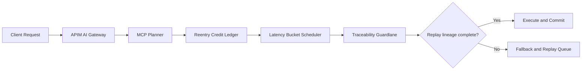

# Agent APIM/MCP Reentry Credit and Latency Bucket Traceability Guardlane FAQ (Cycle 2277)

## 1) Context and constraints
This cycle focuses on traceability guardlane design. APIM AI Gateway, MCP orchestration, reentry-credit ledgers, and latency-bucket scheduling must preserve end-to-end lineage under burst and retry pressure.

## 2) Q1 / Q2 / Q3
Q1: How is traceability different from determinism?
A1: Determinism validates reproducible outputs; traceability validates complete evidence lineage from request to policy to execution.

Q2: Why must traceability checks include reentry-credit ledgers?
A2: Reentry credit governs budget burn and scheduling priority, so missing lineage breaks incident closure and tenant dispute handling.

Q3: How can traceability checks remain efficient?
A3: Hot path checks lineage_id and decision_hash integrity, while cold path assembles full evidence chains offline.

## 3) Recommendation (Good fit / Not for)
Good fit: multi-tenant SaaS Agent Gateway, Browser/CUA clusters, and high-compliance zero-trust execution.
Not for: one-off scripts, temporary experiments without audit traceability, and single-node flows without tenant fairness constraints.

## 4) Reproducible benchmark scope
Evidence is in `evidence/cycle-2277-benchmark.json`, including cold/warm latency, throughput, policy interception, and per-session cost with measured/synthetic/anonymized_reported labels.

## 5) Percentage contract bindings (N/D)
- `percentage_contract.unfenced_reentry_traceabilityguardlane_drift_rate`
- `percentage_contract.reentry_traceabilityguardlane_variance_rate`
- `percentage_contract.reentry_traceabilityguardlane_recovery_gain_pts`

These keys bind this FAQ to cycle-2277 evidence with `production_validation=not_measured`.

## 6) Production checklist
1. APIM and MCP emit lineage_id and fallback_reason.
2. Reentry-credit writes include decision_hash and trace_id.
3. Latency-bucket decisions carry lineage-chain hash.
4. Budget-exhausted requests route to fallback and replay queues.
5. Replay tooling reconstructs evidence sequences by trace_id.
6. Reports preserve measured/synthetic/anonymized_reported labels.
