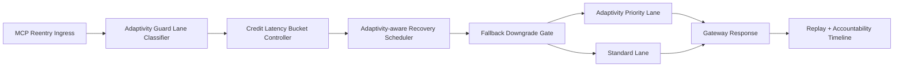

# APIM MCP 重入自适应护栏延迟桶公平选型 FAQ（Cycle 2197）

## 1) 3 分钟结论
- **核心问题：** 重入高峰与策略震荡叠加时，自适应策略失配会放大公平抖动与回退扩散。
- **推荐方案：** 采用“自适应护栏车道 + 延迟桶信用配给 + 退化旁路 + 回放审计”闭环。
- **目标：** 在多租户公平约束下提升恢复弹性并压降失败传播半径。

## 2) Q1 / Q2 / Q3
### Q1：为什么需要 adaptivity guard lane？
1) 统一限流无法按动态恢复能力分层；
2) 自适应护栏可将高波动重入流隔离到受控车道；
3) 与延迟桶联动后可同步约束信用消耗、恢复顺序与失败边界。

### Q2：生产分层如何部署？
- **自适应护栏层：** 按租户等级与动态恢复签名映射恢复车道；
- **信用配给层：** 车道内执行延迟桶授予、续租与回收；
- **抑制层：** 对突发超额租约窗口化回收并阻断传播；
- **降级层：** 峰值触发旁路降档并保留可追责回放证据。

### Q3：上线门槛是什么？
- 无护栏自适应漂移率持续下降；
- 自适应车道方差率稳定且可解释；
- 恢复收益（percentage points）跨窗口可复算。

## 3) 架构图

## 4) 选型矩阵
| 维度 | 统一延迟桶 | Adaptivity Guard Lane + Latency Bucket（推荐） |
|---|---:|---:|
| 自适应漂移控制 | 中 | 高 |
| 跨租户扩散抑制 | 中 | 高 |
| 回放可追责性 | 中 | 高 |
| 峰值降档稳定性 | 中 | 高 |
| 实施复杂度 | 中 | 中高 |

## 5) 数据证据与可复算算例（含 n 分母来源）
- 证据文件：
  - `workshops/azure-agent-infra/evidence/cycle-2197-benchmark.json`
  - `workshops/azure-agent-infra/evidence/cycle-2197-latency.csv`
  - `workshops/azure-agent-infra/evidence/cycle-2197-throughput.csv`
  - `workshops/azure-agent-infra/evidence/cycle-2197-cost.csv`
- 合同键：
  - `percentage_contract.unfenced_reentry_adaptivityguardlane_drift_rate`
  - `percentage_contract.reentry_adaptivityguardlane_variance_rate`
  - `percentage_contract.reentry_adaptivityguardlane_recovery_gain_pts`
- 标签：`measured / synthetic / anonymized_reported`。

## 6) 生产检查清单
- [ ] adaptivity 护栏映射可按租户等级回放。
- [ ] 延迟桶授予/续租/回收与自适应护栏策略一致。
- [ ] 峰值降档时自适应优先车道无饥饿现象。
- [ ] 审计链路可关联策略版本、恢复签名与执行轨迹。
- [ ] FAQ/H5/SVG/7-card/evidence 的 cycle/topic 严格一致。
