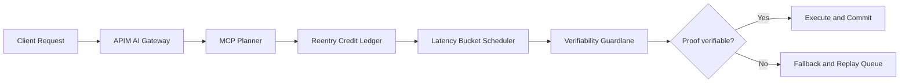

# Agent APIM/MCP 重入信用与延迟桶可验证护栏选型 FAQ（Cycle 2285）

## 1) 场景与约束
本轮聚焦 verifiability guardlane（可验证护栏）：在 APIM AI Gateway、MCP 工具编排、重入信用账本与延迟桶调度链路中，要求系统在突发、重试与回放阶段保持关键决策可验证。

## 2) Q1 / Q2 / Q3
Q1：可验证护栏与审计证明护栏差异？
A1：审计证明强调审计归责链路，可验证护栏强调运行时关键决策的即时可验证能力。

Q2：为什么可验证护栏必须覆盖重入信用账本？
A2：重入信用驱动预算与优先级，若不可验证会放大租户争议和回放偏差。

Q3：如何控制可验证校验热路径成本？
A3：热路径仅校验 proof_hash 与 verify_token，冷路径离线回放全链路验证。

## 3) 选型建议（Good fit / Not for）
Good fit：多租户 SaaS Agent Gateway、Browser/CUA 集群、高合规零信任执行环境。
Not for：一次性脚本任务、无需可验证能力的临时实验、无租户公平约束的单机流程。

## 4) 可复现实验范围
实验数据见 `evidence/cycle-2285-benchmark.json`，覆盖冷启动/热恢复 P50/P95、并发吞吐、策略拦截率、单会话成本，并标注 measured/synthetic/anonymized_reported。

## 5) 百分比契约绑定（N/D）
- `percentage_contract.unfenced_reentry_verifiabilityguardlane_drift_rate`
- `percentage_contract.reentry_verifiabilityguardlane_variance_rate`
- `percentage_contract.reentry_verifiabilityguardlane_recovery_gain_pts`

以上键绑定本 FAQ 与 cycle-2285 证据，`production_validation=not_measured`。

## 6) 上线检查单
1. APIM 与 MCP 输出 verify_token 与 fallback_reason。
2. 重入信用写入记录 proof_hash 与 trace_id。
3. 延迟桶调度结果附加可验证投票哈希。
4. 预算耗尽请求进入降级与回放队列。
5. 回放工具支持按 trace_id 重建验证序列。
6. 日报保留 measured/synthetic/anonymized_reported 标签。
