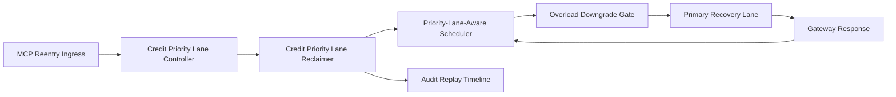

# APIM MCP 重入授信优先车道公平选型 FAQ（Cycle 1988）

## 1) 3 分钟结论
- **核心问题：** 重入流量在优先车道内会快速耗尽共享配额，导致租户恢复顺序不可控。
- **推荐方案：** “授信优先车道配给 + 超额借额斜率回收 + 过载降档闸门”闭环治理。
- **目标：** 在保持跨租户公平前提下，稳定关键斜率会话的恢复吞吐。

## 2) Q1 / Q2 / Q3
### Q1：为什么要引入 credit priority lane 而不是固定信用桶？
1) 固定信用桶缺少时间维度，无法表达租约到期与续租优先级；
2) 仅按信用衰减会在边界时刻发生集中抢占；
3) credit priority lane 让“额度+时效”同时参与调度决策。

### Q2：生产分层应如何设计？
- **配给层：** 每租户按优先级分发授信优先车道与续租预算；
- **回收层：** 对超额借额斜率采用窗口化回收与抖振保护；
- **降档层：** 在拥塞峰值触发降档闸门，保护核心会话；
- **审计层：** 记录租约授予、续租、回收与降档动作。

### Q3：上线判据是什么？
- 授信优先车道漂移率持续下降；
- 高优先级租约成功率稳定；
- 借额斜率回收与降档轨迹可租户级回放。

## 3) 架构图

## 4) 选型矩阵
| 维度 | 固定信用桶 | Credit Priority Lane Fairness（推荐） |
|---|---:|---:|
| 租约恢复顺序稳定性 | 中 | 高 |
| 边界抢占抖振抑制 | 中 | 高 |
| 额度与时效耦合能力 | 低 | 高 |
| 回放可解释性 | 中 | 高 |
| 实施复杂度 | 中 | 中高 |

## 5) 数据证据与可复算算例（含 n 分母来源）
- 证据文件：
  - `workshops/azure-agent-infra/evidence/cycle-1988-benchmark.json`
  - `workshops/azure-agent-infra/evidence/cycle-1988-latency.csv`
  - `workshops/azure-agent-infra/evidence/cycle-1988-throughput.csv`
  - `workshops/azure-agent-infra/evidence/cycle-1988-cost.csv`
- 合同键：
  - `percentage_contract.unfenced_reentry_credit_prioritylane_drift_rate`
  - `percentage_contract.reentry_credit_prioritylane_variance_rate`
  - `percentage_contract.reentry_credit_prioritylane_recovery_gain_pts`
- 标签：`measured / synthetic / anonymized_reported`。

## 6) 生产检查清单
- [ ] 授信优先车道授予/续租/回收在同窗口内可重放。
- [ ] 超额借额斜率回收不会造成关键租户饥饿。
- [ ] 降档闸门在 10x 峰值下保持单调收敛。
- [ ] 审计链路可关联租户、租约等级与策略版本。
- [ ] FAQ/H5/SVG/7-card/evidence 的 cycle/topic 一致。
