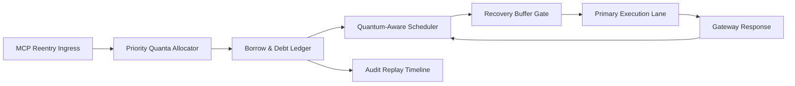

# APIM MCP Reentry Priority Quanta Fairness Selection FAQ (Cycle 1945)

## 1) Three-minute decision
- **Core issue:** under night-window reentry bursts, FIFO fairness still lets high-frequency tenants dominate recovery slots.
- **Recommendation:** adopt a three-stage control loop: priority quanta budget, dynamic borrow-reclaim, and guarded recovery fallback.
- **Goal:** keep reentry oscillation inside a replayable budget while preserving explainable recovery order for critical tenants.

## 2) Q1 / Q2 / Q3
### Q1: Why move from rebalance lanes to priority quanta?
1) lane-level fairness caps volume but not business criticality,
2) without quanta, same-lane contention creates noisy preemption swings,
3) priority quanta encode fairness and criticality in one scheduler primitive.

### Q2: What is the production layering model?
- **Budget layer:** define base quanta and borrow caps per tenant and priority,
- **Scheduling layer:** enforce windowed debt reclaim and preemption streak limits,
- **Recovery layer:** downgrade quanta and enable buffer gates under burst conditions,
- **Audit layer:** persist replayable quanta allocation, borrow, and reclaim events.

### Q3: What is the go-live bar?
- priority-quanta drift rate keeps declining,
- high-priority success rate stays stable under fairness constraints,
- recovery and budget transitions are tenant-replayable.

## 3) Reference architecture

## 4) Decision matrix
| Dimension | Fixed lane fairness | Priority Quanta Fairness (Recommended) |
|---|---:|---:|
| Recovery-order stability for critical tenants | Medium | High |
| Reentry burst oscillation suppression | Medium | High |
| Fairness + priority compatibility | Low | High |
| Replay explainability | Medium | High |
| Implementation complexity | Medium | Medium-High |

## 5) Evidence and reproducibility
- Evidence files:
  - `workshops/azure-agent-infra/evidence/cycle-1945-benchmark.json`
  - `workshops/azure-agent-infra/evidence/cycle-1945-latency.csv`
  - `workshops/azure-agent-infra/evidence/cycle-1945-throughput.csv`
  - `workshops/azure-agent-infra/evidence/cycle-1945-cost.csv`
- Contract keys:
  - `percentage_contract.unfenced_reentry_priority_quanta_drift_rate`
  - `percentage_contract.reentry_priority_quanta_variance_rate`
  - `percentage_contract.reentry_priority_quanta_recovery_gain_pts`
- Labels: `measured / synthetic / anonymized_reported`.

## 6) Production checklist
- [ ] Quanta allocation and borrow-reclaim transitions are window-replayable.
- [ ] Debt reclaim does not starve high-priority tenants.
- [ ] Downgrade recovery gates converge monotonically at 10x load.
- [ ] Audit trails bind tenant, priority, and policy version deterministically.
- [ ] FAQ/H5/SVG/7-card/evidence remain cycle-topic consistent.
