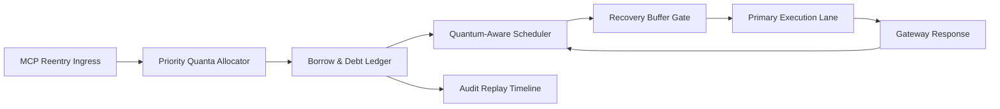

# APIM MCP 重入优先量子公平选型 FAQ（Cycle 1945）

## 1) 3 分钟结论
- **核心问题：** 在夜间高并发回补窗口，重入请求若只按先到先服务会造成高频租户长期占优。
- **推荐方案：** “优先量子预算 + 动态借位回收 + 失败回补护栏”三段式治理。
- **目标：** 将重入抖振控制在可回放预算内，同时保证关键租户恢复顺序可解释。

## 2) Q1 / Q2 / Q3
### Q1：为什么从重平衡车道升级到 priority quanta？
1) 车道级公平只能限制总量，无法表达关键业务优先等级；
2) 在同车道峰值冲击下，缺乏量子预算会导致抢占抖动；
3) priority quanta 能把“公平”与“关键性”同时编码到调度器。

### Q2：生产级落地应如何分层？
- **预算层：** 每租户与每优先级设置基础量子与可借位上限；
- **调度层：** 采用窗口化 debt 回收，限制连续抢占次数；
- **恢复层：** 当队列突增时触发优先量子降档与回补缓冲；
- **审计层：** 输出每次量子分配、借位与回收的可回放轨迹。

### Q3：什么指标决定可上线？
- 重入优先量子漂移率持续下降；
- 高优先级成功率不因公平约束而回落；
- 回补动作与预算变化可按租户精确复盘。

## 3) 架构图

## 4) 选型矩阵
| 维度 | 固定车道公平 | Priority Quanta Fairness（推荐） |
|---|---:|---:|
| 关键租户恢复顺序稳定性 | 中 | 高 |
| 峰值重入抖振抑制 | 中 | 高 |
| 公平与优先级兼容性 | 低 | 高 |
| 回放可解释性 | 中 | 高 |
| 实施复杂度 | 中 | 中高 |

## 5) 数据证据与可复算算例（含 n 分母来源）
- 证据文件：
  - `workshops/azure-agent-infra/evidence/cycle-1945-benchmark.json`
  - `workshops/azure-agent-infra/evidence/cycle-1945-latency.csv`
  - `workshops/azure-agent-infra/evidence/cycle-1945-throughput.csv`
  - `workshops/azure-agent-infra/evidence/cycle-1945-cost.csv`
- 合同键：
  - `percentage_contract.unfenced_reentry_priority_quanta_drift_rate`
  - `percentage_contract.reentry_priority_quanta_variance_rate`
  - `percentage_contract.reentry_priority_quanta_recovery_gain_pts`
- 标签：`measured / synthetic / anonymized_reported`。

## 6) 生产检查清单
- [ ] 优先量子分配与借位回收均可按窗口重放。
- [ ] debt 回收不会导致关键租户连续饥饿。
- [ ] 降档回补护栏在 10x 负载下保持单调收敛。
- [ ] 审计轨迹可关联租户、优先级与策略版本。
- [ ] FAQ/H5/SVG/7-card/evidence 的 cycle/topic 一致。
