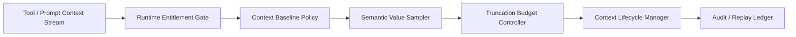

# Agent Context Window 截断治理选型 FAQ（固定截断阈值 vs 自适应上下文打包）

## 1) 核心结论（先给负责人）
- **多租户生产默认采用“自适应上下文打包 + 截断预算门禁”**，不建议长期只用固定截断阈值。
- **固定截断阈值在长链工具调用和多轮推理场景更容易触发关键信息丢失**，放大重试与尾延迟成本。
- **截断治理必须与租户权限、网关策略和回放审计联动**，否则可靠性与合规边界无法同时满足。

## 2) Q1 / Q2 / Q3（术语先通俗解释）
- **固定截断阈值**：上下文到达固定 token 上限后直接截断，简单但鲁棒性弱。
- **自适应上下文打包**：按任务风险和证据优先级重排上下文，降低关键语义被截断概率。

### Q1：为什么固定截断阈值在生产有风险？
第一性原理：上下文价值密度并不均匀，静态阈值截断会随机切断关键因果链，导致模型决策质量波动。

### Q2：什么时候可以接受固定截断阈值？
短会话、单租户、提示模板高度稳定且有严格人工复核兜底时，可短期使用。

### Q3：截断治理的最小安全闭环是什么？
租户运行权限 -> 上下文基线策略 -> 价值采样与重排决策 -> 截断预算门禁 -> 失败重放与审计回溯。

## 3) Mermaid（MCP 上下文截断治理闭环）

## 4) 决策矩阵
| 维度 | 固定截断阈值 | 自适应上下文打包 |
|---|---|---|
| 实现复杂度 | 低 | 中 |
| 关键语义保留能力 | 低-中 | 高 |
| 截断损失控制 | 低-中 | 高 |
| 多租户治理能力 | 中 | 高 |
| 生产默认建议 | 短期过渡 | 多租户长期运行 |

## 5) 数据证据与可复算算例（含 n/分母/来源）
> 本节百分比为 `synthetic_assumed` 假设算例（hypothetical），用于机制比较；生产机制认证仍为 `not_measured`。  
> 合同字段见：`workshops/azure-agent-infra/evidence/cycle-436-benchmark.json` 的 `percentage_contract`。

- 指标 A（截断损失率，固定截断阈值）  
  - 定义：`n_loss_fixed_truncation / n_runtime_requests_observed`  
  - 值：`312/2400 = 13.0%`（`synthetic_assumed`）  
  - 路径：`percentage_contract.fixed_truncation_loss_rate`
- 指标 B（截断损失率，自适应上下文打包）  
  - 定义：`n_loss_adaptive_context_packing / n_runtime_requests_observed`  
  - 值：`92/2400 = 3.8%`（`synthetic_assumed`）  
  - 路径：`percentage_contract.adaptive_context_packing_loss_rate`
- 指标 C（恢复成功率提升，百分点）  
  - 定义：`(n_recovery_success_adaptive - n_recovery_success_fixed) / n_runtime_requests_observed`  
  - 值：`(2186-1874)/2400 = 13.0` 个百分点（`synthetic_assumed`）  
  - 路径：`percentage_contract.context_recovery_gain_pts`

## 6) 生产 Checklist（上线前必须打勾）
- [ ] 上下文打包与截断预算策略含版本、灰度与回滚路径  
- [ ] 租户运行权限与截断预算门禁在网关层生效  
- [ ] 截断损失率、恢复成功率与审计回放可追溯  
- [ ] 指标口径标注 `synthetic_assumed` 与分母/单位，生产机制认证保持 `not_measured`
