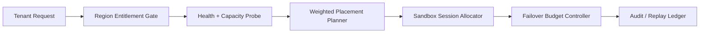

# Agent Cross-Region Sandbox Placement Governance Selection FAQ (Single-Region Affinity vs Geo-Weighted Placement)

## 1) Core conclusions
- **Production multi-tenant deployments should default to geo-weighted placement with failover budgets**, not long-term single-region affinity.
- **Single-region affinity amplifies overflow and queue tail risk during regional turbulence or quota pressure**, especially for bursty coding workloads.
- **Cross-region placement governance must be coupled with tenant region entitlements, gateway policy, and replay audit loops** to balance recovery speed and compliance boundaries.

## 2) Q1 / Q2 / Q3 (plain terms first)
- **Single-region affinity**: pin sessions to one region; simple and low-latency, but weak against regional volatility.
- **Geo-weighted placement**: route sessions by region weights and health signals, while keeping warm failover paths.

### Q1: Why is single-region affinity risky in production?
First principle: regional capacity and queue depth continuously fluctuate; fixed single-region routing concentrates overflow and magnifies retry/tail-latency effects.

### Q2: When is single-region affinity acceptable?
Short-lived single-tenant workloads with stable regional headroom, high cross-region compliance cost, and relaxed recovery objectives.

### Q3: What is the minimum safe cross-region placement control loop?
Tenant region entitlement -> health/capacity probe -> weighted planner -> session quota gate -> failover budget controller -> replay audit ledger.

## 3) Mermaid (cross-region sandbox placement governance loop)

## 4) Decision matrix
| Dimension | Single-region affinity | Geo-weighted placement |
|---|---|---|
| Implementation complexity | Low | Medium-High |
| Regional volatility tolerance | Low | High |
| Overflow control ability | Low-Medium | High |
| Compliance boundary expression | Medium | High |
| Default production fit | Short transitional phase | Multi-tenant long-running workloads |

## 5) Evidence contract + recomputable examples (n/denominator/source)
> Percentages in this section are `synthetic_assumed` hypothetical examples for mechanism comparison; production mechanism validation remains `not_measured`.  
> Contract fields: `workshops/azure-agent-infra/evidence/cycle-429-benchmark.json` -> `percentage_contract`.

- Metric A (overflow rate, single-region affinity)  
  - Formula: `n_overflow_single_region / n_sessions_observed`  
  - Value: `288/2400 = 12.0%` (`synthetic_assumed`)  
  - Path: `percentage_contract.single_region_overflow_rate`
- Metric B (overflow rate, geo-weighted placement)  
  - Formula: `n_overflow_geo_weighted / n_sessions_observed`  
  - Value: `86/2400 = 3.6%` (`synthetic_assumed`)  
  - Path: `percentage_contract.geo_weighted_overflow_rate`
- Metric C (cross-region placement success gain, percentage points)  
  - Formula: `(n_success_geo_weighted - n_success_single_region) / n_sessions_observed`  
  - Value: `(2140-1938)/2400 = 8.4 percentage points` (`synthetic_assumed`)  
  - Path: `percentage_contract.cross_region_success_gain_pts`

## 6) Production checklist
- [ ] Region entitlement policy is versioned with rollout and rollback controls
- [ ] Tenant region entitlement and quota gates are enforced at gateway level
- [ ] Failover budget, replay audit, and region probes are traceable
- [ ] Metrics are tagged `synthetic_assumed` with denominator and units; production validation remains `not_measured`
