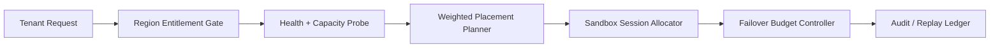

# Agent 跨区域 Sandbox 选址治理选型 FAQ（单区域亲和 vs 跨区域加权放置）

## 1) 核心结论（先给负责人）
- **多租户生产默认采用“跨区域加权放置 + 失效转移预算”**，不建议长期固定单区域亲和。
- **单区域亲和在区域抖动或配额紧张时会放大溢出与排队尾延迟**，对高并发 Coding Agent 不稳定。
- **跨区域选址治理必须与租户区域权限、网关策略与审计回放联动**，否则恢复速度与合规边界无法同时保障。

## 2) Q1 / Q2 / Q3（术语先通俗解释）
- **单区域亲和**：默认把会话固定在一个区域，路径简单、时延低，但抗区域波动能力弱。
- **跨区域加权放置**：按区域权重和健康度动态分流，保留热备切换能力。

### Q1：为什么单区域亲和在生产里有风险？
第一性原理：区域可用容量和瞬时队列会持续波动，固定单区域会让溢出集中，放大重试和排队尾延迟。

### Q2：什么时候可以接受单区域亲和？
单租户、区域容量长期充足、跨区域合规成本高且恢复目标宽松时，可作为短期策略。

### Q3：跨区域选址治理的最小安全闭环是什么？
租户区域权限 -> 区域健康探针 -> 加权放置器 -> 会话配额门禁 -> 失效转移预算 -> 审计回放账本。

## 3) Mermaid（跨区域 Sandbox 选址治理闭环）

## 4) 决策矩阵
| 维度 | 单区域亲和 | 跨区域加权放置 |
|---|---|---|
| 实现复杂度 | 低 | 中-高 |
| 区域抖动抗性 | 低 | 高 |
| 溢出控制能力 | 低-中 | 高 |
| 合规边界表达 | 中 | 高 |
| 生产默认建议 | 短期过渡 | 多租户长期运行 |

## 5) 数据证据与可复算算例（含 n/分母/来源）
> 本节百分比为 `synthetic_assumed` 假设算例（hypothetical），用于机制比较；生产机制认证仍为 `not_measured`。  
> 合同字段见：`workshops/azure-agent-infra/evidence/cycle-429-benchmark.json` 的 `percentage_contract`。

- 指标 A（溢出率，单区域亲和）  
  - 定义：`n_overflow_single_region / n_sessions_observed`  
  - 值：`288/2400 = 12.0%`（`synthetic_assumed`）  
  - 路径：`percentage_contract.single_region_overflow_rate`
- 指标 B（溢出率，跨区域加权放置）  
  - 定义：`n_overflow_geo_weighted / n_sessions_observed`  
  - 值：`86/2400 = 3.6%`（`synthetic_assumed`）  
  - 路径：`percentage_contract.geo_weighted_overflow_rate`
- 指标 C（跨区域放置成功率提升，百分点）  
  - 定义：`(n_success_geo_weighted - n_success_single_region) / n_sessions_observed`  
  - 值：`(2140-1938)/2400 = 8.4` 个百分点（`synthetic_assumed`）  
  - 路径：`percentage_contract.cross_region_success_gain_pts`

## 6) 生产 Checklist（上线前必须打勾）
- [ ] 区域权限策略含版本、灰度与回滚路径  
- [ ] 租户区域 entitlement 与配额门禁在网关层生效  
- [ ] 失效转移预算、回放审计与区域探针可追溯  
- [ ] 指标口径标注 `synthetic_assumed` 与分母/单位，生产机制认证保持 `not_measured`  
