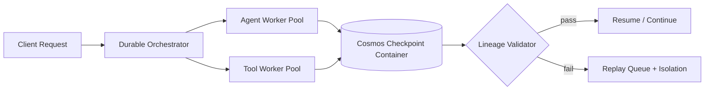

# Durable Functions + Cosmos DB Multi-Agent Checkpoint Governance FAQ (Cycle 2368)

## 1) Scenario and constraints
This round focuses on **Durable Functions orchestration + Cosmos DB checkpoints** for multi-agent state governance. The goal is deterministic resume, auditable lineage, and replay safety under retries and regional turbulence.

## 2) Daily breakthrough signals (verifiable)
- Durable Functions remains a strong state-machine runtime for recoverable multi-step AI workflows.
- Cosmos DB consistency controls provide concrete boundaries for checkpoint lineage integrity.
- Azure Functions Host releases provide practical runtime evolution signals for compatibility/risk tracking.

## 3) Decision matrix (architecture trade-offs)
| Path | State consistency | Recovery latency | Delivery complexity | Cost/TCO | Best fit |
|---|---:|---:|---:|---:|---|
| Durable + Cosmos (primary) | High | Low | Medium | Medium | Long-running multi-agent flows |
| Queue + cache only | Medium-low | Low | Low | Low | Lightweight short tasks |
| Event sourcing + external DB | High | Medium | High | Medium-high | Strict audit pipelines |
| In-process memory state | Low | Very low | Low | Low | PoC/temporary tasks |

## 4) Guidance (Good fit / Not for)
Good fit:
1. Multi-stage agent workflows requiring deterministic recovery points.
2. Browser/CUA + tool fanout flows requiring unified replay evidence.
3. Regulated workloads requiring traceable state lineage.

Not for:
1. One-off synchronous jobs with no resume need.
2. Temporary experiments without replay/audit requirements.
3. Low-value background jobs tolerant to state loss.

## 5) Percentage contract bindings (N/D)
- `percentage_contract.unfenced_durable_checkpoint_drift_rate`
- `percentage_contract.checkpoint_replay_consistency_rate`
- `percentage_contract.multiagent_resume_recovery_gain_pts`

These keys bind to `cycle-2368-benchmark.json`; `production_validation=not_measured`.

## 6) Five-step rollout guide
1. Persist checkpoint_version and trace_id on each durable transition.
2. Partition Cosmos by tenant + workflow and keep lineage index.
3. Run lineage validation before replay resume.
4. Route failed resumes into replay queue with isolation reason.
5. Expose latency/throughput/intercept/cost as one operational dashboard.
