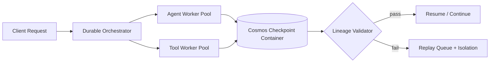

# Durable Functions + Cosmos DB 多智能体状态检查点治理 FAQ（Cycle 2368）

## 1) 场景与约束
本轮聚焦 **Durable Functions 编排 + Cosmos DB 检查点** 的多智能体状态治理。目标是在“长链路任务 + 频繁重试 + 区域抖动”条件下，确保 checkpoint 可恢复、lineage 可追溯、回放可审计。

## 2) 当日能力突破信号（可验证）
- Durable Functions 在编排可恢复性与诊断能力上持续增强，适合承载多步 Agent 任务状态机。  
- Cosmos DB 一致性级别策略可用于 checkpoint lineage 保真与跨区域恢复边界控制。  
- Azure Functions Host 持续发布节奏可作为夜班能力演进信号源，用于评估运行时兼容窗口。

## 3) 决策矩阵（架构权衡）
| 路径 | 状态一致性 | 恢复延迟 | 实施复杂度 | 成本/TCO | 适用性 |
|---|---:|---:|---:|---:|---|
| Durable + Cosmos（主路径） | 高 | 低 | 中 | 中 | 多智能体长事务 |
| 仅队列+缓存 | 中低 | 低 | 低 | 低 | 轻量短任务 |
| 事件溯源+外置DB | 高 | 中 | 高 | 中高 | 严格审计场景 |
| 单进程内存状态 | 低 | 很低 | 低 | 低 | PoC/临时任务 |

## 4) 方案建议（Good fit / Not for）
Good fit：
1. 多阶段 Agent 工作流需要精确恢复点。  
2. Browser/CUA 与工具链并行执行后需统一回放证据。  
3. 金融/政企场景要求状态 lineage 可审计与可归因。  

Not for：
1. 一次性同步任务且无需恢复。  
2. 不要求回放审计的临时实验。  
3. 对状态丢失容忍度高的低价值后台任务。  

## 5) 百分比契约绑定（N/D）
- `percentage_contract.unfenced_durable_checkpoint_drift_rate`
- `percentage_contract.checkpoint_replay_consistency_rate`
- `percentage_contract.multiagent_resume_recovery_gain_pts`

上述键绑定到 `cycle-2368-benchmark.json` 与本 FAQ；`production_validation=not_measured`。

## 6) 五步落地指南
1. Durable orchestrator 事件必须落盘 checkpoint_version 与 trace_id。  
2. Cosmos 容器按 tenant + workflow 分区，保留 lineage 索引。  
3. 回放前执行 lineage validator，阻断乱序恢复。  
4. 失败路径进入 replay queue 并标注隔离原因。  
5. 监控面板统一展示 latency/throughput/intercept/cost 四类指标。  
