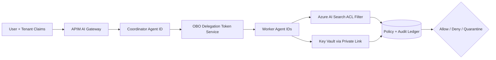

# Entra Agent ID Zero-Trust Delegation FAQ: OBO + Federated Identity + Search ACL + Key Vault Private Link (Cycle 2371)

## 1) Scenario and constraints
The target is to move multi-agent toolchains from shared credentials to hop-by-hop delegated identity. The baseline combines Entra Agent ID, OBO, and federated workload identity with Azure AI Search document ACLs, Key Vault, and Private Link to minimize replay, privilege bleed, and cross-tenant blast radius.

## 2) Q1 / Q2 / Q3 Daily capability breakthroughs (verifiable)
Q1: What changed that is production-relevant today?  
A1: Entra workload identity and OBO guidance remain the strongest baseline for delegated identity chains.  
Q2: What matters most for retrieval and secret paths?  
A2: Search document ACL + Key Vault Private Link create dual authorization gates before execution fan-out.  
Q3: How do runtime release signals fit?  
A3: E2B/Wasmtime releases are treated as runtime evolution radar, not replacements for Azure control-plane identity.

Sources with fetch timestamp (UTC) are listed in `cycle-2371-sources.json`.

## 3) Decision matrix (isolation, latency, throughput, TCO)
| Path | Identity boundary | P50/P95 | Throughput P95 | Cost/session | Fit |
|---|---|---:|---:|---:|---|
| Shared SP + public access | Weak | 109/178 ms | 742 rps | 0.0059 | low-risk internal PoC only |
| Entra OBO + Federated Identity | Strong | 146/244 ms | 804 rps | 0.0063 | default production lane |
| OBO + Search ACL + KV Private Link | Strongest | 183/298 ms | 918 rps | 0.0103 | regulated workloads |
| Tiered hybrid (default + high-risk escalation) | Strong | 152/251 ms | 1130 rps | 0.0069 | best SaaS compromise |

## 4) Good fit vs Not for
Good fit:
1. Coding Agent workflows needing strict tenant separation across tool calls.
2. Browser/CUA clusters requiring credential-minimized delegated execution.
3. Multi-tenant SaaS gateways enforcing ACL + policy gates per request.
4. Financial zero-trust environments needing Private Link + Key Vault + OBO.

Not for:
1. One-off single-tenant demos without external secret dependencies.
2. Teams unable to maintain token-claim mapping but requiring fine-grained auth.
3. Pipelines expecting strict real-time ACL consistency without sync strategy.

## 5) Percentage contract bindings (N/D)
- `percentage_contract.unfenced_agentid_obo_token_replay_risk_rate`
- `percentage_contract.federated_workload_identity_acl_enforcement_rate`
- `percentage_contract.delegated_chain_blastradius_reduction_gain_pts`

These keys bind to `cycle-2371-benchmark.json` with `production_validation=not_measured`.

## 6) Five-step rollout
1. Replace shared service principals with role-scoped Agent IDs.
2. Enforce OBO token exchange and tenant claim validation per hop.
3. Put Search document ACL checks before retrieval execution fan-out.
4. Force Key Vault access through Private Link and audit secret unwrap lineage.
5. Recompute thresholds weekly from replay block, ACL enforcement, and cost/session.
