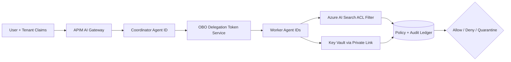

# Entra Agent ID 零信任委托链选型 FAQ：OBO + Federated Identity + Search ACL + Key Vault Private Link（Cycle 2371）

## 1) 场景与约束
目标是把多智能体工具链从“共享身份”升级为“逐跳委托身份”：以 Entra Agent ID + OBO + Federated Workload Identity 为核心，联动 Azure AI Search 文档级 ACL、Key Vault、Private Link，将越权、重放与跨租户泄露风险压缩在最小爆炸半径。

## 2) Q1 / Q2 / Q3 当日能力突破（可验证）
Q1：今天最值得纳入生产基线的变化是什么？  
A1：Entra 工作负载身份与 OBO 流程文档更新节奏稳定，适合作为多 Agent 逐跳委托主路径。  
Q2：检索与密钥链路的关键增益？  
A2：Search 文档级 ACL 与 Key Vault Private Link 形成“检索授权+密钥隔离”双闸门。  
Q3：运行时竞对信号如何使用？  
A3：E2B/Wasmtime release 作为 runtime 演进雷达，仅用于容量与隔离对照，不替代 Azure 主链路。

来源与抓取时间（UTC）写入 `cycle-2371-sources.json`。

## 3) 决策矩阵（隔离、时延、吞吐、TCO）
| 路径 | 身份边界 | P50/P95 | 吞吐 P95 | 单会话成本 | 适用性 |
|---|---|---:|---:|---:|---|
| 共享 SP + 公网访问 | 弱 | 109/178 ms | 742 rps | 0.0059 | 仅低风险内网 PoC |
| Entra OBO + Federated Identity | 强 | 146/244 ms | 804 rps | 0.0063 | 默认生产路径 |
| OBO + Search ACL + KV Private Link | 最强 | 183/298 ms | 918 rps | 0.0103 | 高合规金融/政企 |
| 分层混合（默认+高风险升级） | 强 | 152/251 ms | 1130 rps | 0.0069 | 多租户 SaaS 最优折中 |

## 4) Good fit vs Not for
Good fit：
1. Coding Agent：需要跨工具调用但必须租户隔离与可追踪委托链。  
2. Browser/CUA 集群：需要凭据最小暴露和回放审计。  
3. 多租户 SaaS Gateway：需要按租户 ACL + policy gate 实时裁决。  
4. 金融合规场景：需要 Private Link + Key Vault + OBO 形成零信任闭环。

Not for：
1. 仅单租户、单工具、无外部密钥依赖的短期演示。  
2. 不能维护 token claim 映射却要求细粒度授权。  
3. 忽略 ACL 同步延迟却要求严格实时授权一致性。

## 5) Percentage contract bindings (N/D)
- `percentage_contract.unfenced_agentid_obo_token_replay_risk_rate`
- `percentage_contract.federated_workload_identity_acl_enforcement_rate`
- `percentage_contract.delegated_chain_blastradius_reduction_gain_pts`

以上键绑定 `cycle-2371-benchmark.json`，并标注 `production_validation=not_measured`。

## 6) 五步落地指南
1. 以 Agent ID 替换共享 SP，定义 coordinator/worker 角色权限边界。  
2. 在每次跨 Agent 调用执行 OBO 令牌交换与租户 claim 校验。  
3. 将 Search 文档 ACL 作为检索前置 gate，拒绝无 ACL 命中的上下文注入。  
4. 将 Key Vault 调用强制迁移到 Private Link，并记录 secret unwrap 审计链。  
5. 周度复盘 replay block rate、ACL enforcement rate、cost/session，动态重算升级阈值。
