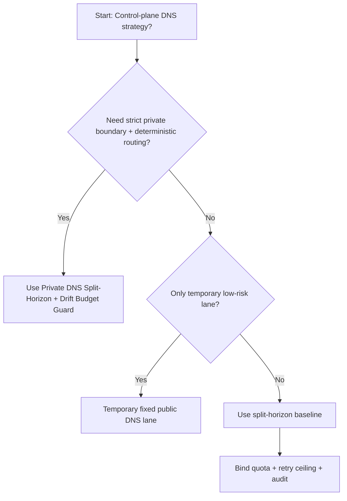
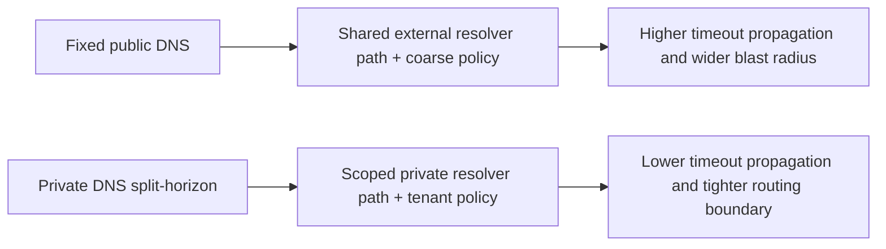
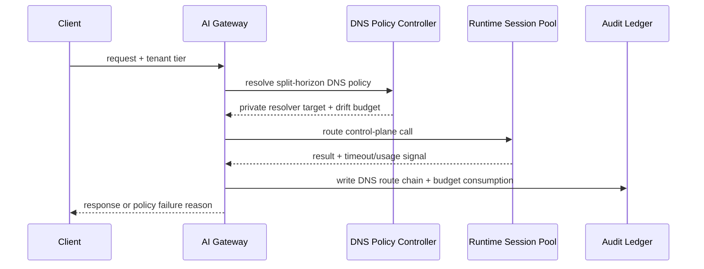

# Agent Foundry Control Plane Private DNS Split-Horizon Selection FAQ (Fixed Public DNS vs Private DNS Split-Horizon + Drift Budget Guard)

## 1) Core conclusions (for decision-makers first)
- **For Agent Foundry control-plane production, default to Private DNS Split-Horizon + Drift Budget Guard**, not fixed public DNS routing.
- **Fixed public DNS amplifies timeout cascades and misrouting under regional/cache drift**, increasing both recovery time and blast radius.
- **DNS controls must couple tenant quotas, retry ceilings, resolver TTL, and audit lineage**, or private boundary guarantees will erode through bypasses.

## 2) Q1 / Q2 / Q3 (plain-language definitions first)
- **Fixed Public DNS**: control-plane calls resolve through external/public DNS path. Easy to bootstrap, weak for strict boundary control.
- **Private DNS Split-Horizon + Drift Budget Guard**: internal/external views are separated with tenant-aware drift budgets and admission gates.

### Q1: Why is fixed public DNS fragile at high concurrency?
First principles: DNS resolution is a multiplier. TTL mismatch or cache poisoning propagates quickly across retry paths and bursts.

### Q2: When is public DNS direct routing acceptable?
Only as a temporary lane for low-risk environments with an explicit cutover deadline to private split-horizon DNS.

### Q3: What is the minimum safe control loop?
Request classification -> split-horizon DNS resolution -> budget gate -> timeout/failure audit -> TTL/cache retuning drills.

## 3) Mermaid (decision tree / path comparison / sequence)
### 3.1 Selection decision tree

### 3.2 Path comparison

### 3.3 Runtime sequence

## 4) Decision matrix
| Dimension | Fixed Public DNS | Private DNS Split-Horizon + Drift Budget Guard |
|---|---|---|
| Implementation complexity | Low | Medium |
| Routing consistency | Medium-Low | High |
| Timeout risk control | Medium-Low | High |
| Multi-tenant sustainability | Medium | High |
| Default production fit | Temporary low-priority lane only | Long-term default |

## 5) Evidence contract + recomputable examples (n/denominator/source)
> Percentages in this section are `synthetic_assumed` hypothetical examples for mechanism comparison; production mechanism validation remains `not_measured`.  
> Contract fields: `workshops/azure-agent-infra/evidence/cycle-507-benchmark.json` -> `percentage_contract`.

- Metric A (fixed public DNS timeout rate)  
  - Formula: `n_fixed_public_dns_timeout / n_gateway_requests_observed`  
  - Value: `463/3900 = 11.9%` (`synthetic_assumed`)  
  - Path: `percentage_contract.fixed_public_dns_timeout_rate`
- Metric B (private DNS split-horizon timeout rate)  
  - Formula: `n_private_dns_split_horizon_timeout / n_gateway_requests_observed`  
  - Value: `226/3900 = 5.8%` (`synthetic_assumed`)  
  - Path: `percentage_contract.private_dns_split_horizon_timeout_rate`
- Metric C (recovery gain, percentage points)  
  - Formula: `(n_recovered_split_horizon - n_recovered_public_dns) / n_gateway_requests_observed`  
  - Value: `(3621-3404)/3900 = 5.6 percentage points` (`synthetic_assumed`)  
  - Path: `percentage_contract.private_dns_recovery_gain_pts`

## 6) Production checklist
- [ ] Private split-horizon DNS policy has versioning, staged rollout, and rollback controls
- [ ] Resolver TTL, tenant quotas, retry ceilings, and drift budgets are observable and auditable
- [ ] Resolution drift, timeout chains, and replay paths are tenant-traceable
- [ ] All metrics are tagged `synthetic_assumed` with denominator/unit; production validation remains `not_measured`
