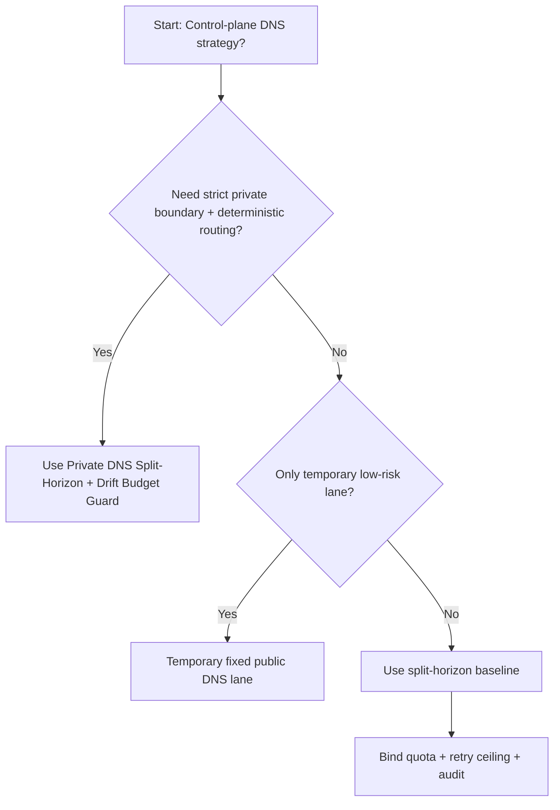
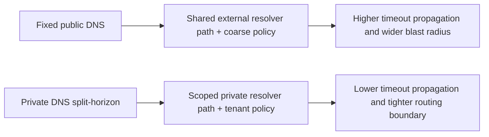
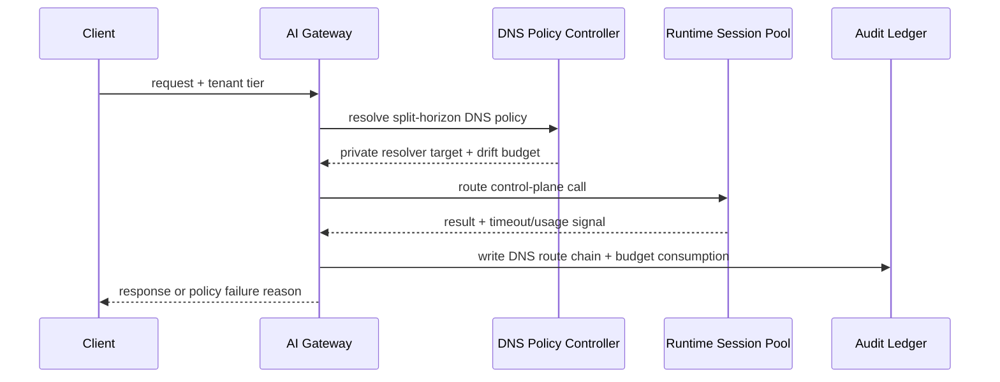

# Agent Foundry Control Plane Private DNS Split-Horizon 选型 FAQ（Fixed Public DNS vs Private DNS Split-Horizon + Drift Budget Guard）

## 1) 核心结论（先给负责人）
- **Agent Foundry 控制平面生产默认应选 Private DNS Split-Horizon + Drift Budget Guard**，不应长期依赖公网 DNS 直连。
- **Fixed Public DNS 在跨区域抖动和名称漂移场景更容易触发级联超时与误路由**，会同时放大恢复时间与故障半径。
- **DNS 治理必须联动租户配额、重试上限、解析 TTL 与审计链路**，否则私网边界会被临时旁路持续侵蚀。

## 2) Q1 / Q2 / Q3（术语先通俗解释）
- **Fixed Public DNS**：控制面统一解析公网域名，部署简单但解析路径暴露面大、边界可控性弱。
- **Private DNS Split-Horizon + Drift Budget Guard**：内外网采用分视图解析，按租户与会话施加解析漂移预算与门禁。

### Q1：为什么固定公网 DNS 在高并发更脆弱？
第一性原理：控制面解析是放大器，一旦 TTL 不一致或缓存污染，错误解析会在重试链路中快速扩散。

### Q2：什么时候可短期保留公网 DNS 直连？
仅在低价值、短生命周期、无强监管约束的临时环境中，并要求明确私网 DNS 切换时间点。

### Q3：最小安全闭环是什么？
请求分级 -> 分视图 DNS 解析 -> 预算门禁 -> 超时/失败审计 -> TTL/缓存校准回归。

## 3) Mermaid（决策树 / 路径对比 / 时序）
### 3.1 选型决策树

### 3.2 路径对比图

### 3.3 运行时序图

## 4) 选型决策矩阵
| 维度 | Fixed Public DNS | Private DNS Split-Horizon + Drift Budget Guard |
|---|---|---|
| 实现复杂度 | 低 | 中 |
| 路由一致性 | 中-低 | 高 |
| 超时风险控制 | 中-低 | 高 |
| 多租户可持续性 | 中 | 高 |
| 生产默认建议 | 仅临时低优先级通道 | 长期默认 |

## 5) 数据证据与可复算算例（含 n/分母/来源）
> 本节百分比为 `synthetic_assumed` 假设算例（hypothetical），用于机制比较；生产机制认证保持 `not_measured`。  
> 合同字段见：`workshops/azure-agent-infra/evidence/cycle-507-benchmark.json` 的 `percentage_contract`。

- 指标 A（Fixed Public DNS 超时率）  
  - 定义：`n_fixed_public_dns_timeout / n_gateway_requests_observed`  
  - 值：`463/3900 = 11.9%`（`synthetic_assumed`）  
  - 路径：`percentage_contract.fixed_public_dns_timeout_rate`
- 指标 B（Private DNS Split-Horizon 超时率）  
  - 定义：`n_private_dns_split_horizon_timeout / n_gateway_requests_observed`  
  - 值：`226/3900 = 5.8%`（`synthetic_assumed`）  
  - 路径：`percentage_contract.private_dns_split_horizon_timeout_rate`
- 指标 C（恢复增益，百分点）  
  - 定义：`(n_recovered_split_horizon - n_recovered_public_dns) / n_gateway_requests_observed`  
  - 值：`(3621-3404)/3900 = 5.6` 个百分点（`synthetic_assumed`）  
  - 路径：`percentage_contract.private_dns_recovery_gain_pts`

## 6) 生产 Checklist（上线前必须打勾）
- [ ] 私网 DNS 分视图策略具备版本、灰度和回滚路径
- [ ] 解析 TTL、租户配额、重试上限和漂移预算均可观测可审计
- [ ] 解析偏差、超时链路与回放审计可按租户追踪
- [ ] 指标全部标注 `synthetic_assumed`、分母与单位；生产机制认证保持 `not_measured`
