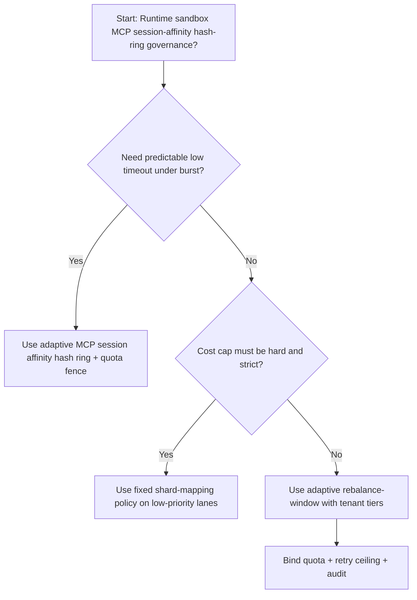
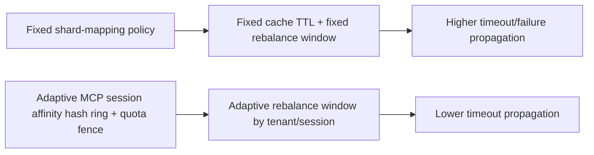
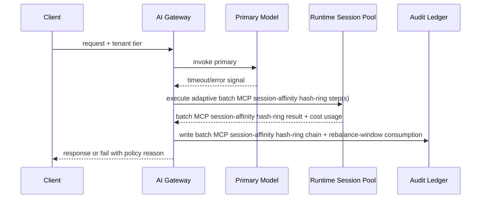

# Agent Gateway MCP Session Affinity Hash Ring Selection FAQ (Fixed Shard-Mapping Policy vs Adaptive Hash-Ring Affinity + Quorum Fence)

## 1) Core conclusions (for decision-makers first)
- **For multi-tenant Agent Runtime production, default to adaptive MCP session affinity hash ring + quota fence**, not fixed shard-mapping policy as the baseline.
- **Fixed shard-mapping policy propagates burst pressure into user-visible failures/timeouts** during peak traffic windows.
- **MCP session-affinity hash-ring control loops must be coupled with tenant quota tiers, retry ceilings, and replay audit**, or the runtime path becomes an uncontrolled cost amplifier.

## 2) Q1 / Q2 / Q3 (plain-language definitions first)
- **Fixed shard-mapping policy**: use fixed cache retention and fixed rebalance windows; easy to reason about but more brittle under uneven load.
- **Adaptive MCP session affinity hash ring + quota fence**: dynamically allocate rebalance budgets per tenant/session while preserving auditable policy boundaries.

### Q1: Why does fixed shard-mapping policy increase timeout propagation at scale?
First principles: cache heat is uneven. Fixed TTL windows over-retain cold keys while evicting hot keys too late, which amplifies tail latency.

### Q2: When is fixed shard-mapping policy acceptable?
Low-value traffic lanes with hard cost caps and lower availability requirements.

### Q3: What is the minimum safe control loop?
Request classification -> rebalance budget assignment -> admission gate -> replay audit -> rebalance-window retuning.

## 3) Mermaid (decision tree / path comparison / sequence)
### 3.1 Selection decision tree

### 3.2 Path comparison

### 3.3 Runtime sequence

## 4) Decision matrix
| Dimension | Fixed shard-mapping policy | Adaptive MCP session affinity hash ring + quota fence |
|---|---|---|
| Implementation complexity | Low | Medium |
| Timeout risk control | Medium-Low | High |
| Cost predictability | High (static) | Medium-High (dynamic) |
| Multi-tenant sustainability | Medium | High |
| Default production fit | Low-priority lane only | Long-term default |

## 5) Evidence contract + recomputable examples (n/denominator/source)
> Percentages in this section are `synthetic_assumed` hypothetical examples for mechanism comparison; production mechanism validation remains `not_measured`.  
> Contract fields: `workshops/azure-agent-infra/evidence/cycle-475-benchmark.json` -> `percentage_contract`.

- Metric A (fixed shard-mapping policy timeout rate)  
  - Formula: `n_fixed_shard_mapping_timeout / n_gateway_requests_observed`  
  - Value: `294/2800 = 10.5%` (`synthetic_assumed`)  
  - Path: `percentage_contract.fixed_shard_mapping_timeout_rate`
- Metric B (adaptive MCP session affinity hash ring timeout rate)  
  - Formula: `n_adaptive_hash_ring_timeout / n_gateway_requests_observed`  
  - Value: `151/2800 = 5.4%` (`synthetic_assumed`)  
  - Path: `percentage_contract.adaptive_hash_ring_timeout_rate`
- Metric C (recovery gain, percentage points)  
  - Formula: `(n_recovered_adaptive_hash_ring - n_recovered_fixed_shard_mapping) / n_gateway_requests_observed`  
  - Value: `(2649-2506)/2800 = 5.1 percentage points` (`synthetic_assumed`)  
  - Path: `percentage_contract.adaptive_hash_ring_recovery_gain_pts`

## 6) Production checklist
- [ ] MCP session-affinity hash-ring policy has versioning, rollout, and rollback controls
- [ ] Tenant tiers, rebalance-window usage, and retry ceilings are observable and auditable
- [ ] Timeout events, recovery chains, and replay audits are tenant-traceable
- [ ] All metrics are tagged `synthetic_assumed` with denominator/unit; production validation remains `not_measured`
