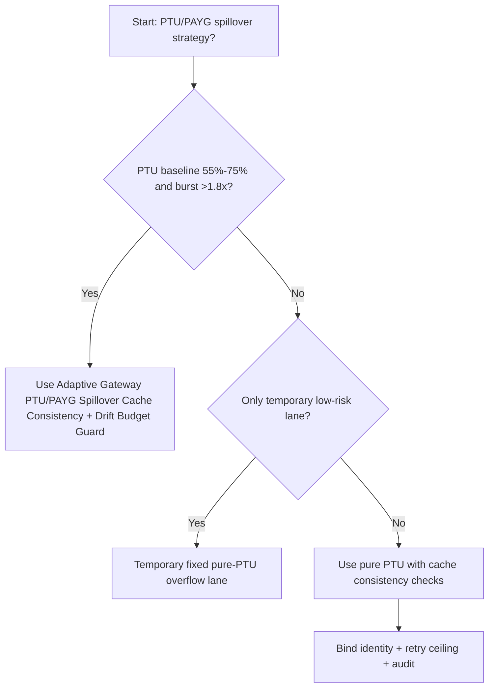
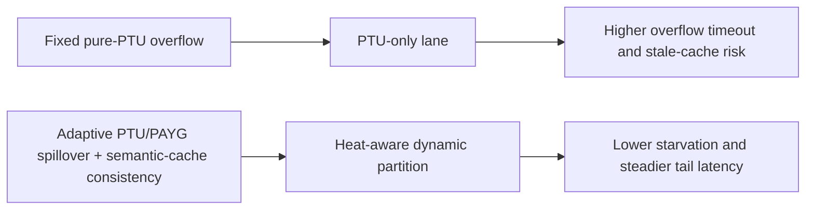
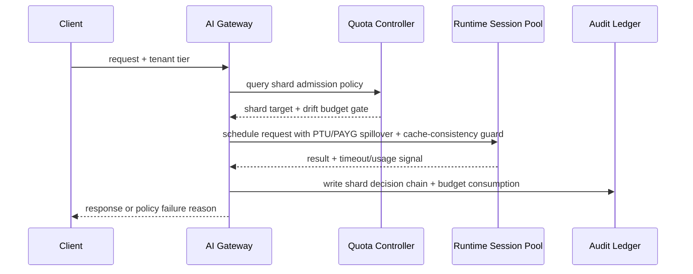

# Agent Runtime Gateway PTU/PAYG Spillover Cache Consistency Selection FAQ (Fixed Pure-PTU Overflow vs Adaptive Gateway PTU/PAYG Spillover Cache Consistency + Drift Budget Guard)

## 1) Core conclusions (for decision-makers first)
- **When baseline PTU utilization sits in 55%-75% and burst exceeds 1.8x baseline, default to Adaptive PTU/PAYG Spillover + Semantic Cache Consistency**; below that, pure PTU can remain primary.
- **When semantic-cache hit ratio drops below 42% and cross-model refill exceeds 18%, fixed pure-PTU overflow quickly enters the 12.5% timeout band**, so hybrid spillover becomes mandatory.
- **When spillover share exceeds 28% and cache-version drift exceeds 0.7%, enforce token-budget drift guards plus replay audit**, or cross-tenant response consistency becomes non-deterministic.

## 2) Q1 / Q2 / Q3 (plain-language definitions first)
- **Fixed Pure-PTU Overflow**: PTU-only routing with overflow under pressure; predictable but fragile at burst edges.
- **Adaptive Gateway PTU/PAYG Spillover Cache Consistency + Drift Budget Guard**: heat-aware PTU/PAYG routing with semantic-cache version consistency plus drift-budget gates.

### Q1: Why is pure PTU overflow fragile at high concurrency?
First principles: PTU is a reserved lane and PAYG is an emergency lane. PTU-only strategy saturates reserved capacity first; without cache-consistency constraints, PAYG refill introduces result drift.

### Q2: When is pure PTU still acceptable?
Use it only when PTU utilization is <55%, burst/baseline is <1.3x, and cache hit ratio remains >60%.

### Q3: What is the minimum safe control loop?
Request classification -> PTU/PAYG spillover gate -> semantic-cache version consistency check -> timeout/failure audit -> threshold recalibration.

## 3) Mermaid (decision tree / path comparison / sequence)
### 3.1 Selection decision tree

### 3.2 Path comparison

### 3.3 Runtime sequence

## 4) Decision matrix
| Dimension | Fixed Pure-PTU Overflow | Adaptive Gateway PTU/PAYG Spillover Cache Consistency + Drift Budget Guard |
|---|---|---|
| Implementation complexity | Low | Medium |
| Hotspot resilience | Medium-Low | High |
| Timeout risk control | Medium-Low | High |
| Multi-tenant sustainability | Medium | High |
| Default production fit | Temporary low-priority lane only | Long-term default |

## 5) Evidence contract + recomputable examples (n/denominator/source)
> Percentages in this section are `synthetic_assumed` hypothetical examples for mechanism comparison; production mechanism validation remains `not_measured`.  
> Contract fields: `workshops/azure-agent-infra/evidence/cycle-518-benchmark.json` -> `percentage_contract`.

- Metric A (fixed pure-PTU overflow timeout rate)  
  - Formula: `n_fixed_pure_ptu_overflow_timeout / n_gateway_requests_observed`  
  - Value: `547/4360 = 12.5%` (`synthetic_assumed`)  
  - Path: `percentage_contract.fixed_pure_ptu_overflow_timeout_rate`
- Metric B (adaptive ptu-payg-spillover-cache-consistency timeout rate)  
  - Formula: `n_adaptive_hybrid_spillover_timeout / n_gateway_requests_observed`  
  - Value: `218/4360 = 5.0%` (`synthetic_assumed`)  
  - Path: `percentage_contract.adaptive_hybrid_spillover_timeout_rate`
- Metric C (recovery gain, percentage points)  
  - Formula: `(n_recovered_adaptive_hybrid - n_recovered_fixed_pure_ptu) / n_gateway_requests_observed`  
  - Value: `(4019-3690)/4360 = 7.5 percentage points` (`synthetic_assumed`)  
  - Path: `percentage_contract.adaptive_hybrid_spillover_recovery_gain_pts`

## 6) Production checklist
- [ ] Hybrid spillover admission policy has versioning, staged rollout, and rollback controls
- [ ] Tenant heat, queue depth, retry ceilings, and drift budgets are observable and auditable
- [ ] Starvation events, timeout chains, and replay paths are tenant-traceable
- [ ] All metrics are tagged `synthetic_assumed` with denominator/unit; production validation remains `not_measured`
