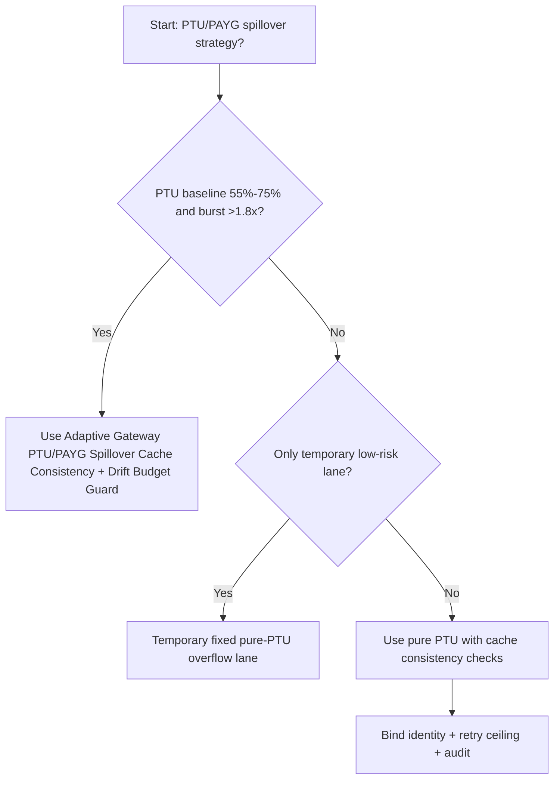
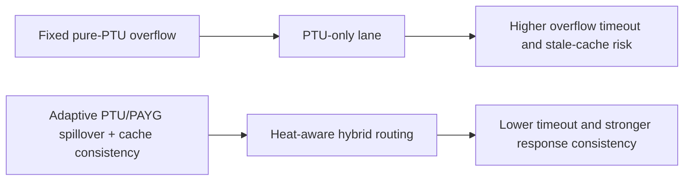
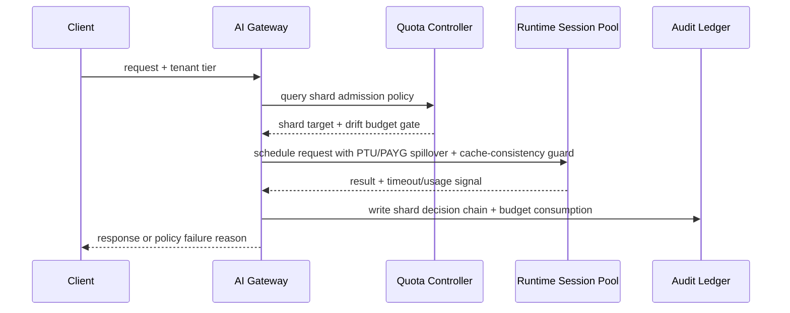

# Agent Runtime Gateway PTU/PAYG Spillover Cache Consistency 选型 FAQ（Fixed Pure-PTU Overflow vs Adaptive Gateway PTU/PAYG Spillover Cache Consistency + Drift Budget Guard）

## 1) 核心结论（先给负责人）
- **当 PTU 基线利用率长期在 55%–75% 且突发峰值 >1.8× 基线时，生产默认应选 Adaptive PTU/PAYG Spillover + Semantic Cache Consistency**；低于该区间可保留纯 PTU。
- **当语义缓存命中率 <42% 且跨模型回填比例 >18% 时，Fixed Pure-PTU Overflow 超时率会快速爬升（12.5% 档）**，应切到混合溢出并启用一致性门禁。
- **当 Spillover 占比 >28% 且缓存版本漂移 >0.7% 时，必须强制 token-budget 漂移护栏与审计回放**，否则跨租户响应会出现不可追责不一致。

## 2) Q1 / Q2 / Q3（术语先通俗解释）
- **Fixed Pure-PTU Overflow**：每个租户固定切片，规则稳定但在负载偏斜时利用率低且容易局部饥饿。
- **Adaptive Gateway PTU/PAYG Spillover Cache Consistency + Drift Budget Guard**：按实时热度动态分流到 PTU 或 PAYG，并要求语义缓存版本与模型路由保持一致，再用漂移预算限制突发借用。

### Q1：为什么固定纯 PTU 溢出在高并发更脆弱？
第一性原理：PTU 是“预留车道”，PAYG 是“应急车道”。只用 PTU 时峰值会把预留车道堵死；没有一致性约束时，PAYG 回填又会引入结果漂移。

### Q2：什么时候可短期使用固定纯 PTU 溢出？
仅在 PTU 利用率 <55%、峰值/基线 <1.3×、且缓存命中率 >60% 的稳定租户场景短期使用。

### Q3：最小安全闭环是什么？
请求分级 -> PTU/PAYG 溢出门禁 -> 语义缓存版本一致性校验 -> 超时/失败审计 -> 周期阈值回归校准。

## 3) Mermaid（决策树 / 路径对比 / 时序）
### 3.1 选型决策树

### 3.2 路径对比图

### 3.3 运行时序图

## 4) 选型决策矩阵
| 维度 | Fixed Pure-PTU Overflow | Adaptive Gateway PTU/PAYG Spillover Cache Consistency + Drift Budget Guard |
|---|---|---|
| 实现复杂度 | 低 | 中 |
| 热点抗压能力 | 中-低 | 高 |
| 超时风险控制 | 中-低 | 高 |
| 多租户可持续性 | 中 | 高 |
| 生产默认建议 | 仅临时低优先级通道 | 长期默认 |

## 5) 数据证据与可复算算例（含 n/分母/来源）
> 本节百分比为 `synthetic_assumed` 假设算例（hypothetical），用于机制比较；生产机制认证保持 `not_measured`。  
> 合同字段见：`workshops/azure-agent-infra/evidence/cycle-518-benchmark.json` 的 `percentage_contract`。

- 指标 A（Fixed Pure-PTU Overflow 超时率）  
  - 定义：`n_fixed_pure_ptu_overflow_timeout / n_gateway_requests_observed`  
  - 值：`547/4360 = 12.5%`（`synthetic_assumed`）  
  - 路径：`percentage_contract.fixed_pure_ptu_overflow_timeout_rate`
- 指标 B（Adaptive Gateway PTU/PAYG Spillover Cache Consistency 超时率）  
  - 定义：`n_adaptive_hybrid_spillover_timeout / n_gateway_requests_observed`  
  - 值：`218/4360 = 5.0%`（`synthetic_assumed`）  
  - 路径：`percentage_contract.adaptive_hybrid_spillover_timeout_rate`
- 指标 C（恢复增益，百分点）  
  - 定义：`(n_recovered_adaptive_hybrid - n_recovered_fixed_pure_ptu) / n_gateway_requests_observed`  
  - 值：`(4019-3690)/4360 = 7.5` 个百分点（`synthetic_assumed`）  
  - 路径：`percentage_contract.adaptive_hybrid_spillover_recovery_gain_pts`

## 6) 生产 Checklist（上线前必须打勾）
- [ ] PTU/PAYG 溢出与语义缓存一致性门禁策略具备版本、灰度和回滚路径
- [ ] 租户热度、队列深度、重试上限和漂移预算均可观测可审计
- [ ] 饥饿事件、超时链路与回放审计可按租户追踪
- [ ] 指标全部标注 `synthetic_assumed`、分母与单位；生产机制认证保持 `not_measured`
