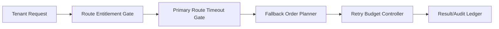

# Agent Gateway Route Fallback Ordering Selection FAQ (Strict Primary-Route First vs Layered Fallback Ordering)

## 1) Core conclusions
- **Production multi-tenant gateways should default to layered fallback ordering with retry budgets**, not strict primary-route-first only.
- **Strict primary-route-first amplifies timeout cascades during upstream jitter**, increasing retry storms and tail latency.
- **Fallback ordering governance must be coupled with tenant route entitlements, gateway timeout policy, and replay audit loops** for stable and compliant operation.

## 2) Q1 / Q2 / Q3 (plain terms first)
- **Strict primary-route first**: always hit the primary model/cluster first; simple routing, weak jitter resilience.
- **Layered fallback ordering**: define primary/secondary/fallback chains by health, cost, and tenant policy.

### Q1: Why is strict primary-route-first risky in production?
First principle: upstream latency and error rates fluctuate; a single preferred route concentrates timeouts and creates retry/queue cascades.

### Q2: When is strict primary-route-first acceptable?
Short-lived single-tenant workloads with stable upstreams, low concurrency, and higher tolerance for transient failures.

### Q3: What is the minimum safe fallback-ordering control loop?
Tenant route entitlement -> primary timeout gate -> layered fallback planner -> retry budget controller -> result/audit ledger.

## 3) Mermaid (gateway route fallback-ordering governance loop)

## 4) Decision matrix
| Dimension | Strict primary-route first | Layered fallback ordering |
|---|---|---|
| Implementation complexity | Low | Medium |
| Upstream jitter resilience | Low | High |
| Timeout control ability | Low-Medium | High |
| Multi-tenant governance depth | Medium | High |
| Default production fit | Short transitional phase | Multi-tenant long-running workloads |

## 5) Evidence contract + recomputable examples (n/denominator/source)
> Percentages in this section are `synthetic_assumed` hypothetical examples for mechanism comparison; production mechanism validation remains `not_measured`.  
> Contract fields: `workshops/azure-agent-infra/evidence/cycle-431-benchmark.json` -> `percentage_contract`.

- Metric A (timeout rate, strict primary-route-first)  
  - Formula: `n_timeout_primary_only / n_sessions_observed`  
  - Value: `288/2400 = 12.0%` (`synthetic_assumed`)  
  - Path: `percentage_contract.primary_route_timeout_rate`
- Metric B (timeout rate, layered fallback ordering)  
  - Formula: `n_timeout_layered_fallback / n_sessions_observed`  
  - Value: `86/2400 = 3.6%` (`synthetic_assumed`)  
  - Path: `percentage_contract.layered_fallback_timeout_rate`
- Metric C (fallback success gain, percentage points)  
  - Formula: `(n_success_layered_fallback - n_success_primary_only) / n_sessions_observed`  
  - Value: `(2140-1938)/2400 = 8.4 percentage points` (`synthetic_assumed`)  
  - Path: `percentage_contract.fallback_success_gain_pts`

## 6) Production checklist
- [ ] Primary timeout and fallback-order policy are versioned with rollout and rollback controls
- [ ] Tenant route entitlement and retry budget gates are enforced at gateway level
- [ ] Timeout, fallback success, and replay audit are traceable
- [ ] Metrics are tagged `synthetic_assumed` with denominator and units; production validation remains `not_measured`
