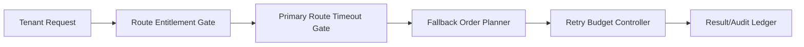

# Agent Gateway 路由回退顺序治理选型 FAQ（严格主路由优先 vs 分层回退顺序）

## 1) 核心结论（先给负责人）
- **多租户生产默认采用“分层回退顺序 + 重试预算”**，不建议仅用严格主路由优先。
- **严格主路由优先在上游抖动时更易触发超时连锁**，会放大重试风暴与尾延迟。
- **回退顺序治理必须与租户路由权限、网关超时策略和审计回放联动**，才能保证稳定与合规。

## 2) Q1 / Q2 / Q3（术语先通俗解释）
- **严格主路由优先**：所有请求先走主模型/主集群，失败后才切换，路径简单但抗抖动能力弱。
- **分层回退顺序**：按健康度、成本与租户策略配置主/备/兜底链路，分层退避。

### Q1：为什么严格主路由优先在生产里有风险？
第一性原理：上游延迟与错误率会波动，单一路由偏好会让超时集中，导致重试与排队级联。

### Q2：什么时候可以接受严格主路由优先？
单租户、上游稳定、低并发且对瞬时失败容忍较高时，可作为短期策略。

### Q3：路由回退顺序治理的最小安全闭环是什么？
租户路由权限 -> 主路由超时门限 -> 分层回退策略 -> 重试预算控制 -> 结果审计回放。

## 3) Mermaid（Gateway 路由回退顺序治理闭环）

## 4) 决策矩阵
| 维度 | 严格主路由优先 | 分层回退顺序 |
|---|---|---|
| 实现复杂度 | 低 | 中 |
| 抗上游抖动能力 | 低 | 高 |
| 超时控制能力 | 低-中 | 高 |
| 多租户治理能力 | 中 | 高 |
| 生产默认建议 | 短期过渡 | 多租户长期运行 |

## 5) 数据证据与可复算算例（含 n/分母/来源）
> 本节百分比为 `synthetic_assumed` 假设算例（hypothetical），用于机制比较；生产机制认证仍为 `not_measured`。  
> 合同字段见：`workshops/azure-agent-infra/evidence/cycle-431-benchmark.json` 的 `percentage_contract`。

- 指标 A（超时率，严格主路由优先）  
  - 定义：`n_timeout_primary_only / n_sessions_observed`  
  - 值：`288/2400 = 12.0%`（`synthetic_assumed`）  
  - 路径：`percentage_contract.primary_route_timeout_rate`
- 指标 B（超时率，分层回退顺序）  
  - 定义：`n_timeout_layered_fallback / n_sessions_observed`  
  - 值：`86/2400 = 3.6%`（`synthetic_assumed`）  
  - 路径：`percentage_contract.layered_fallback_timeout_rate`
- 指标 C（回退成功率提升，百分点）  
  - 定义：`(n_success_layered_fallback - n_success_primary_only) / n_sessions_observed`  
  - 值：`(2140-1938)/2400 = 8.4` 个百分点（`synthetic_assumed`）  
  - 路径：`percentage_contract.fallback_success_gain_pts`

## 6) 生产 Checklist（上线前必须打勾）
- [ ] 主路由超时门限与回退顺序策略含版本、灰度与回滚路径  
- [ ] 租户路由权限与重试预算门禁在网关层生效  
- [ ] 超时、回退成功率与审计回放可追溯  
- [ ] 指标口径标注 `synthetic_assumed` 与分母/单位，生产机制认证保持 `not_measured`  
