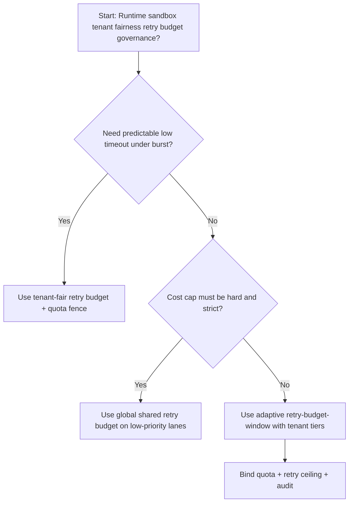
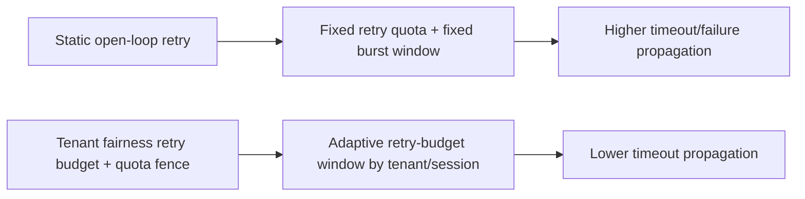
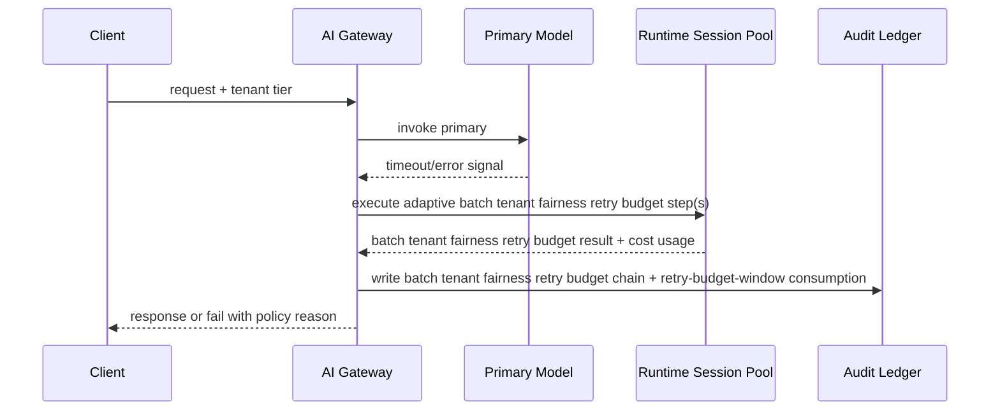

# Agent Gateway 多租户公平重试预算选型 FAQ（Global Shared Retry Budget 策略 vs Tenant-Fair Retry Budget + Quota Fence 策略）

## 1) 核心结论（先给负责人）
- **多租户 Agent Gateway 生产默认应选 Tenant-Fair Retry Budget + Quota Fence 策略**，不建议长期采用一刀切 Global Shared Retry Budget。
- **Global Shared Retry Budget 在突发高并发阶段更容易把短期流量抖动放大为用户侧失败或超时**，导致成功率和尾延迟同时恶化。
- **多租户公平重试预算控制必须联动租户配额、重试上限和观测告警**，否则网关路径会变成不可控成本放大器。

## 2) Q1 / Q2 / Q3（术语先通俗解释）
- **Global Shared Retry Budget 策略**：使用固定重试节奏与固定突发窗口，逻辑简单但面对不均匀流量更脆弱。
- **Tenant-Fair Retry Budget + Quota Fence 策略**：按租户/会话动态探测并恢复流量，保证治理边界可审计。

### Q1：为什么 Global Shared Retry Budget 在高并发更容易放大失败？
第一性原理：请求突发天然不均匀；固定重试窗口会让热点租户过载、冷租户饿死，进而放大全局尾延迟。

### Q2：什么时候可以短期采用 Global Shared Retry Budget？
低价值请求、容错要求低、且更看重固定成本上限时可短期采用。

### Q3：最小安全闭环是什么？
请求分级 -> 重试预算分配 -> 准入门禁 -> 回放审计 -> 重试预算窗口再校准。

## 3) Mermaid（决策树 / 路径对比 / 时序）
### 3.1 选型决策树

### 3.2 路径对比图

### 3.3 运行时序图

## 4) 选型决策矩阵
| 维度 | Global Shared Retry Budget 策略 | Tenant-Fair Retry Budget + Quota Fence 策略 |
|---|---|---|
| 实现复杂度 | 低 | 中 |
| 超时风险控制 | 中-低 | 高 |
| 成本可控性 | 高（静态） | 中-高（动态） |
| 多租户可持续性 | 中 | 高 |
| 生产默认建议 | 仅低优先级通道 | 长期默认 |

## 5) 数据证据与可复算算例（含 n/分母/来源）
> 本节百分比为 `synthetic_assumed` 假设算例（hypothetical），用于机制比较；生产机制认证保持 `not_measured`。  
> 合同字段见：`workshops/azure-agent-infra/evidence/cycle-471-benchmark.json` 的 `percentage_contract`。  

- 指标 A（Static open-loop 超时率）  
  - 定义：`n_static_open_loop_timeout / n_runtime_requests_observed`  
  - 值：`286/2600 = 11.0%`（`synthetic_assumed`）  
  - 路径：`percentage_contract.global_retry_budget_timeout_rate`
- 指标 B（Tenant-fair retry-budget 超时率）  
  - 定义：`n_tenant_fair_retry_budget_timeout / n_runtime_requests_observed`  
  - 值：`146/2600 = 5.6%`（`synthetic_assumed`）  
  - 路径：`percentage_contract.tenant_fair_retry_budget_timeout_rate`
- 指标 C（恢复增益，百分点）  
  - 定义：`(n_recovered_tenant_fair_retry - n_recovered_static_open_loop) / n_runtime_requests_observed`  
  - 值：`(2435-2314)/2600 = 4.7` 个百分点（`synthetic_assumed`）  
  - 路径：`percentage_contract.tenant_fair_retry_recovery_gain_pts`

## 6) 生产 Checklist（上线前必须打勾）
- [ ] Runtime 沙箱多租户公平重试预算策略具备版本、灰度和回滚路径
- [ ] 租户分层、预算消耗与重试上限可观测可审计
- [ ] 超时事件、恢复链路与失败回放可按租户追踪
- [ ] 指标全部标注 `synthetic_assumed`、分母与单位；生产机制认证保持 `not_measured`
