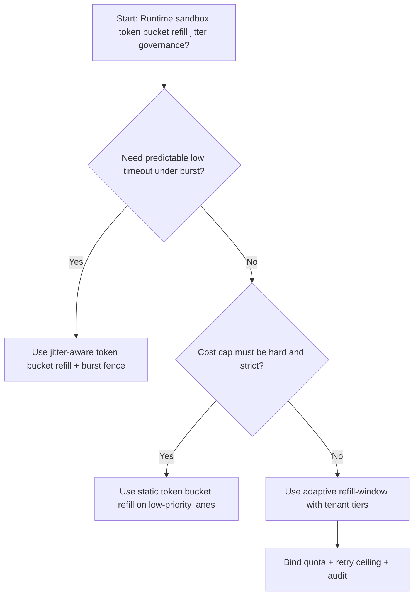
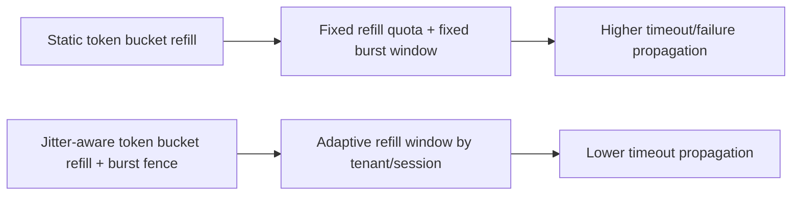
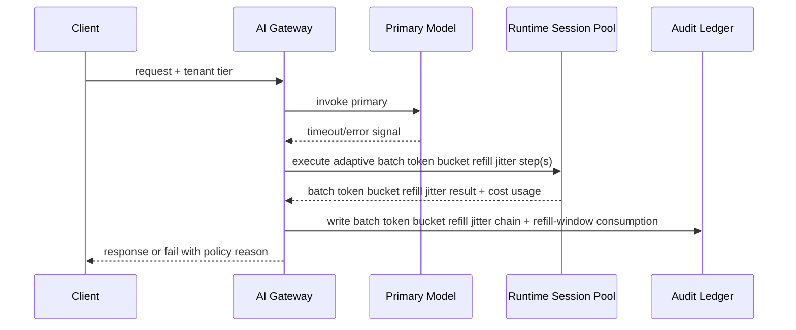

# Agent Gateway Token Bucket Refill Jitter Selection FAQ (Static Token Bucket Refill vs Jitter-Aware Token Bucket Refill + Burst Fence)

## 1) Core conclusions (for decision-makers first)
- **For multi-tenant Agent Gateway production, default to jitter-aware token bucket refill + burst fence**, not static token bucket refill as the baseline.
- **Static token bucket refill propagates burst pressure into user-visible failures/timeouts** during peak traffic windows.
- **Jitter-aware refill control loops must be coupled with tenant quota tiers, retry ceilings, and replay audit**, or the gateway path becomes an uncontrolled cost amplifier.

## 2) Q1 / Q2 / Q3 (plain-language definitions first)
- **Static token bucket refill**: use fixed refill rates and fixed burst windows; easy to reason about but more brittle under uneven load.
- **Jitter-aware token bucket refill + burst fence**: dynamically adjust refill pace and burst fences per tenant/session, while preserving auditable policy boundaries.

### Q1: Why does static token bucket refill increase timeout propagation at scale?
First principles: request bursts are uneven. Static refill windows oversubscribe hot tenants and starve cold tenants, which amplifies tail latency.

### Q2: When is static token bucket refill acceptable?
Low-value traffic lanes with hard cost caps and lower availability requirements.

### Q3: What is the minimum safe control loop?
Request classification -> refill budget assignment -> admission gate -> replay audit -> refill-window retuning.

## 3) Mermaid (decision tree / path comparison / sequence)
### 3.1 Selection decision tree

### 3.2 Path comparison

### 3.3 Runtime sequence

## 4) Decision matrix
| Dimension | Static token bucket refill | Jitter-aware token bucket refill + burst fence |
|---|---|---|
| Implementation complexity | Low | Medium |
| Timeout risk control | Medium-Low | High |
| Cost predictability | High (static) | Medium-High (dynamic) |
| Multi-tenant sustainability | Medium | High |
| Default production fit | Low-priority lane only | Long-term default |

## 5) Evidence contract + recomputable examples (n/denominator/source)
> Percentages in this section are `synthetic_assumed` hypothetical examples for mechanism comparison; production mechanism validation remains `not_measured`.  
> Contract fields: `workshops/azure-agent-infra/evidence/cycle-469-benchmark.json` -> `percentage_contract`.

- Metric A (static refill timeout rate)  
  - Formula: `n_static_refill_timeout / n_runtime_requests_observed`  
  - Value: `286/2600 = 11.0%` (`synthetic_assumed`)  
  - Path: `percentage_contract.static_refill_timeout_rate`
- Metric B (jitter-aware refill timeout rate)  
  - Formula: `n_jitter_aware_refill_timeout / n_runtime_requests_observed`  
  - Value: `146/2600 = 5.6%` (`synthetic_assumed`)  
  - Path: `percentage_contract.jitter_aware_refill_timeout_rate`
- Metric C (recovery gain, percentage points)  
  - Formula: `(n_recovered_jitter_aware_refill - n_recovered_static_refill) / n_runtime_requests_observed`  
  - Value: `(2435-2314)/2600 = 4.7 percentage points` (`synthetic_assumed`)  
  - Path: `percentage_contract.refill_jitter_recovery_gain_pts`

## 6) Production checklist
- [ ] Token-bucket refill policy has versioning, rollout, and rollback controls
- [ ] Tenant tiers, refill-window usage, and retry ceilings are observable and auditable
- [ ] Timeout events, recovery chains, and replay audits are tenant-traceable
- [ ] All metrics are tagged `synthetic_assumed` with denominator/unit; production validation remains `not_measured`
