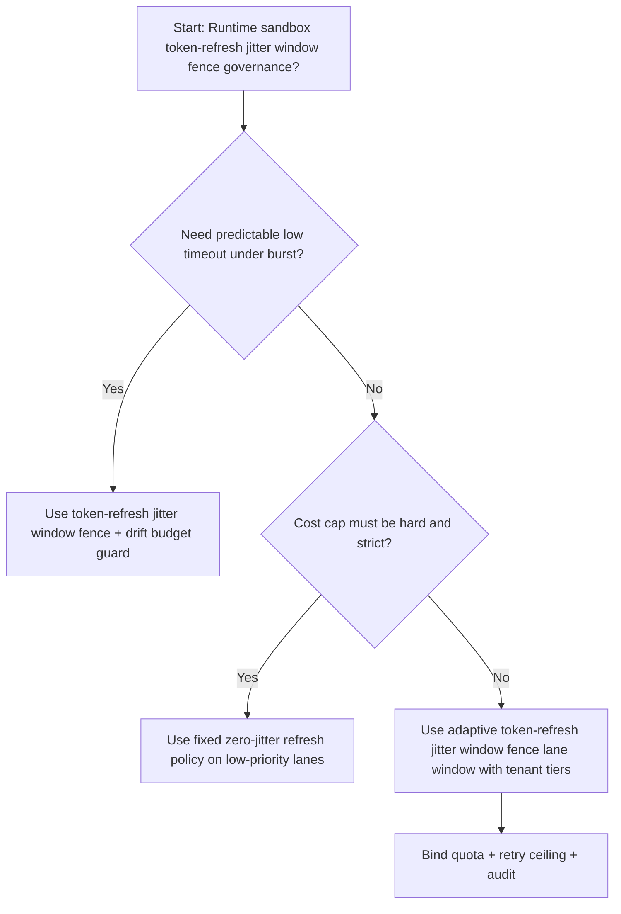
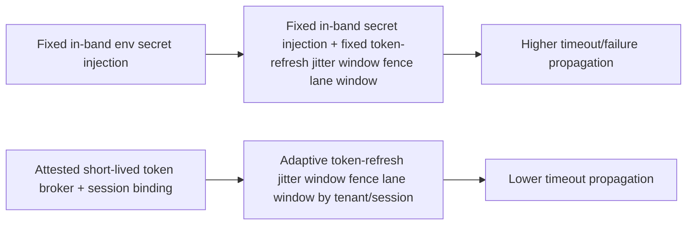
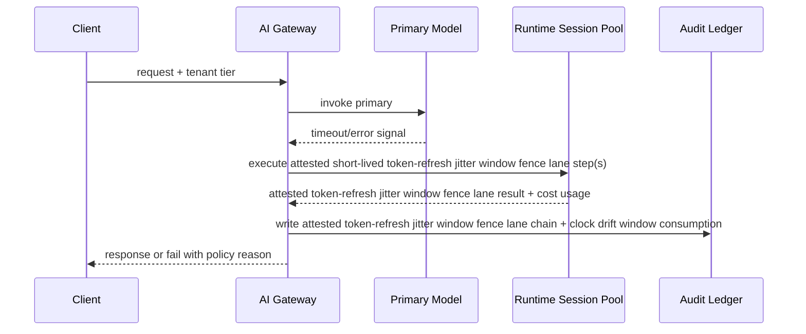

# Agent Gateway Token-Refresh Jitter Window 选型 FAQ（Fixed Zero-Jitter Refresh 策略 vs Adaptive Token-Refresh Jitter-Window Fence + Drift Budget Guard 策略）

## 1) 核心结论（先给负责人）
- **多租户 Agent Runtime 生产默认应选 Adaptive Token-Refresh Jitter-Window Fence + Drift Budget Guard 策略**，不建议长期采用一刀切 Fixed Zero-Jitter Refresh。
- **Fixed Zero-Jitter Refresh 在突发高并发阶段更容易因时钟漂移累积导致超时误判，放大用户侧失败或超时**，导致成功率和尾延迟同时恶化。
- **运行时短时Adaptive Token-Refresh Jitter-Window Fence控制必须联动租户配额、重试上限和观测告警**，否则运行时路径会变成不可控成本放大器。

## 2) Q1 / Q2 / Q3（术语先通俗解释）
- **Fixed Zero-Jitter Refresh 策略**：使用固定短回放窗口与静态策略，逻辑简单但面对不均匀热度更脆弱。
- **Adaptive Token-Refresh Jitter-Window Fence + Drift Budget Guard 策略**：按租户/会话动态分配短时Adaptive Token-Refresh Jitter-Window Fence预算，保证治理边界可审计。

### Q1：为什么 Fixed Zero-Jitter Refresh 在高并发更容易放大失败？
第一性原理：系统时钟天然会有漂移；若只信任主机墙钟而不做单调时钟围栏，长链路重试会把漂移放大为超时和错误判定。

### Q2：什么时候可以短期采用 Fixed Zero-Jitter Refresh？
低价值请求、容错要求低、且更看重固定成本上限时可短期采用。

### Q3：最小安全闭环是什么？
请求分级 -> Adaptive Token-Refresh Jitter-Window Fence预算分配 -> 准入门禁 -> 回放审计 -> 交接窗口再校准。

## 3) Mermaid（决策树 / 路径对比 / 时序）
### 3.1 选型决策树

### 3.2 路径对比图

### 3.3 运行时序图

## 4) 选型决策矩阵
| 维度 | Fixed Zero-Jitter Refresh 策略 | Adaptive Token-Refresh Jitter-Window Fence + Drift Budget Guard 策略 |
|---|---|---|
| 实现复杂度 | 低 | 中 |
| 超时风险控制 | 中-低 | 高 |
| 成本可控性 | 高（静态） | 中-高（动态） |
| 多租户可持续性 | 中 | 高 |
| 生产默认建议 | 仅低优先级通道 | 长期默认 |

## 5) 数据证据与可复算算例（含 n/分母/来源）
> 本节百分比为 `synthetic_assumed` 假设算例（hypothetical），用于机制比较；生产机制认证保持 `not_measured`。  
> 合同字段见：`workshops/azure-agent-infra/evidence/cycle-499-benchmark.json` 的 `percentage_contract`。  

- 指标 A（Fixed in-band env secret injection 超时率）  
  - 定义：`n_fixed_zero_jitter_refresh_timeout / n_gateway_requests_observed`  
  - 值：`428/3600 = 11.9%`（`synthetic_assumed`）  
  - 路径：`percentage_contract.fixed_zero_jitter_refresh_timeout_rate`
- 指标 B（Attested short-lived token broker 超时率）  
  - 定义：`n_adaptive_jitter_window_refresh_timeout / n_gateway_requests_observed`  
  - 值：`205/3600 = 5.7%`（`synthetic_assumed`）  
  - 路径：`percentage_contract.adaptive_jitter_window_refresh_timeout_rate`
- 指标 C（恢复增益，百分点）  
  - 定义：`(n_recovered_adaptive_jitter_window_refresh - n_recovered_fixed_zero_jitter_refresh) / n_gateway_requests_observed`  
  - 值：`(3362-3172)/3600 = 5.3` 个百分点（`synthetic_assumed`）  
  - 路径：`percentage_contract.adaptive_jitter_window_refresh_recovery_gain_pts`

## 6) 生产 Checklist（上线前必须打勾）
- [ ] Runtime 沙箱网关Adaptive Token-Refresh Jitter-Window Fence策略具备版本、灰度和回滚路径
- [ ] 租户分层、预算消耗与重试上限可观测可审计
- [ ] 超时事件、令牌刷新抖动窗口失配抑制链路与失败回放可按租户追踪
- [ ] 指标全部标注 `synthetic_assumed`、分母与单位；生产机制认证保持 `not_measured`
