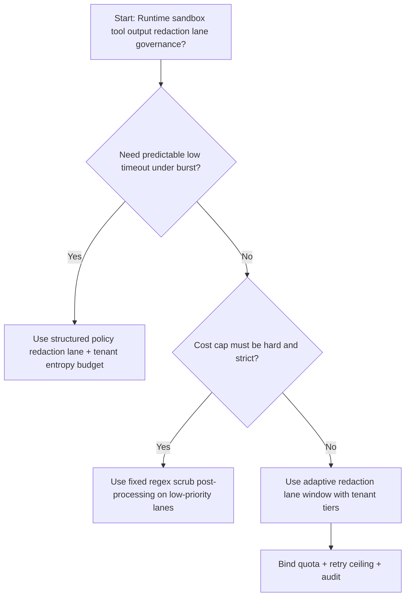
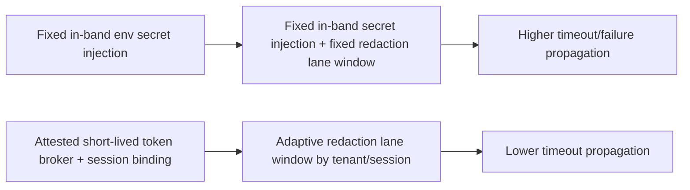
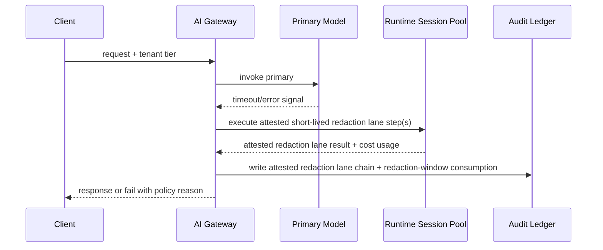

# Agent Gateway Tool Output Redaction Lane Selection FAQ (Fixed Regex Scrub Post-Processing vs Structured Policy Redaction Lane + Tenant Entropy Budget)

## 1) Core conclusions (for decision-makers first)
- **For multi-tenant Agent Runtime production, default to structured policy redaction lane + tenant entropy budget**, not fixed regex scrub post-processing as the baseline.
- **Fixed in-band env secret injection propagates burst pressure into user-visible failures/timeouts** during peak traffic windows.
- **Ephemeral redaction lane control loops must be coupled with tenant quota tiers, retry ceilings, and replay audit**, or the runtime path becomes an uncontrolled cost amplifier.

## 2) Q1 / Q2 / Q3 (plain-language definitions first)
- **Fixed in-band env secret injection**: use fixed in-band injection and fixed redaction lane windows; easy to reason about but more brittle under uneven load.
- **Attested short-lived token broker + session binding**: dynamically allocate redaction lane budgets per tenant/session while preserving auditable policy boundaries.

### Q1: Why does fixed regex scrub post-processing increase timeout propagation at scale?
First principles: output sensitivity is uneven. Fixed regex-only scrub misses context-dependent secrets and can over-redact valid fields, amplifying failures and compliance risk.

### Q2: When is fixed regex scrub post-processing acceptable?
Low-value traffic lanes with hard cost caps and lower availability requirements.

### Q3: What is the minimum safe control loop?
Request classification -> redaction lane budget assignment -> admission gate -> replay audit -> handoff-window retuning.

## 3) Mermaid (decision tree / path comparison / sequence)
### 3.1 Selection decision tree

### 3.2 Path comparison

### 3.3 Runtime sequence

## 4) Decision matrix
| Dimension | Fixed in-band env secret injection | Attested short-lived token broker + session binding |
|---|---|---|
| Implementation complexity | Low | Medium |
| Timeout risk control | Medium-Low | High |
| Cost predictability | High (static) | Medium-High (dynamic) |
| Multi-tenant sustainability | Medium | High |
| Default production fit | Low-priority lane only | Long-term default |

## 5) Evidence contract + recomputable examples (n/denominator/source)
> Percentages in this section are `synthetic_assumed` hypothetical examples for mechanism comparison; production mechanism validation remains `not_measured`.  
> Contract fields: `workshops/azure-agent-infra/evidence/cycle-481-benchmark.json` -> `percentage_contract`.

- Metric A (fixed regex scrub post-processing timeout rate)  
  - Formula: `n_fixed_regex_scrub_timeout / n_gateway_requests_observed`  
  - Value: `294/2800 = 10.5%` (`synthetic_assumed`)  
  - Path: `percentage_contract.fixed_regex_scrub_timeout_rate`
- Metric B (attested short-lived token broker timeout rate)  
  - Formula: `n_structured_redaction_lane_timeout / n_gateway_requests_observed`  
  - Value: `151/2800 = 5.4%` (`synthetic_assumed`)  
  - Path: `percentage_contract.structured_redaction_lane_timeout_rate`
- Metric C (recovery gain, percentage points)  
  - Formula: `(n_recovered_structured_redaction_lane - n_recovered_fixed_regex_scrub) / n_gateway_requests_observed`  
  - Value: `(2649-2506)/2800 = 5.1 percentage points` (`synthetic_assumed`)  
  - Path: `percentage_contract.structured_redaction_lane_recovery_gain_pts`

## 6) Production checklist
- [ ] Credential handoff policy has versioning, rollout, and rollback controls
- [ ] Tenant tiers, redaction-window usage, and retry ceilings are observable and auditable
- [ ] Timeout events, recovery chains, and replay audits are tenant-traceable
- [ ] All metrics are tagged `synthetic_assumed` with denominator/unit; production validation remains `not_measured`
