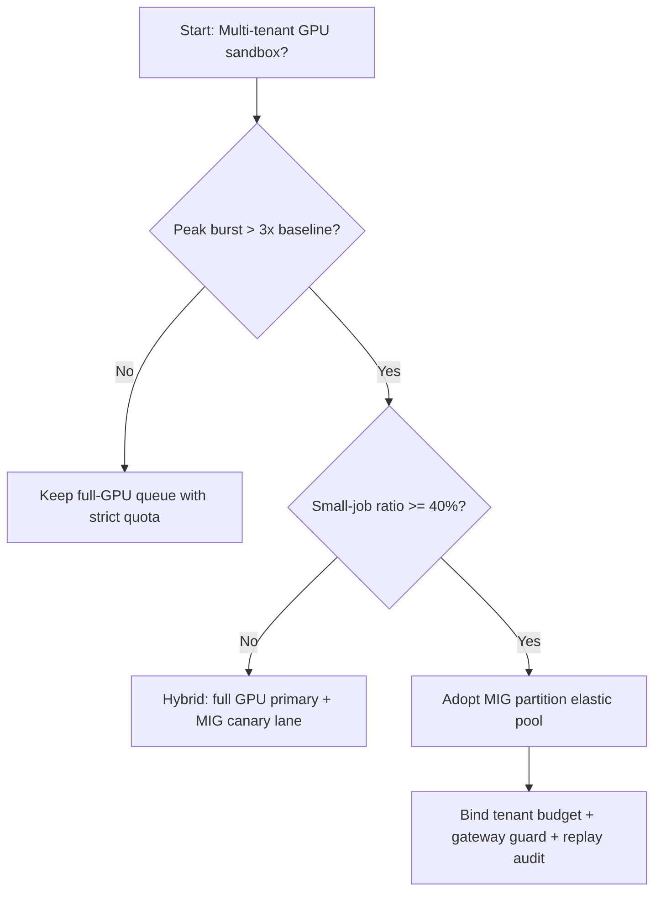
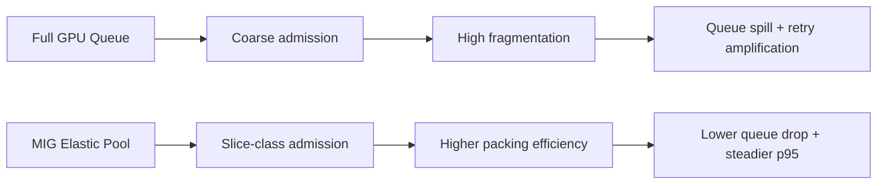
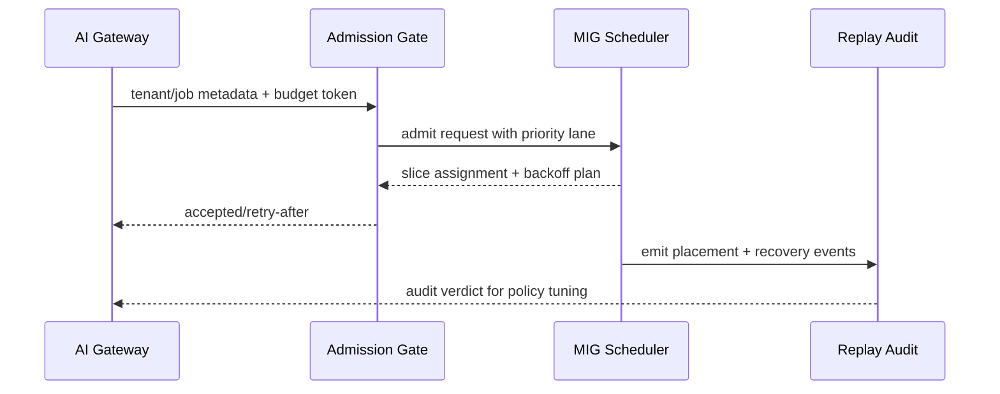

# Agent GPU MIG Partitioning Selection FAQ (Full-GPU Exclusive Queue vs MIG Elastic Pool)

## 1) Core conclusions (for decision-makers first)
- **For multi-tenant production, default to a MIG elastic pool with tenant budgets**, not long-term full-GPU exclusive queues.
- **Full-GPU exclusivity amplifies fragmentation waste under many small concurrent jobs**, reducing throughput at the same cost and worsening tail latency.
- **MIG partitioning must be coupled with gateway quotas, priority lanes, and replay audit**, or slicing alone will not produce stable SLA gains.

## 2) Q1 / Q2 / Q3 (plain-language definitions first)
- **Full-GPU exclusive queue**: each job reserves an entire GPU; simple admission, but leaves packing gaps for small jobs.
- **MIG elastic pool**: split one GPU into isolated slices (like dividing a large warehouse into smaller bins) and place jobs dynamically by size class.

### Q1: Why does full-GPU exclusivity inflate cost in multi-tenant production?
First principles: arrivals are bursty and heterogeneous; coarse full-GPU granularity drives fragmentation and lowers packing efficiency.

### Q2: When is full-GPU exclusivity still acceptable?
Few tenants, mostly long-running large-model jobs, and a team not yet ready for partition scheduling + replay operations.

### Q3: What is the minimum safe loop for MIG rollout?
Versioned quota/priority policy -> admission gate -> partition placement/backoff -> billing + replay audit -> threshold retuning.

## 3) Mermaid (decision tree / path comparison / sequence)
### 3.1 Selection decision tree

### 3.2 Path comparison

### 3.3 Runtime sequence

## 4) Decision matrix
| Dimension | Full-GPU exclusive queue | MIG elastic pool |
|---|---|---|
| Implementation complexity | Low | Medium-High |
| Resource efficiency | Medium | High |
| Peak anti-jitter resilience | Low-Medium | High |
| Multi-tenant fairness | Medium | High |
| Recommended production default | Transitional | Long-term default |

## 5) Quant evidence and reproducible examples (with n/denominator/source)
> Percentages in this section are `synthetic_assumed` hypothetical examples for mechanism comparison; production mechanism certification remains `not_measured`.  
> Contract fields are in `workshops/azure-agent-infra/evidence/cycle-441-benchmark.json` under `percentage_contract`.

- Metric A (full-GPU fragmentation rate)  
  - Definition: `n_fragmented_full_gpu / n_runtime_requests_observed`  
  - Value: `286/2400 = 11.9%` (`synthetic_assumed`)  
  - Path: `percentage_contract.fixed_full_gpu_fragmentation_rate`
- Metric B (MIG partition fragmentation rate)  
  - Definition: `n_fragmented_mig_partition / n_runtime_requests_observed`  
  - Value: `118/2400 = 4.9%` (`synthetic_assumed`)  
  - Path: `percentage_contract.mig_partition_fragmentation_rate`
- Metric C (recovery-success uplift, percentage points)  
  - Definition: `(n_recovery_success_mig - n_recovery_success_full_gpu) / n_runtime_requests_observed`  
  - Value: `(2148-1978)/2400 = 7.1` percentage points (`synthetic_assumed`)  
  - Path: `percentage_contract.mig_recovery_gain_pts`

### Daily-hot source references (with fetch timestamps)
- APIM / AI Gateway overview (Microsoft Learn): `fetched_at_utc=2026-11-09T15:33:22Z`, `source_label=measured`
- Azure API Management changelog (Unified model API / MCP / A2A): `fetched_at_utc=2026-11-09T15:33:22Z`, `source_label=measured`
- Azure Container Apps Dynamic Sessions: `fetched_at_utc=2026-11-09T15:33:22Z`, `source_label=measured`
- Firecracker / Kata / Wasmtime / E2B releases: `fetched_at_utc=2026-11-09T15:33:22Z`, `source_label=measured`

## 6) Production validation checklist
- [ ] MIG partition policy (slice classes, concurrency, backoff) has versioning, canary, and rollback
- [ ] Gateway budgets, tenant priority, and partition scheduling are consistently enforced in both control and data planes
- [ ] Fragmentation rate, queue drop rate, recovery-success rate, and replay audit chain are traceable
- [ ] Every metric explicitly labels `synthetic_assumed` / `not_measured` with denominator, unit, and source path
