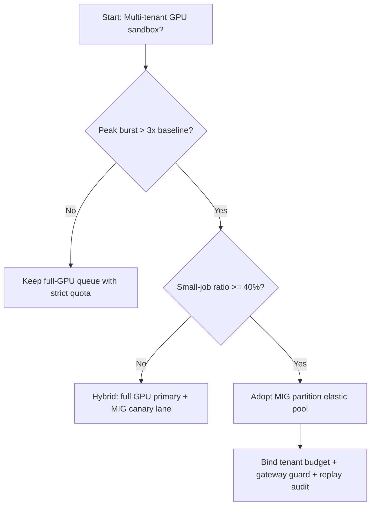
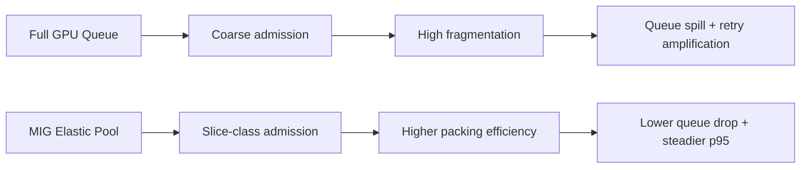
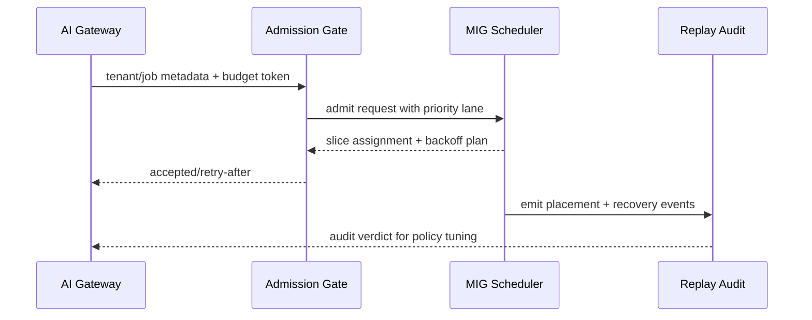

# Agent GPU MIG 分区选型 FAQ（整卡独占队列 vs MIG 分区弹性池）

## 1) 核心结论（先给负责人）
- **多租户生产默认优先“MIG 分区弹性池 + 租户预算”**，不建议长期仅用整卡独占队列。
- **整卡独占在小请求高并发场景会放大碎片浪费与排队**，导致同等成本下吞吐更低、尾延迟更高。
- **MIG 分区必须和网关配额、优先级通道、回放审计联动**，否则只是把资源切小，不能稳定获得 SLA 收益。

## 2) Q1 / Q2 / Q3（术语先通俗解释）
- **整卡独占队列**：一个作业拿一整块 GPU，排队简单，但会把很多小作业“塞满前的空位”浪费掉。
- **MIG 分区弹性池**：把一块 GPU 切成多个隔离小片（像把大仓库分成小仓位），按作业大小动态放置。

### Q1：为什么整卡独占容易在多租户下成本失控？
第一性原理：请求到达是突发且大小不均匀，整卡粒度太粗，会造成高碎片和低装箱率。

### Q2：什么时候仍可先用整卡独占？
租户很少、作业几乎都是长时大模型、团队暂时不具备分区调度与回放能力时，可短期过渡。

### Q3：MIG 分区上线的最小安全闭环是什么？
配额/优先级策略版本化 -> Admission Gate -> 分区放置与退避 -> 账单与审计回放 -> 阈值复盘。

## 3) Mermaid（决策树 / 路径对比 / 时序）
### 3.1 选型决策树

### 3.2 路径对比图

### 3.3 运行时序图

## 4) 选型决策矩阵
| 维度 | 整卡独占队列 | MIG 分区弹性池 |
|---|---|---|
| 实现复杂度 | 低 | 中-高 |
| 资源利用率 | 中 | 高 |
| 峰值抗抖动能力 | 低-中 | 高 |
| 多租户公平性 | 中 | 高 |
| 生产默认建议 | 过渡方案 | 长期默认 |

## 5) 数据证据与可复算算例（含 n/分母/来源）
> 本节百分比为 `synthetic_assumed` 假设算例（hypothetical），用于机制比较；生产机制认证保持 `not_measured`。  
> 合同字段见：`workshops/azure-agent-infra/evidence/cycle-441-benchmark.json` 的 `percentage_contract`。

- 指标 A（整卡独占碎片化率）  
  - 定义：`n_fragmented_full_gpu / n_runtime_requests_observed`  
  - 值：`286/2400 = 11.9%`（`synthetic_assumed`）  
  - 路径：`percentage_contract.fixed_full_gpu_fragmentation_rate`
- 指标 B（MIG 分区碎片化率）  
  - 定义：`n_fragmented_mig_partition / n_runtime_requests_observed`  
  - 值：`118/2400 = 4.9%`（`synthetic_assumed`）  
  - 路径：`percentage_contract.mig_partition_fragmentation_rate`
- 指标 C（恢复成功率提升，百分点）  
  - 定义：`(n_recovery_success_mig - n_recovery_success_full_gpu) / n_runtime_requests_observed`  
  - 值：`(2148-1978)/2400 = 7.1` 个百分点（`synthetic_assumed`）  
  - 路径：`percentage_contract.mig_recovery_gain_pts`

### 当日热点来源（抓取时间）
- APIM / AI Gateway 概览（Microsoft Learn）：`fetched_at_utc=2026-11-09T15:33:22Z`，`source_label=measured`
- Azure API Management changelog（Unified model API / MCP / A2A）：`fetched_at_utc=2026-11-09T15:33:22Z`，`source_label=measured`
- Azure Container Apps Dynamic Sessions：`fetched_at_utc=2026-11-09T15:33:22Z`，`source_label=measured`
- Firecracker / Kata / Wasmtime / E2B releases：`fetched_at_utc=2026-11-09T15:33:22Z`，`source_label=measured`

## 6) 生产核验 Checklist（上线前必须打勾）
- [ ] MIG 分区策略（slice class、并发、退避）含版本、灰度和回滚
- [ ] Gateway 预算、租户优先级、分区调度在控制面和数据面一致生效
- [ ] 碎片化率、排队丢失率、恢复成功率、回放审计链可追溯
- [ ] 指标全部标注 `synthetic_assumed` / `not_measured` 与分母、单位、source_path
