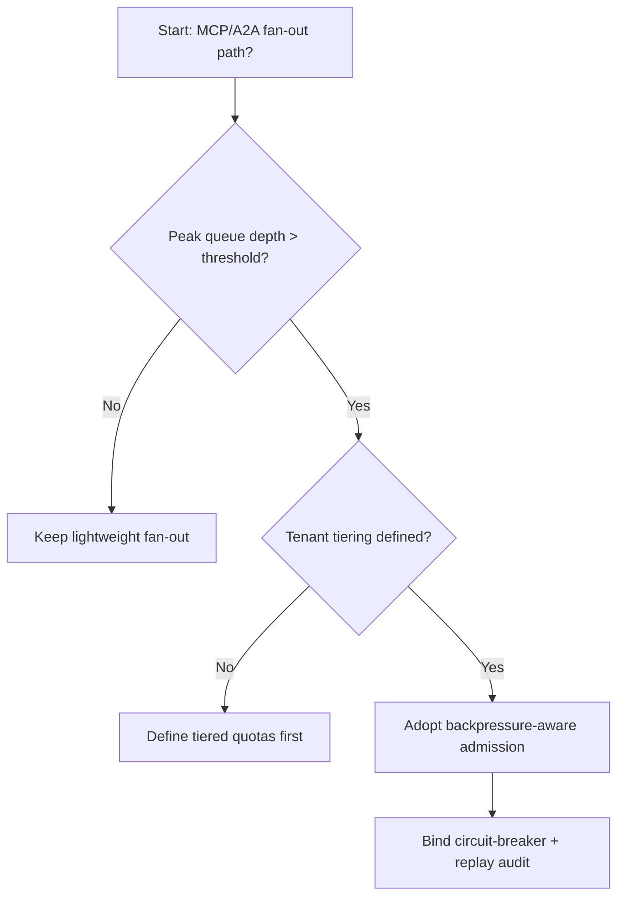
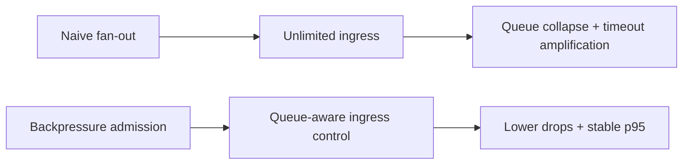
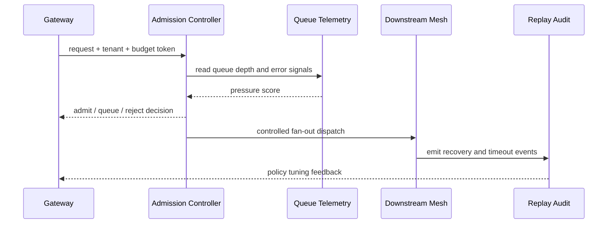

# Agent MCP/A2A Backpressure Admission Selection FAQ (Naive Fan-out vs Backpressure-aware Admission)

## 1) Core conclusions (for decision-makers first)
- **For MCP/A2A multi-hop production calls, default to backpressure-aware admission with tenant-tier quotas**, not naive unrestricted fan-out.
- **Naive fan-out causes queue collapse and cascading timeouts under bursts**, amplifying retries and tail-latency regressions.
- **Backpressure admission must be coupled with gateway budgets, priority lanes, circuit breakers, and replay audit**, or only local bottlenecks improve while system-wide instability remains.

## 2) Q1 / Q2 / Q3 (plain-language definitions first)
- **Naive fan-out**: dispatch to downstream paths as fast as possible with minimal ingress gating.
- **Backpressure-aware admission**: dynamically tighten ingress based on queue depth, latency, and error signals with prioritized queuing.

### Q1: Why does naive fan-out become unstable in production?
First principles: end-to-end throughput is bounded by the slowest stage; uncontrolled ingress propagates local congestion into full-path congestion.

### Q2: When is naive fan-out still acceptable?
Low concurrency, single-tenant scope, highly stable downstream performance, and tolerance for occasional timeout spikes.

### Q3: What is the minimum safe loop?
Ingress budget + priority -> backpressure admission verdict -> rate-limit/queue/circuit-break -> recovery fallback -> replay audit retuning.

## 3) Mermaid (decision tree / path comparison / sequence)
### 3.1 Selection decision tree

### 3.2 Path comparison

### 3.3 Runtime sequence

## 4) Decision matrix
| Dimension | Naive fan-out | Backpressure-aware admission |
|---|---|---|
| Implementation complexity | Low | Medium |
| Peak stability | Low | High |
| Drop control | Low-Medium | High |
| Multi-tenant fairness | Medium | High |
| Recommended production default | Transitional | Long-term default |

## 5) Quant evidence and reproducible examples (with n/denominator/source)
> Percentages in this section are `synthetic_assumed` hypothetical examples for mechanism comparison; production mechanism certification remains `not_measured`.  
> Contract fields are in `workshops/azure-agent-infra/evidence/cycle-445-benchmark.json` under `percentage_contract`.

- Metric A (naive fan-out drop rate)  
  - Definition: `n_drop_naive_fanout / n_runtime_requests_observed`  
  - Value: `332/2400 = 13.8%` (`synthetic_assumed`)  
  - Path: `percentage_contract.naive_fanout_drop_rate`
- Metric B (backpressure-admission drop rate)  
  - Definition: `n_drop_backpressure_admission / n_runtime_requests_observed`  
  - Value: `139/2400 = 5.8%` (`synthetic_assumed`)  
  - Path: `percentage_contract.backpressure_admission_drop_rate`
- Metric C (recovery-success uplift, percentage points)  
  - Definition: `(n_recovery_success_backpressure - n_recovery_success_naive) / n_runtime_requests_observed`  
  - Value: `(2234-2043)/2400 = 8.0` percentage points (`synthetic_assumed`)  
  - Path: `percentage_contract.backpressure_recovery_gain_pts`

### Daily-hot source references (with fetch timestamps)
- APIM / AI Gateway overview (Microsoft Learn): `fetched_at_utc=2026-11-09T15:53:12Z`, `source_label=measured`
- Azure API Management changelog (Unified model API / MCP / A2A): `fetched_at_utc=2026-11-09T15:53:12Z`, `source_label=measured`
- Azure Container Apps Dynamic Sessions: `fetched_at_utc=2026-11-09T15:53:12Z`, `source_label=measured`
- Firecracker / Kata / Wasmtime / E2B releases: `fetched_at_utc=2026-11-09T15:53:12Z`, `source_label=measured`

## 6) Production validation checklist
- [ ] Backpressure policy (quota/queue/circuit-break) supports versioning, canary, and rollback
- [ ] Ingress budget matches downstream capacity model to prevent burst amplification
- [ ] Drop rate, queue latency, recovery-success rate, and audit chain are traceable
- [ ] Every metric explicitly labels `synthetic_assumed` / `not_measured` with denominator, unit, and source path
