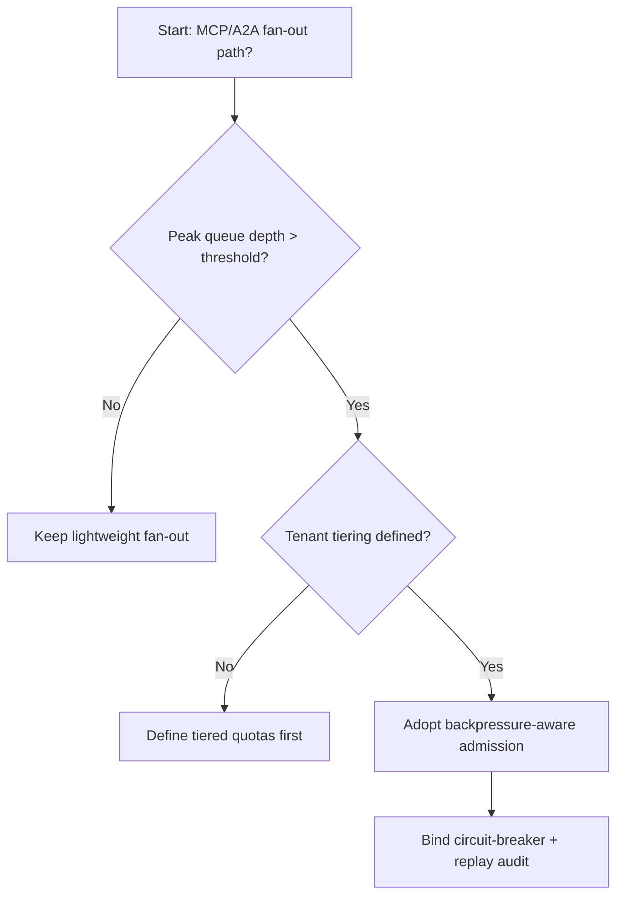
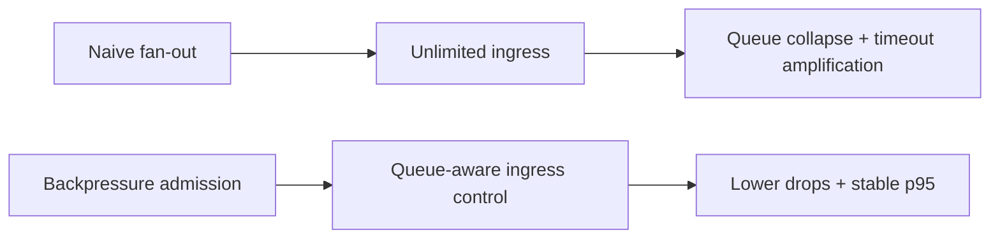
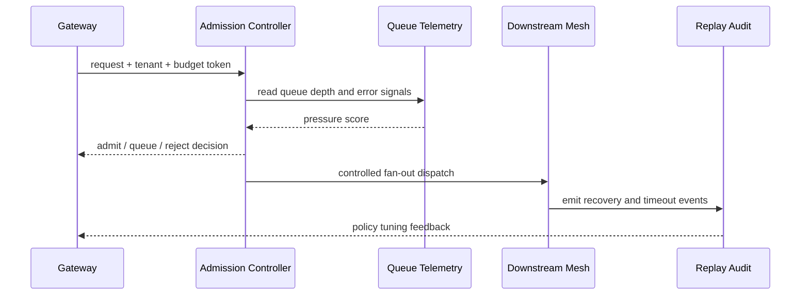

# Agent MCP/A2A 背压准入策略选型 FAQ（无背压直通扇出 vs 背压感知准入）

## 1) 核心结论（先给负责人）
- **MCP/A2A 多跳调用生产默认优先“背压感知准入 + 租户分层配额”**，不建议长期无背压直通扇出。
- **无背压直通在高峰流量会触发队列雪崩与级联超时**，放大失败重试并拖垮尾延迟。
- **背压准入必须联动网关预算、优先级通道、熔断与回放审计**，否则只能缓解局部而无法稳定全局。

## 2) Q1 / Q2 / Q3（术语先通俗解释）
- **无背压直通扇出**：请求来了就尽量并发下发给所有下游，简单但容易冲垮慢节点。
- **背压感知准入**：根据队列水位、延迟、失败率动态收紧入口并做优先级排队。

### Q1：为什么无背压直通在生产会失控？
第一性原理：系统吞吐由最慢环节决定，入口不控速会把局部拥塞放大成全链路拥塞。

### Q2：什么时候仍可先用直通扇出？
低并发、单租户、下游性能高度稳定且容忍偶发超时时，可作为短期过渡。

### Q3：最小安全闭环是什么？
入口预算与优先级 -> 背压准入判定 -> 限流/排队/熔断 -> 恢复回退 -> 回放审计复盘。

## 3) Mermaid（决策树 / 路径对比 / 时序）
### 3.1 选型决策树

### 3.2 路径对比图

### 3.3 运行时序图

## 4) 选型决策矩阵
| 维度 | 无背压直通扇出 | 背压感知准入 |
|---|---|---|
| 实现复杂度 | 低 | 中 |
| 峰值稳定性 | 低 | 高 |
| 丢请求控制 | 低-中 | 高 |
| 多租户公平性 | 中 | 高 |
| 生产默认建议 | 过渡方案 | 长期默认 |

## 5) 数据证据与可复算算例（含 n/分母/来源）
> 本节百分比为 `synthetic_assumed` 假设算例（hypothetical），用于机制比较；生产机制认证保持 `not_measured`。  
> 合同字段见：`workshops/azure-agent-infra/evidence/cycle-445-benchmark.json` 的 `percentage_contract`。

- 指标 A（无背压直通丢弃率）  
  - 定义：`n_drop_naive_fanout / n_runtime_requests_observed`  
  - 值：`332/2400 = 13.8%`（`synthetic_assumed`）  
  - 路径：`percentage_contract.naive_fanout_drop_rate`
- 指标 B（背压准入丢弃率）  
  - 定义：`n_drop_backpressure_admission / n_runtime_requests_observed`  
  - 值：`139/2400 = 5.8%`（`synthetic_assumed`）  
  - 路径：`percentage_contract.backpressure_admission_drop_rate`
- 指标 C（恢复成功率提升，百分点）  
  - 定义：`(n_recovery_success_backpressure - n_recovery_success_naive) / n_runtime_requests_observed`  
  - 值：`(2234-2043)/2400 = 8.0` 个百分点（`synthetic_assumed`）  
  - 路径：`percentage_contract.backpressure_recovery_gain_pts`

### 当日热点来源（抓取时间）
- APIM / AI Gateway 概览（Microsoft Learn）：`fetched_at_utc=2026-11-09T15:53:12Z`，`source_label=measured`
- Azure API Management changelog（Unified model API / MCP / A2A）：`fetched_at_utc=2026-11-09T15:53:12Z`，`source_label=measured`
- Azure Container Apps Dynamic Sessions：`fetched_at_utc=2026-11-09T15:53:12Z`，`source_label=measured`
- Firecracker / Kata / Wasmtime / E2B releases：`fetched_at_utc=2026-11-09T15:53:12Z`，`source_label=measured`

## 6) 生产核验 Checklist（上线前必须打勾）
- [ ] 背压准入策略（配额、排队、熔断）具备版本、灰度、回滚
- [ ] 入口预算与下游容量模型一致，防止流量突刺越级放大
- [ ] 丢弃率、排队时延、恢复成功率和审计链可追溯
- [ ] 指标全部标注 `synthetic_assumed` / `not_measured` 与分母、单位、source_path
