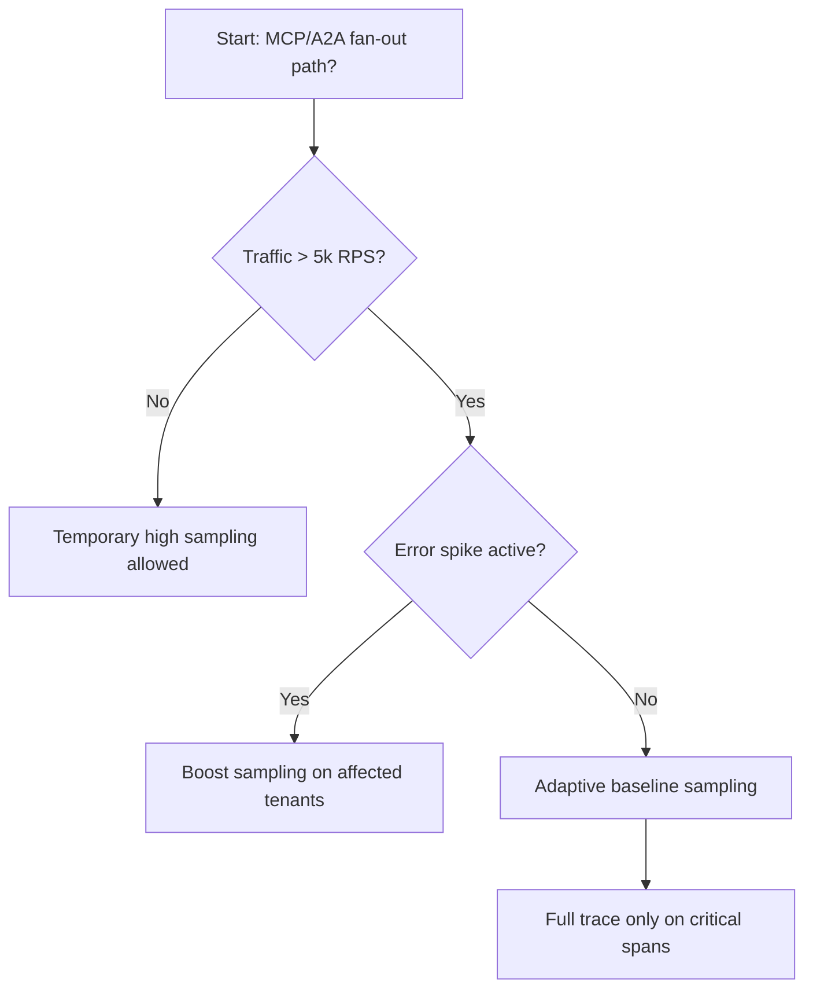
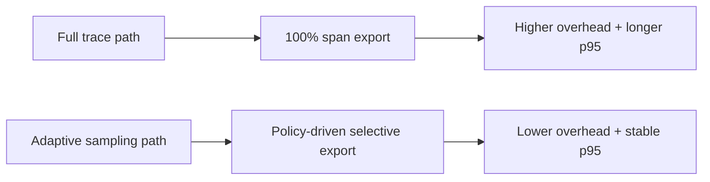
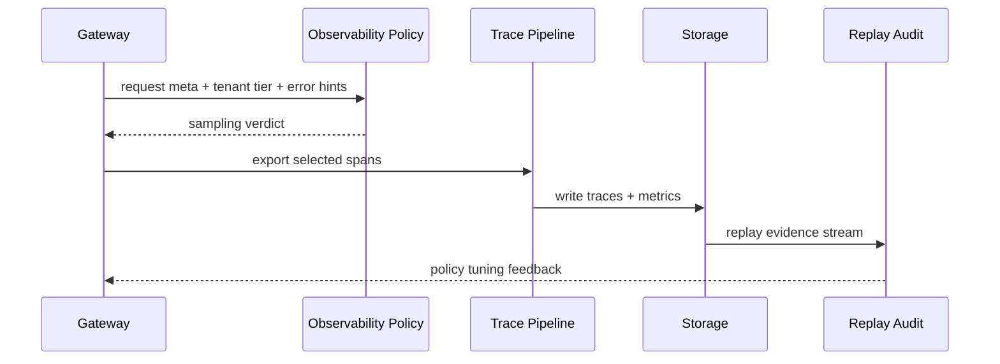

# Agent MCP/A2A Observability Sampling Selection FAQ (Full Trace vs Adaptive Sampling)

## 1) Core conclusions (for decision-makers first)
- **For multi-hop MCP/A2A production orchestration, default to adaptive sampling with full trace on critical paths**, not permanent 100% trace coverage.
- **Full-trace mode amplifies observability tax (CPU/network/storage) under high concurrency and increases end-to-end latency**.
- **Sampling policy must bind tenant priority, incident severity, policy versioning, and replay audit**, or troubleshooting evidence becomes incomplete and non-reproducible.

## 2) Q1 / Q2 / Q3 (plain-language definitions first)
- **Full trace**: record and export every request/span; maximum diagnostic detail, maximum cost.
- **Adaptive sampling**: adjust sampling rates by error rate, latency, and tenant tier; keep full fidelity only for critical requests.

### Q1: Why is permanent full trace not recommended in production?
First principles: observability itself consumes resources; the observer must not destabilize the observed system.

### Q2: When is temporary full trace acceptable?
Major incident windows, compliance forensics windows, or early canary phases with strict time bounds and rollback switches.

### Q3: What is the minimum safe loop?
Ingress tiering -> sampling decision -> critical-path fidelity -> replay audit -> threshold retuning and policy iteration.

## 3) Mermaid (decision tree / path comparison / sequence)
### 3.1 Selection decision tree

### 3.2 Path comparison

### 3.3 Runtime sequence

## 4) Decision matrix
| Dimension | Full trace | Adaptive sampling |
|---|---|---|
| Implementation complexity | Low | Medium |
| Observability completeness | High | Medium-High (high for critical path) |
| Performance/cost pressure | High | Medium-Low |
| Large-scale sustainability | Low | High |
| Recommended production default | Temporary windows | Long-term default |

## 5) Quant evidence and reproducible examples (with n/denominator/source)
> Percentages in this section are `synthetic_assumed` hypothetical examples for mechanism comparison; production mechanism certification remains `not_measured`.  
> Contract fields are in `workshops/azure-agent-infra/evidence/cycle-444-benchmark.json` under `percentage_contract`.

- Metric A (full-trace overhead rate)  
  - Definition: `n_trace_overhead_full / n_runtime_requests_observed`  
  - Value: `314/2400 = 13.1%` (`synthetic_assumed`)  
  - Path: `percentage_contract.full_trace_overhead_rate`
- Metric B (adaptive-sampling overhead rate)  
  - Definition: `n_trace_overhead_adaptive / n_runtime_requests_observed`  
  - Value: `127/2400 = 5.3%` (`synthetic_assumed`)  
  - Path: `percentage_contract.adaptive_sampling_overhead_rate`
- Metric C (recovery-success uplift, percentage points)  
  - Definition: `(n_recovery_success_adaptive - n_recovery_success_full) / n_runtime_requests_observed`  
  - Value: `(2210-2023)/2400 = 7.8` percentage points (`synthetic_assumed`)  
  - Path: `percentage_contract.sampling_recovery_gain_pts`

### Daily-hot source references (with fetch timestamps)
- APIM / AI Gateway overview (Microsoft Learn): `fetched_at_utc=2026-11-09T15:48:42Z`, `source_label=measured`
- Azure API Management changelog (Unified model API / MCP / A2A): `fetched_at_utc=2026-11-09T15:48:42Z`, `source_label=measured`
- Azure Container Apps Dynamic Sessions: `fetched_at_utc=2026-11-09T15:48:42Z`, `source_label=measured`
- Firecracker / Kata / Wasmtime / E2B releases: `fetched_at_utc=2026-11-09T15:48:42Z`, `source_label=measured`

## 6) Production validation checklist
- [ ] Layered sampling policy (tenant/severity/critical path) supports versioning, canary, and rollback
- [ ] Trace export budget is coupled with gateway budget to avoid observability back-pressure on business traffic
- [ ] Overhead rate, dropped-span rate, recovery-success rate, and audit chain are traceable
- [ ] Every metric explicitly labels `synthetic_assumed` / `not_measured` with denominator, unit, and source path
