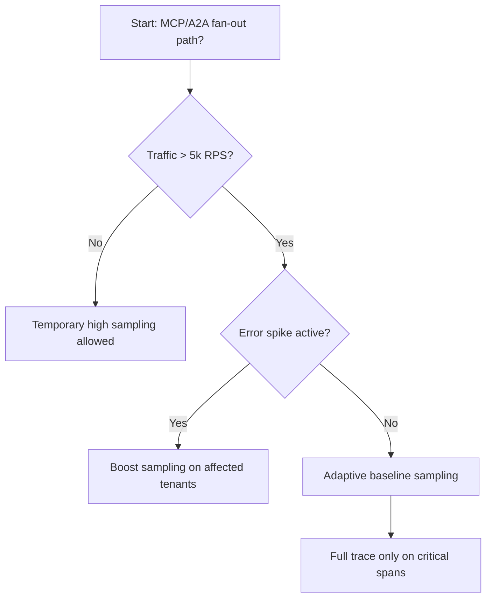
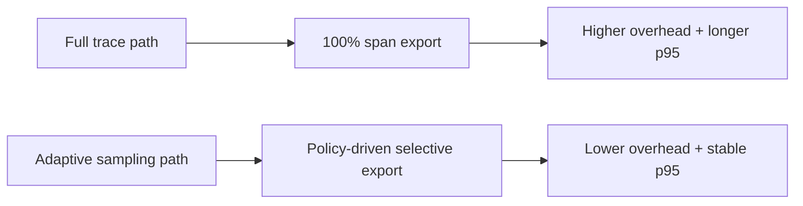
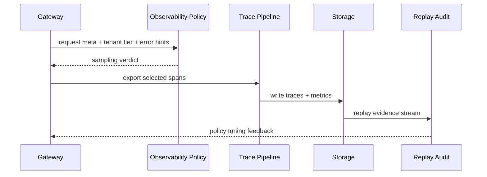

# Agent MCP/A2A 可观测采样策略选型 FAQ（全量追踪 vs 自适应采样）

## 1) 核心结论（先给负责人）
- **MCP/A2A 多跳编排生产默认优先“自适应采样 + 关键路径全量追踪”**，不建议长期全链路100%采样。
- **全量追踪在高并发下会放大可观测开销（CPU/网络/存储）并抬高端到端延迟**。
- **采样策略必须绑定租户优先级、故障级别、策略版本与回放审计**，否则排障证据会不完整且不可复盘。

## 2) Q1 / Q2 / Q3（术语先通俗解释）
- **全量追踪**：每个请求、每个 Span 都记录，诊断信息最完整但成本最高。
- **自适应采样**：根据错误率、延迟、租户等级动态调整采样比例，重点请求保留全量。

### Q1：为什么生产环境不建议长期全量追踪？
第一性原理：可观测数据本身会消耗资源，观察系统不能压垮被观察系统；否则监控越多，服务越慢。

### Q2：什么时候可以临时全量追踪？
重大故障窗口、合规取证窗口、灰度初期关键租户，且有明确时限与回滚开关。

### Q3：最小安全闭环是什么？
入口分级 -> 采样决策 -> 关键路径保真 -> 事件回放 -> 阈值复盘与策略版本迭代。

## 3) Mermaid（决策树 / 路径对比 / 时序）
### 3.1 选型决策树

### 3.2 路径对比图

### 3.3 运行时序图

## 4) 选型决策矩阵
| 维度 | 全量追踪 | 自适应采样 |
|---|---|---|
| 实现复杂度 | 低 | 中 |
| 观测完整度 | 高 | 中-高（关键路径高） |
| 性能与成本压力 | 高 | 中-低 |
| 大规模可持续性 | 低 | 高 |
| 生产默认建议 | 临时窗口 | 长期默认 |

## 5) 数据证据与可复算算例（含 n/分母/来源）
> 本节百分比为 `synthetic_assumed` 假设算例（hypothetical），用于机制比较；生产机制认证保持 `not_measured`。  
> 合同字段见：`workshops/azure-agent-infra/evidence/cycle-444-benchmark.json` 的 `percentage_contract`。

- 指标 A（全量追踪开销率）  
  - 定义：`n_trace_overhead_full / n_runtime_requests_observed`  
  - 值：`314/2400 = 13.1%`（`synthetic_assumed`）  
  - 路径：`percentage_contract.full_trace_overhead_rate`
- 指标 B（自适应采样开销率）  
  - 定义：`n_trace_overhead_adaptive / n_runtime_requests_observed`  
  - 值：`127/2400 = 5.3%`（`synthetic_assumed`）  
  - 路径：`percentage_contract.adaptive_sampling_overhead_rate`
- 指标 C（恢复成功率提升，百分点）  
  - 定义：`(n_recovery_success_adaptive - n_recovery_success_full) / n_runtime_requests_observed`  
  - 值：`(2210-2023)/2400 = 7.8` 个百分点（`synthetic_assumed`）  
  - 路径：`percentage_contract.sampling_recovery_gain_pts`

### 当日热点来源（抓取时间）
- APIM / AI Gateway 概览（Microsoft Learn）：`fetched_at_utc=2026-11-09T15:48:42Z`，`source_label=measured`
- Azure API Management changelog（Unified model API / MCP / A2A）：`fetched_at_utc=2026-11-09T15:48:42Z`，`source_label=measured`
- Azure Container Apps Dynamic Sessions：`fetched_at_utc=2026-11-09T15:48:42Z`，`source_label=measured`
- Firecracker / Kata / Wasmtime / E2B releases：`fetched_at_utc=2026-11-09T15:48:42Z`，`source_label=measured`

## 6) 生产核验 Checklist（上线前必须打勾）
- [ ] 采样策略分层（租户/错误等级/关键路径）具备版本、灰度、回滚
- [ ] Trace 导出预算与网关预算联动，防止观测流量反压业务流量
- [ ] 开销率、丢 Span 率、恢复成功率与审计链可追溯
- [ ] 指标全部标注 `synthetic_assumed` / `not_measured` 与分母、单位、source_path
