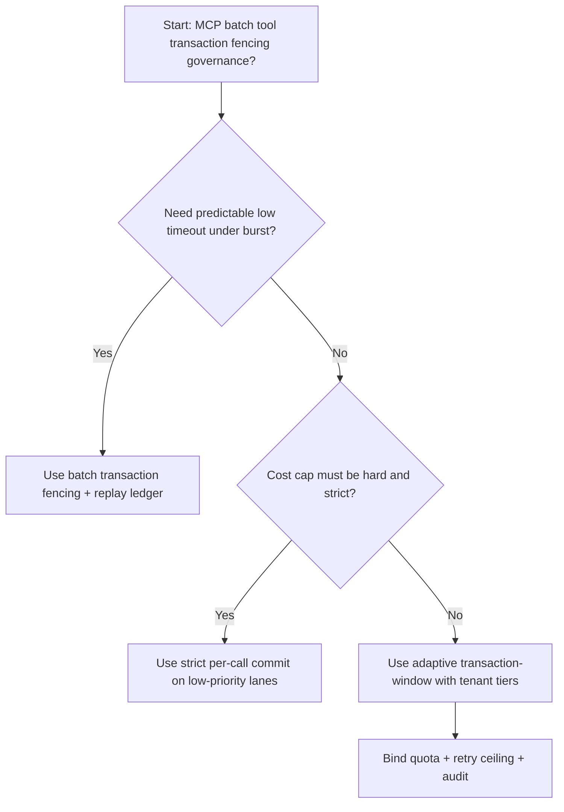
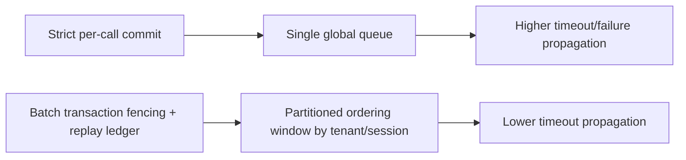
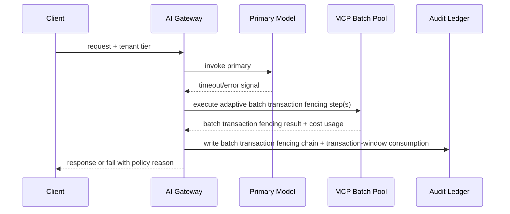

# Agent MCP Batch Tool Transaction Fencing Selection FAQ (Strict Per-Call Commit vs Batch Transaction Fencing + Replay Ledger)

## 1) Core conclusions (for decision-makers first)
- **For multi-tenant Agent MCP batch tool production, default to batch transaction fencing + replay ledger**, not strict per-call commit as the baseline.
- **Strict per-call commit propagates out-of-order burst pressure into user-visible failures/timeouts** during burst periods.
- **Batch transaction fencing must be coupled with tenant quota tiers, retry ceilings, and replay audit**, or the ordering path becomes an uncontrolled cost amplifier.

## 2) Q1 / Q2 / Q3 (plain-language definitions first)
- **Strict per-call commit**: each tool call is committed independently through a single serialized path.
- **Batch transaction fencing + replay ledger**: batch steps are fenced by transaction scope and recovered with replayable idempotent ledger entries.

### Q1: Why does strict per-call commit increase timeout propagation at scale?
First principles: distributed MCP tool systems naturally receive out-of-order events. A single global queue lets one slow partition block unrelated traffic, amplifying queue pressure and tail latency.

### Q2: When is strict per-call commit acceptable?
Low-value traffic lanes with hard cost caps and lower availability requirements.

### Q3: What is the minimum safe control loop?
Request classification -> causality partition assignment -> admission gate -> idempotent replay audit -> transaction-window retuning.

## 3) Mermaid (decision tree / path comparison / sequence)
### 3.1 Selection decision tree

### 3.2 Path comparison

### 3.3 Runtime sequence

## 4) Decision matrix
| Dimension | Strict per-call commit | Batch transaction fencing + replay ledger |
|---|---|---|
| Implementation complexity | Low | Medium |
| Timeout risk control | Medium-Low | High |
| Cost predictability | High (static) | Medium-High (dynamic) |
| Multi-tenant sustainability | Medium | High |
| Default production fit | Low-priority lane only | Long-term default |

## 5) Evidence contract + recomputable examples (n/denominator/source)
> Percentages in this section are `synthetic_assumed` hypothetical examples for mechanism comparison; production mechanism validation remains `not_measured`.  
> Contract fields: `workshops/azure-agent-infra/evidence/cycle-466-benchmark.json` -> `percentage_contract`.

- Metric A (primary-only timeout rate)  
  - Formula: `n_primary_only_timeout / n_runtime_requests_observed`  
  - Value: `286/2600 = 11.0%` (`synthetic_assumed`)  
  - Path: `percentage_contract.primary_only_timeout_rate`
- Metric B (transaction-fencing timeout rate)  
  - Formula: `n_adaptive_transaction-fencing_timeout / n_runtime_requests_observed`  
  - Value: `146/2600 = 5.6%` (`synthetic_assumed`)  
  - Path: `percentage_contract.adaptive_transaction-fencing_timeout_rate`
- Metric C (recovery gain, percentage points)  
  - Formula: `(n_recovered_adaptive_transaction-fencing - n_recovered_primary_only) / n_runtime_requests_observed`  
  - Value: `(2435-2314)/2600 = 4.7 percentage points` (`synthetic_assumed`)  
  - Path: `percentage_contract.transaction-fencing_recovery_gain_pts`

## 6) Production checklist
- [ ] Batch transaction fencing policy has versioning, rollout, and rollback controls
- [ ] Tenant tiers, transaction-window usage, and retry ceilings are observable and auditable
- [ ] Timeout events, ordering chains, and replay audits are tenant-traceable
- [ ] All metrics are tagged `synthetic_assumed` with denominator/unit; production validation remains `not_measured`
