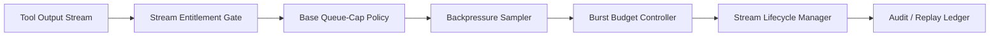

# Agent MCP Tool Output Stream Backpressure Selection FAQ (Fixed Queue Cap vs Adaptive Backpressure Window)

## 1) Core conclusions
- **Production multi-tenant deployments should default to adaptive backpressure windows plus burst-budget gates**, not long-term fixed queue caps.
- **Fixed queue caps are more likely to trigger avoidable drops under bursty output and slow tools**, increasing retry, compensation, and tail-latency cost.
- **Backpressure governance must be coupled with tenant entitlements, gateway policy, and replay audit loops** to satisfy both reliability and compliance boundaries.

## 2) Q1 / Q2 / Q3 (plain terms first)
- **Fixed queue cap**: hard queue threshold; simple to run but less elastic under bursty streams.
- **Adaptive backpressure window**: dynamically adjusts acceptance windows based on stream pressure and risk profile.

### Q1: Why is a fixed queue cap risky in production?
First principle: stream input and downstream processing rates fluctuate continuously; hard static thresholds over-drop recoverable traffic during spikes.

### Q2: When is a fixed queue cap acceptable?
Short-lived single-tenant workloads with stable traffic and tolerance for occasional drop-and-retry cycles.

### Q3: What is the minimum safe backpressure control loop?
Tenant stream entitlement -> base queue-cap policy -> pressure sampling + window decision -> burst-budget gate -> drop/replay audit ledger.

## 3) Mermaid (MCP tool output stream backpressure governance loop)

## 4) Decision matrix
| Dimension | Fixed queue cap | Adaptive backpressure window |
|---|---|---|
| Implementation complexity | Low | Medium |
| Burst absorption | Low | High |
| False-drop control | Low-Medium | High |
| Multi-tenant governance depth | Medium | High |
| Default production fit | Short transitional phase | Multi-tenant long-running workloads |

## 5) Evidence contract + recomputable examples (n/denominator/source)
> Percentages in this section are `synthetic_assumed` hypothetical examples for mechanism comparison; production mechanism validation remains `not_measured`.  
> Contract fields: `workshops/azure-agent-infra/evidence/cycle-433-benchmark.json` -> `percentage_contract`.

- Metric A (stream-drop rate, fixed queue cap)  
  - Formula: `n_drop_fixed_cap / n_stream_events_observed`  
  - Value: `264/2400 = 11.0%` (`synthetic_assumed`)  
  - Path: `percentage_contract.fixed_queue_drop_rate`
- Metric B (stream-drop rate, adaptive backpressure window)  
  - Formula: `n_drop_adaptive_window / n_stream_events_observed`  
  - Value: `82/2400 = 3.4%` (`synthetic_assumed`)  
  - Path: `percentage_contract.adaptive_backpressure_drop_rate`
- Metric C (recovery success gain, percentage points)  
  - Formula: `(n_recovery_success_adaptive - n_recovery_success_fixed) / n_stream_events_observed`  
  - Value: `(2168-1904)/2400 = 11.0 percentage points` (`synthetic_assumed`)  
  - Path: `percentage_contract.backpressure_recovery_gain_pts`

## 6) Production checklist
- [ ] Queue-cap and backpressure-window policies are versioned with rollout and rollback controls
- [ ] Tenant stream entitlement and burst-budget gates are enforced at gateway level
- [ ] Drop rate, recovery success, and replay audit are traceable
- [ ] Metrics are tagged `synthetic_assumed` with denominator and units; production validation remains `not_measured`
