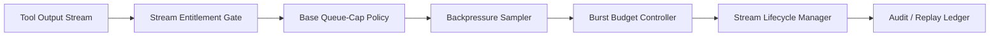

# Agent MCP 工具输出流背压治理选型 FAQ（固定队列上限 vs 自适应背压窗口）

## 1) 核心结论（先给负责人）
- **多租户生产默认采用“自适应背压窗口 + 峰值预算门禁”**，不建议长期使用固定队列上限。
- **固定队列上限在突发输出或慢工具场景下更易触发误丢弃**，会放大重试、补偿和尾延迟。
- **背压治理必须与租户权限、网关策略和审计回放联动**，否则稳定性与合规边界无法同时满足。

## 2) Q1 / Q2 / Q3（术语先通俗解释）
- **固定队列上限**：队列达到阈值后直接拒绝或丢弃，简单但弹性不足。
- **自适应背压窗口**：按实时压力动态调节窗口和节流强度，降低误丢弃。

### Q1：为什么固定队列上限在生产里有风险？
第一性原理：输出流量和下游处理速率会持续波动，固定阈值在突发时更容易把可恢复流量判成不可接收，导致不必要丢弃和重试放大。

### Q2：什么时候可以接受固定队列上限？
单租户、低并发、负载平稳且可接受偶发丢弃重试时，可作为短期过渡方案。

### Q3：背压治理的最小安全闭环是什么？
租户流权限 -> 队列上限基线策略 -> 背压采样与窗口调节 -> 峰值预算门禁 -> 丢弃与回放审计。

## 3) Mermaid（MCP 工具输出流背压治理闭环）

## 4) 决策矩阵
| 维度 | 固定队列上限 | 自适应背压窗口 |
|---|---|---|
| 实现复杂度 | 低 | 中 |
| 突发吸收能力 | 低 | 高 |
| 误丢弃控制能力 | 低-中 | 高 |
| 多租户治理能力 | 中 | 高 |
| 生产默认建议 | 短期过渡 | 多租户长期运行 |

## 5) 数据证据与可复算算例（含 n/分母/来源）
> 本节百分比为 `synthetic_assumed` 假设算例（hypothetical），用于机制比较；生产机制认证仍为 `not_measured`。  
> 合同字段见：`workshops/azure-agent-infra/evidence/cycle-433-benchmark.json` 的 `percentage_contract`。

- 指标 A（输出流丢弃率，固定队列上限）  
  - 定义：`n_drop_fixed_cap / n_stream_events_observed`  
  - 值：`264/2400 = 11.0%`（`synthetic_assumed`）  
  - 路径：`percentage_contract.fixed_queue_drop_rate`
- 指标 B（输出流丢弃率，自适应背压窗口）  
  - 定义：`n_drop_adaptive_window / n_stream_events_observed`  
  - 值：`82/2400 = 3.4%`（`synthetic_assumed`）  
  - 路径：`percentage_contract.adaptive_backpressure_drop_rate`
- 指标 C（恢复成功率提升，百分点）  
  - 定义：`(n_recovery_success_adaptive - n_recovery_success_fixed) / n_stream_events_observed`  
  - 值：`(2168-1904)/2400 = 11.0` 个百分点（`synthetic_assumed`）  
  - 路径：`percentage_contract.backpressure_recovery_gain_pts`

## 6) 生产 Checklist（上线前必须打勾）
- [ ] 队列上限与背压窗口策略含版本、灰度与回滚路径  
- [ ] 租户流权限与峰值预算门禁在网关层生效  
- [ ] 丢弃率、恢复成功率与审计回放可追溯  
- [ ] 指标口径标注 `synthetic_assumed` 与分母/单位，生产机制认证保持 `not_measured`  
