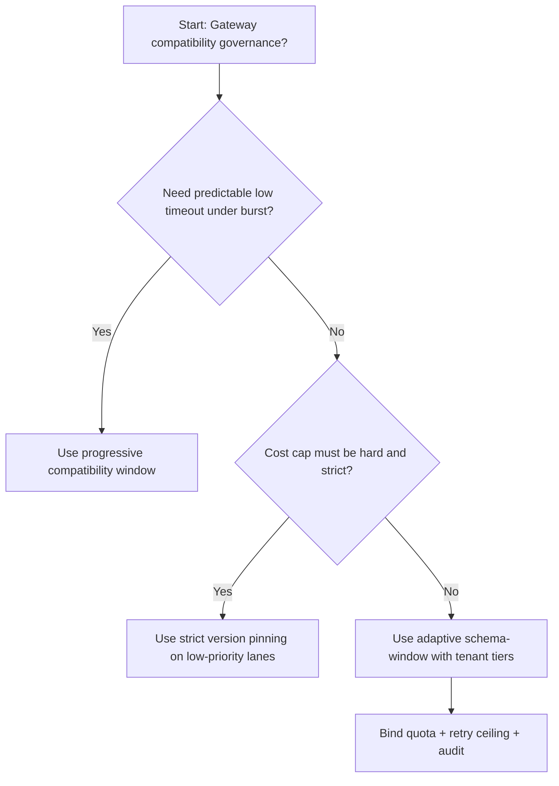
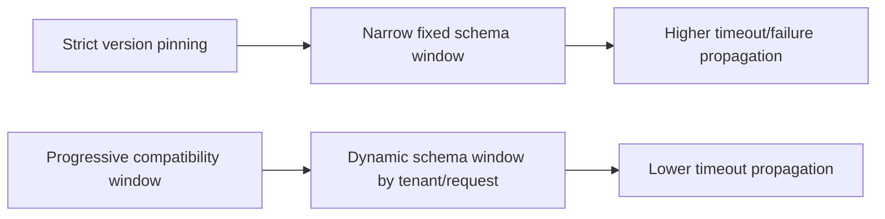
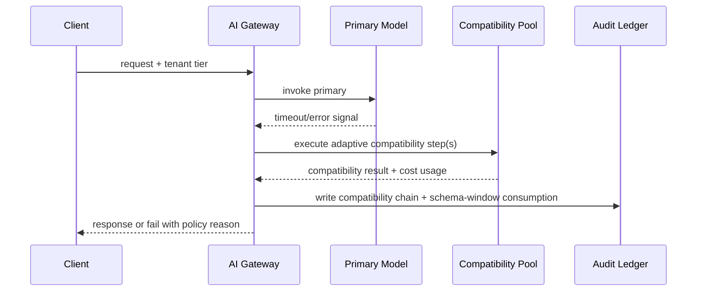

# Agent MCP 工具 Schema 兼容性门禁选型 FAQ（Strict Version Pinning 策略 vs Progressive Compatibility Window 策略）

## 1) 核心结论（先给负责人）
- **多租户 Agent Gateway 生产默认应选 Progressive Compatibility Window 策略**，不建议长期采用一刀切 Strict Version Pinning。
- **Strict Version Pinning 在工具 Schema 演进阶段更容易把短期兼容抖动放大为用户侧失败或超时**，导致成功率和尾延迟同时恶化。
- **Schema 兼容窗口必须联动租户配额、重试上限和观测告警**，否则兼容链路会变成不可控成本放大器。

## 2) Q1 / Q2 / Q3（术语先通俗解释）
- **Strict Version Pinning 策略**：工具调用仅接受固定版本 Schema，版本不匹配即拒绝执行。
- **Progressive Compatibility Window 策略**：按租户等级和请求类型动态放行兼容版本窗口，并记录迁移审计。

### Q1：为什么 Strict Version Pinning 在高并发更容易放大失败？
第一性原理：Schema 版本演进存在过渡期，窗口过窄会让可兼容请求直接失败；失败流量反向触发重试与降级，形成拥塞回路。

### Q2：什么时候可以短期采用 Strict Version Pinning？
低价值请求、容错要求低、且更看重固定成本上限时可短期采用。

### Q3：最小安全闭环是什么？
请求分级 -> Schema 兼容窗口分配 -> 准入门禁 -> 失败回放审计 -> 兼容窗口再校准。

## 3) Mermaid（决策树 / 路径对比 / 时序）
### 3.1 选型决策树

### 3.2 路径对比图

### 3.3 运行时序图

## 4) 选型决策矩阵
| 维度 | Strict Version Pinning 策略 | Progressive Compatibility Window 策略 |
|---|---|---|
| 实现复杂度 | 低 | 中 |
| 超时风险控制 | 中-低 | 高 |
| 成本可控性 | 高（静态） | 中-高（动态） |
| 多租户可持续性 | 中 | 高 |
| 生产默认建议 | 仅低优先级通道 | 长期默认 |

## 5) 数据证据与可复算算例（含 n/分母/来源）
> 本节百分比为 `synthetic_assumed` 假设算例（hypothetical），用于机制比较；生产机制认证保持 `not_measured`。  
> 合同字段见：`workshops/azure-agent-infra/evidence/cycle-463-benchmark.json` 的 `percentage_contract`。  

- 指标 A（Primary-only 超时率）  
  - 定义：`n_primary_only_timeout / n_runtime_requests_observed`  
  - 值：`286/2600 = 11.0%`（`synthetic_assumed`）  
  - 路径：`percentage_contract.primary_only_timeout_rate`
- 指标 B（Progressive compatibility 超时率）  
  - 定义：`n_progressive_compatibility_timeout / n_runtime_requests_observed`  
  - 值：`146/2600 = 5.6%`（`synthetic_assumed`）  
  - 路径：`percentage_contract.adaptive_compatibility_timeout_rate`
- 指标 C（恢复增益，百分点）  
  - 定义：`(n_recovered_adaptive_compatibility - n_recovered_primary_only) / n_runtime_requests_observed`  
  - 值：`(2435-2314)/2600 = 4.7` 个百分点（`synthetic_assumed`）  
  - 路径：`percentage_contract.compatibility_recovery_gain_pts`

## 6) 生产 Checklist（上线前必须打勾）
- [ ] Schema 兼容窗口策略具备版本、灰度和回滚路径
- [ ] 租户分层、预算消耗与重试上限可观测可审计
- [ ] 超时事件、兼容链路与失败回放可按租户追踪
- [ ] 指标全部标注 `synthetic_assumed`、分母与单位；生产机制认证保持 `not_measured`
