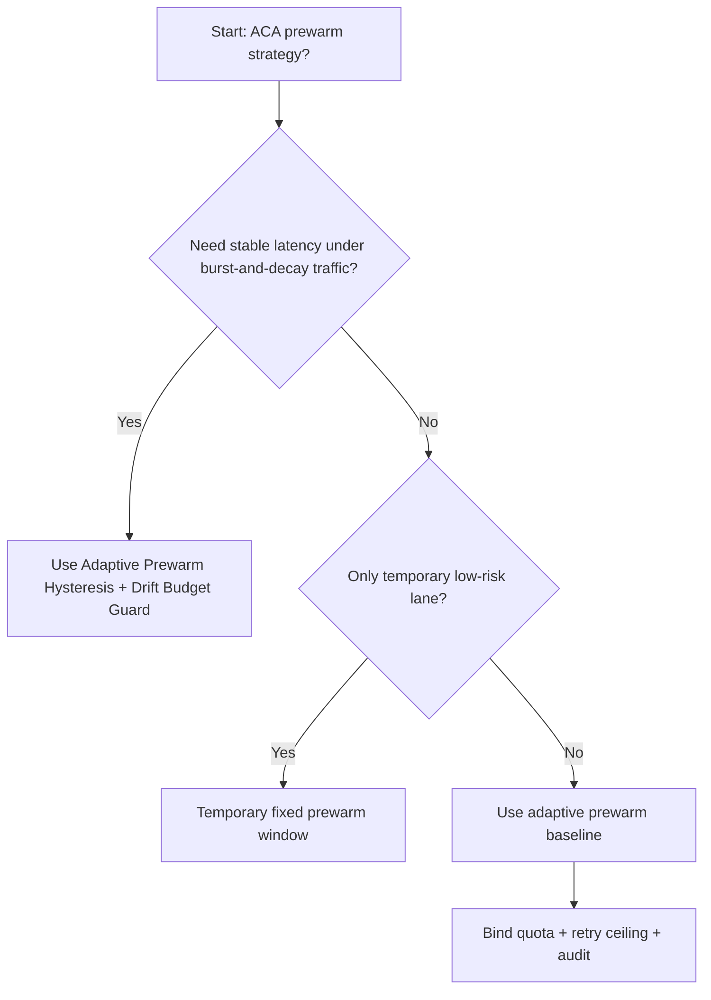
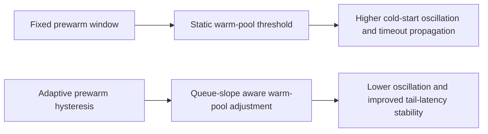
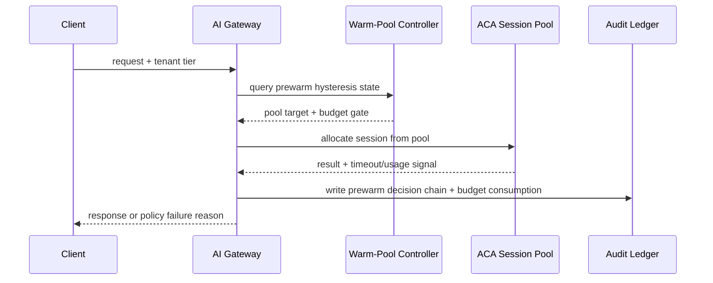

# Agent Runtime ACA Prewarm Hysteresis Selection FAQ (Fixed Prewarm Window vs Adaptive Prewarm Hysteresis + Drift Budget Guard)

## 1) Core conclusions (for decision-makers first)
- **For ACA Dynamic Sessions production, default to Adaptive Prewarm Hysteresis + Drift Budget Guard**, not fixed prewarm windows.
- **Fixed prewarm windows amplify cold-start oscillation under burst/decay traffic**, increasing tail latency and retry cost.
- **Prewarm controls must couple tenant quotas, queue gates, retry ceilings, and audit lineage**, or capacity appears healthy while stability degrades.

## 2) Q1 / Q2 / Q3 (plain-language definitions first)
- **Fixed Prewarm Window**: keep warm instances for a static time window. Simple, but insensitive to traffic slope changes.
- **Adaptive Prewarm Hysteresis + Drift Budget Guard**: adjust warm pools dynamically from queue slope and request gradient to avoid flap loops.

### Q1: Why are fixed prewarm windows fragile at high concurrency?
First principles: traffic is continuous and non-linear. Static thresholds flip frequently around boundaries, causing warm-pool oscillation and repeated cold starts.

### Q2: When is fixed prewarm still acceptable?
Only for temporary low-risk environments with stable low traffic and an explicit migration deadline to adaptive control.

### Q3: What is the minimum safe control loop?
Request classification -> prewarm-slope monitoring -> hysteresis threshold tuning -> timeout/failure audit -> recurrent calibration.

## 3) Mermaid (decision tree / path comparison / sequence)
### 3.1 Selection decision tree

### 3.2 Path comparison

### 3.3 Runtime sequence

## 4) Decision matrix
| Dimension | Fixed Prewarm Window | Adaptive Prewarm Hysteresis + Drift Budget Guard |
|---|---|---|
| Implementation complexity | Low | Medium |
| Tail-latency stability | Medium-Low | High |
| Timeout risk control | Medium-Low | High |
| Multi-tenant sustainability | Medium | High |
| Default production fit | Temporary low-priority lane only | Long-term default |

## 5) Evidence contract + recomputable examples (n/denominator/source)
> Percentages in this section are `synthetic_assumed` hypothetical examples for mechanism comparison; production mechanism validation remains `not_measured`.  
> Contract fields: `workshops/azure-agent-infra/evidence/cycle-508-benchmark.json` -> `percentage_contract`.

- Metric A (fixed prewarm window timeout rate)  
  - Formula: `n_fixed_prewarm_window_timeout / n_gateway_requests_observed`  
  - Value: `463/3900 = 11.9%` (`synthetic_assumed`)  
  - Path: `percentage_contract.fixed_prewarm_window_timeout_rate`
- Metric B (adaptive prewarm hysteresis timeout rate)  
  - Formula: `n_adaptive_prewarm_hysteresis_timeout / n_gateway_requests_observed`  
  - Value: `226/3900 = 5.8%` (`synthetic_assumed`)  
  - Path: `percentage_contract.adaptive_prewarm_hysteresis_timeout_rate`
- Metric C (recovery gain, percentage points)  
  - Formula: `(n_recovered_adaptive_prewarm - n_recovered_fixed_prewarm) / n_gateway_requests_observed`  
  - Value: `(3621-3404)/3900 = 5.6 percentage points` (`synthetic_assumed`)  
  - Path: `percentage_contract.adaptive_prewarm_recovery_gain_pts`

## 6) Production checklist
- [ ] Prewarm hysteresis policy has versioning, staged rollout, and rollback controls
- [ ] Queue depth, tenant quotas, retry ceilings, and drift budgets are observable and auditable
- [ ] Cold-start oscillation, timeout chains, and replay paths are tenant-traceable
- [ ] All metrics are tagged `synthetic_assumed` with denominator/unit; production validation remains `not_measured`
