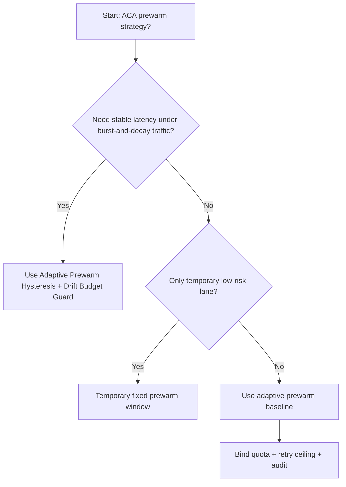
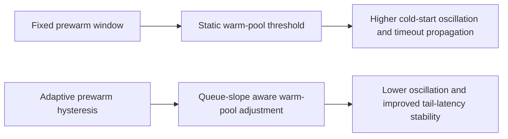
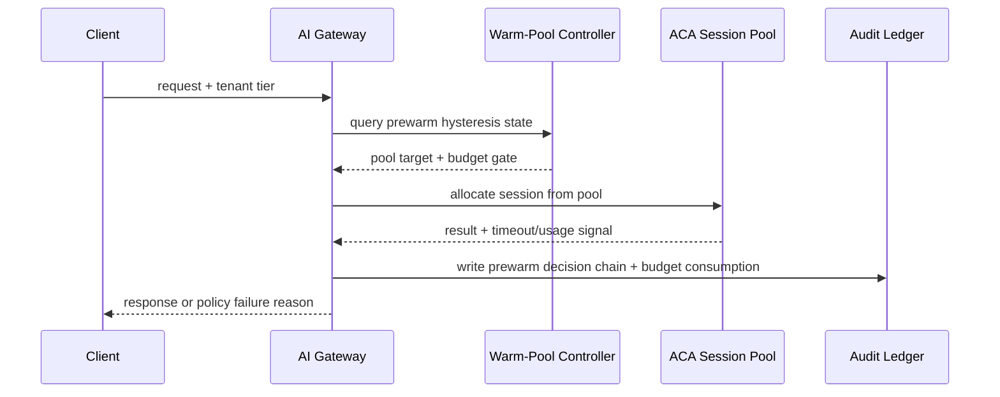

# Agent Runtime ACA Prewarm Hysteresis 选型 FAQ（Fixed Prewarm Window vs Adaptive Prewarm Hysteresis + Drift Budget Guard）

## 1) 核心结论（先给负责人）
- **ACA Dynamic Sessions 生产默认应选 Adaptive Prewarm Hysteresis + Drift Budget Guard**，不应长期依赖固定预热窗口。
- **Fixed Prewarm Window 在突发负载与回落抖动时更容易触发冷启动反复抖动**，会放大尾延迟与重试成本。
- **预热策略必须联动租户配额、排队门禁、重试上限与审计链**，否则容量看似充足但稳定性不可控。

## 2) Q1 / Q2 / Q3（术语先通俗解释）
- **Fixed Prewarm Window**：按固定时间窗口保留预热实例，逻辑简单但无法适配流量波峰波谷。
- **Adaptive Prewarm Hysteresis + Drift Budget Guard**：依据请求斜率与队列深度动态调整预热池，避免频繁开关抖动。

### Q1：为什么固定预热窗口在高并发更脆弱？
第一性原理：流量变化是连续且非线性的，固定阈值会在边界附近频繁开关，导致“热池不足-冷启动-再预热”的振荡链。

### Q2：什么时候可短期使用固定预热窗口？
仅在流量低且规律稳定、容错要求较低的临时环境中短期使用，并应设置切换到自适应策略的时间点。

### Q3：最小安全闭环是什么？
请求分级 -> 预热池斜率监控 -> 迟滞门限调节 -> 超时/失败审计 -> 周期回归校准。

## 3) Mermaid（决策树 / 路径对比 / 时序）
### 3.1 选型决策树

### 3.2 路径对比图

### 3.3 运行时序图

## 4) 选型决策矩阵
| 维度 | Fixed Prewarm Window | Adaptive Prewarm Hysteresis + Drift Budget Guard |
|---|---|---|
| 实现复杂度 | 低 | 中 |
| 尾延迟稳定性 | 中-低 | 高 |
| 超时风险控制 | 中-低 | 高 |
| 多租户可持续性 | 中 | 高 |
| 生产默认建议 | 仅临时低优先级通道 | 长期默认 |

## 5) 数据证据与可复算算例（含 n/分母/来源）
> 本节百分比为 `synthetic_assumed` 假设算例（hypothetical），用于机制比较；生产机制认证保持 `not_measured`。  
> 合同字段见：`workshops/azure-agent-infra/evidence/cycle-508-benchmark.json` 的 `percentage_contract`。

- 指标 A（Fixed Prewarm Window 超时率）  
  - 定义：`n_fixed_prewarm_window_timeout / n_gateway_requests_observed`  
  - 值：`463/3900 = 11.9%`（`synthetic_assumed`）  
  - 路径：`percentage_contract.fixed_prewarm_window_timeout_rate`
- 指标 B（Adaptive Prewarm Hysteresis 超时率）  
  - 定义：`n_adaptive_prewarm_hysteresis_timeout / n_gateway_requests_observed`  
  - 值：`226/3900 = 5.8%`（`synthetic_assumed`）  
  - 路径：`percentage_contract.adaptive_prewarm_hysteresis_timeout_rate`
- 指标 C（恢复增益，百分点）  
  - 定义：`(n_recovered_adaptive_prewarm - n_recovered_fixed_prewarm) / n_gateway_requests_observed`  
  - 值：`(3621-3404)/3900 = 5.6` 个百分点（`synthetic_assumed`）  
  - 路径：`percentage_contract.adaptive_prewarm_recovery_gain_pts`

## 6) 生产 Checklist（上线前必须打勾）
- [ ] 预热迟滞策略具备版本、灰度和回滚路径
- [ ] 队列深度、租户配额、重试上限和漂移预算均可观测可审计
- [ ] 冷启动振荡、超时链路与回放审计可按租户追踪
- [ ] 指标全部标注 `synthetic_assumed`、分母与单位；生产机制认证保持 `not_measured`
