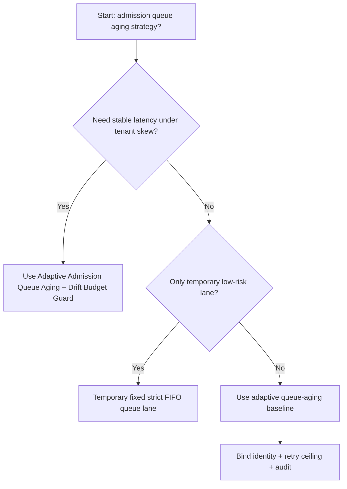
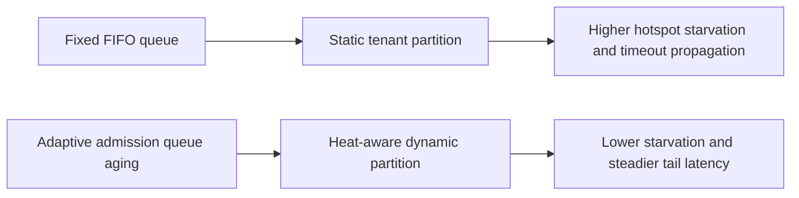
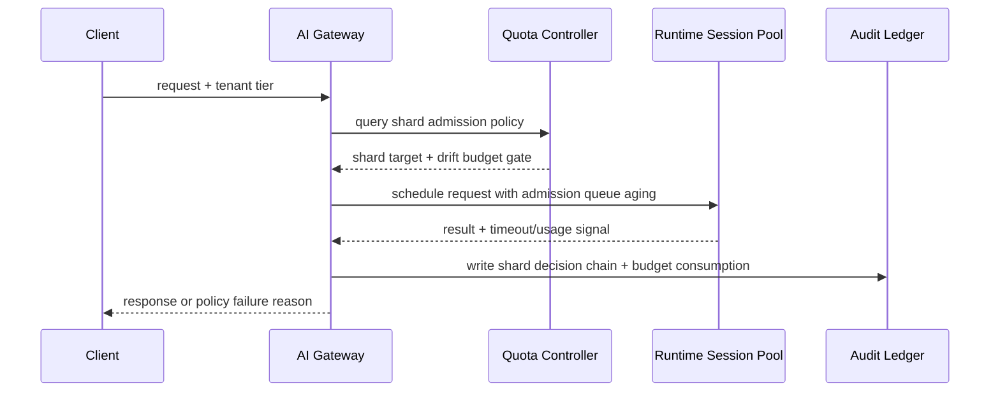

# Agent Runtime Admission Queue Aging Selection FAQ (Fixed Strict FIFO Queue vs Adaptive Admission Queue Aging + Drift Budget Guard)

## 1) Core conclusions (for decision-makers first)
- **For multi-tenant production, default to Adaptive Admission Queue Aging + Drift Budget Guard**, not fixed strict FIFO queue.
- **Fixed quota slices amplify queue congestion under tenant skew**, driving timeout cascades and retry storms.
- **Admission controls must couple tenant identity, queue depth, retry ceilings, and audit lineage**, or apparent quota sufficiency still collapses under hotspots.

## 2) Q1 / Q2 / Q3 (plain-language definitions first)
- **Fixed Strict FIFO Queue**: static per-tenant partitioning. Predictable rules, poor utilization under skew.
- **Adaptive Admission Queue Aging + Drift Budget Guard**: dynamic quota repartition by heat signal, bounded by drift budget gates.

### Q1: Why are fixed slices fragile at high concurrency?
First principles: traffic is not evenly distributed. Static partitions starve hot tenants while cold partitions sit idle, reducing total throughput.

### Q2: When are fixed slices still acceptable?
Only for temporary environments with stable traffic shape, small peak-to-valley gaps, and low rollback complexity.

### Q3: What is the minimum safe control loop?
Request classification -> shard heat monitoring -> dynamic quota migration -> timeout/failure audit -> periodic recalibration.

## 3) Mermaid (decision tree / path comparison / sequence)
### 3.1 Selection decision tree

### 3.2 Path comparison

### 3.3 Runtime sequence

## 4) Decision matrix
| Dimension | Fixed Strict FIFO Queue | Adaptive Admission Queue Aging + Drift Budget Guard |
|---|---|---|
| Implementation complexity | Low | Medium |
| Hotspot resilience | Medium-Low | High |
| Timeout risk control | Medium-Low | High |
| Multi-tenant sustainability | Medium | High |
| Default production fit | Temporary low-priority lane only | Long-term default |

## 5) Evidence contract + recomputable examples (n/denominator/source)
> Percentages in this section are `synthetic_assumed` hypothetical examples for mechanism comparison; production mechanism validation remains `not_measured`.  
> Contract fields: `workshops/azure-agent-infra/evidence/cycle-517-benchmark.json` -> `percentage_contract`.

- Metric A (fixed strict FIFO queue timeout rate)  
  - Formula: `n_fixed_strict_fifo_timeout / n_gateway_requests_observed`  
  - Value: `534/4320 = 12.4%` (`synthetic_assumed`)  
  - Path: `percentage_contract.fixed_strict_fifo_timeout_rate`
- Metric B (adaptive admission-queue-aging timeout rate)  
  - Formula: `n_adaptive_queue_aging_timeout / n_gateway_requests_observed`  
  - Value: `229/4320 = 5.3%` (`synthetic_assumed`)  
  - Path: `percentage_contract.adaptive_queue_aging_timeout_rate`
- Metric C (recovery gain, percentage points)  
  - Formula: `(n_recovered_adaptive_aging - n_recovered_fixed_strict_fifo) / n_gateway_requests_observed`  
  - Value: `(3926-3655)/4320 = 6.3 percentage points` (`synthetic_assumed`)  
  - Path: `percentage_contract.adaptive_queue_aging_recovery_gain_pts`

## 6) Production checklist
- [ ] Admission queue-aging policy has versioning, staged rollout, and rollback controls
- [ ] Tenant heat, queue depth, retry ceilings, and drift budgets are observable and auditable
- [ ] Starvation events, timeout chains, and replay paths are tenant-traceable
- [ ] All metrics are tagged `synthetic_assumed` with denominator/unit; production validation remains `not_measured`
