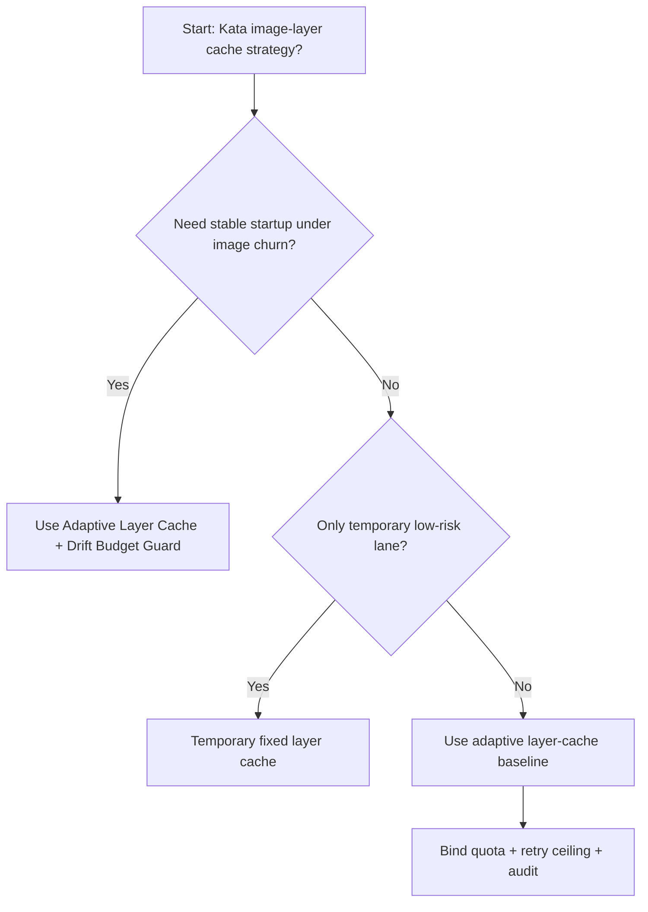
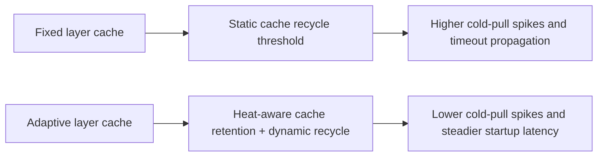
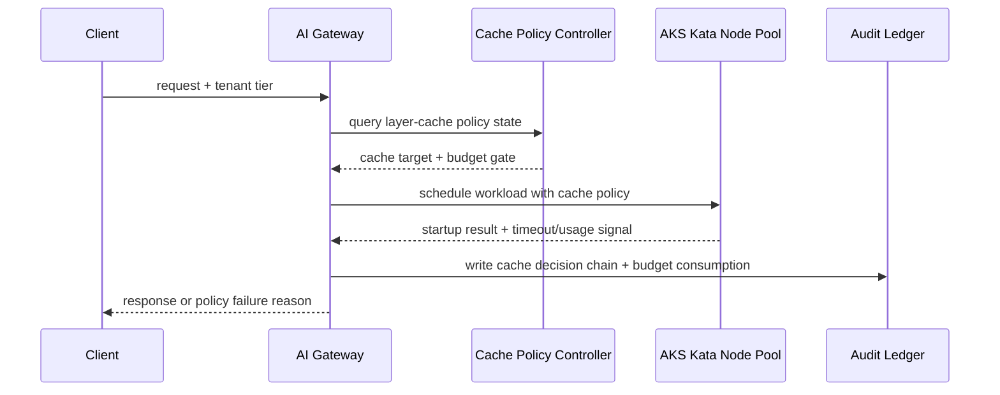

# Agent Runtime AKS Kata Image-Layer Cache Governance Selection FAQ (Fixed Layer Cache vs Adaptive Layer Cache + Drift Budget Guard)

## 1) Core conclusions (for decision-makers first)
- **For AKS Kata multi-tenant production, default to Adaptive Layer Cache + Drift Budget Guard**, not fixed layer-cache policy.
- **Fixed layer-cache policy amplifies cold-pull spikes under image churn and node replacement**, increasing startup latency and retry cost.
- **Layer-cache controls must couple tenant quotas, image-signing policy, retry ceilings, and audit lineage**, or both stability and compliance boundaries degrade.

## 2) Q1 / Q2 / Q3 (plain-language definitions first)
- **Fixed Layer Cache**: static cache retention and recycle thresholds. Easy to implement, brittle under workload swings.
- **Adaptive Layer Cache + Drift Budget Guard**: dynamically tune cache retention/recycle from heat signals and queue slope.

### Q1: Why is fixed cache fragile at high concurrency?
First principles: cache hit/eviction dynamics are non-linear. Static thresholds create “evict too early -> repull storm -> queue spike” oscillations.

### Q2: When is fixed cache still acceptable?
Only for temporary environments with stable image sets, low churn, and explicit migration deadline to adaptive cache control.

### Q3: What is the minimum safe control loop?
Request classification -> cache heat monitoring -> adaptive threshold tuning -> failure audit -> periodic recalibration.

## 3) Mermaid (decision tree / path comparison / sequence)
### 3.1 Selection decision tree

### 3.2 Path comparison

### 3.3 Runtime sequence

## 4) Decision matrix
| Dimension | Fixed Layer Cache | Adaptive Layer Cache + Drift Budget Guard |
|---|---|---|
| Implementation complexity | Low | Medium |
| Startup stability | Medium-Low | High |
| Timeout risk control | Medium-Low | High |
| Multi-tenant sustainability | Medium | High |
| Default production fit | Temporary low-priority lane only | Long-term default |

## 5) Evidence contract + recomputable examples (n/denominator/source)
> Percentages in this section are `synthetic_assumed` hypothetical examples for mechanism comparison; production mechanism validation remains `not_measured`.  
> Contract fields: `workshops/azure-agent-infra/evidence/cycle-509-benchmark.json` -> `percentage_contract`.

- Metric A (fixed layer-cache timeout rate)  
  - Formula: `n_fixed_layer_cache_timeout / n_gateway_requests_observed`  
  - Value: `463/3900 = 11.9%` (`synthetic_assumed`)  
  - Path: `percentage_contract.fixed_layer_cache_timeout_rate`
- Metric B (adaptive layer-cache timeout rate)  
  - Formula: `n_adaptive_layer_cache_timeout / n_gateway_requests_observed`  
  - Value: `226/3900 = 5.8%` (`synthetic_assumed`)  
  - Path: `percentage_contract.adaptive_layer_cache_timeout_rate`
- Metric C (recovery gain, percentage points)  
  - Formula: `(n_recovered_adaptive_cache - n_recovered_fixed_cache) / n_gateway_requests_observed`  
  - Value: `(3621-3404)/3900 = 5.6 percentage points` (`synthetic_assumed`)  
  - Path: `percentage_contract.adaptive_layer_cache_recovery_gain_pts`

## 6) Production checklist
- [ ] Layer-cache policy has versioning, staged rollout, and rollback controls
- [ ] Cache heat, tenant quotas, retry ceilings, and drift budgets are observable and auditable
- [ ] Cold-pull spikes, timeout chains, and replay paths are tenant-traceable
- [ ] All metrics are tagged `synthetic_assumed` with denominator/unit; production validation remains `not_measured`
