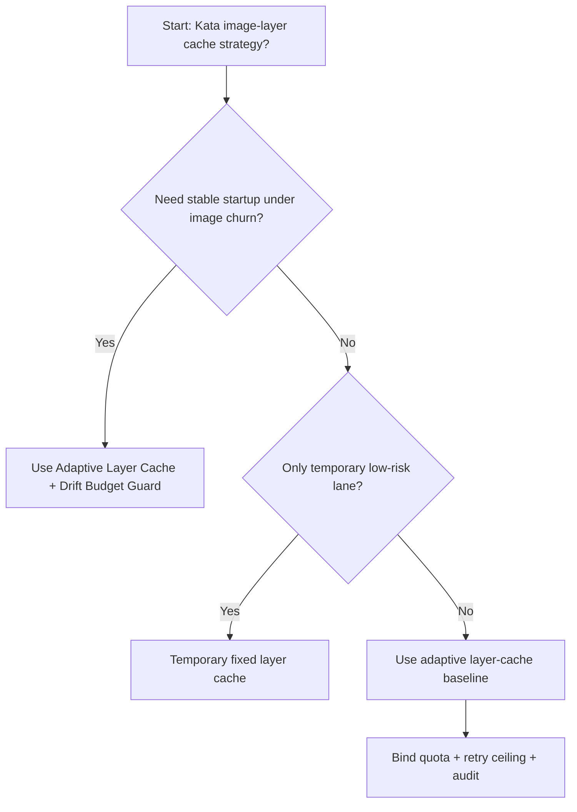
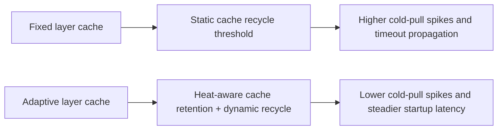
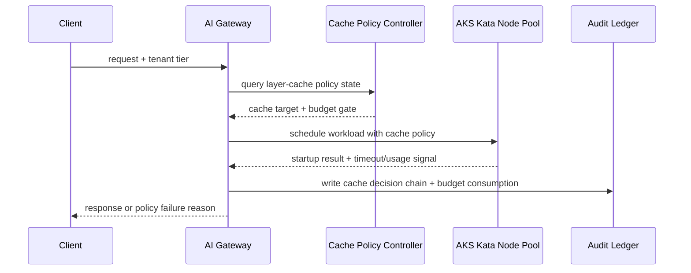

# Agent Runtime AKS Kata Image-Layer Cache Governance 选型 FAQ（Fixed Layer Cache vs Adaptive Layer Cache + Drift Budget Guard）

## 1) 核心结论（先给负责人）
- **AKS Kata 多租户运行时生产默认应选 Adaptive Layer Cache + Drift Budget Guard**，不应长期依赖固定镜像层缓存策略。
- **Fixed Layer Cache 在镜像热度突变和节点替换场景更容易触发冷拉取尖峰**，会放大启动延迟与失败重试。
- **镜像层缓存治理必须联动租户配额、镜像签名策略、重试上限和审计链**，否则吞吐稳定性与合规边界都会退化。

## 2) Q1 / Q2 / Q3（术语先通俗解释）
- **Fixed Layer Cache**：节点缓存阈值和回收规则固定不变，易实现但无法适配负载波动。
- **Adaptive Layer Cache + Drift Budget Guard**：按镜像热度和队列斜率动态调整缓存层级与回收门限，控制抖动。

### Q1：为什么固定缓存策略在高并发更脆弱？
第一性原理：缓存命中与失效是动态过程，固定阈值会在工作负载切换时产生“回收过早-重复拉取-再拥塞”的振荡。

### Q2：什么时候可短期使用固定缓存策略？
仅在镜像集合稳定、变更频率低且容量富余的临时环境中短期使用，并应设置迁移到自适应缓存的时间点。

### Q3：最小安全闭环是什么？
请求分级 -> 缓存热度监控 -> 动态阈值调节 -> 失败审计 -> 周期性回归校准。

## 3) Mermaid（决策树 / 路径对比 / 时序）
### 3.1 选型决策树

### 3.2 路径对比图

### 3.3 运行时序图

## 4) 选型决策矩阵
| 维度 | Fixed Layer Cache | Adaptive Layer Cache + Drift Budget Guard |
|---|---|---|
| 实现复杂度 | 低 | 中 |
| 启动稳定性 | 中-低 | 高 |
| 超时风险控制 | 中-低 | 高 |
| 多租户可持续性 | 中 | 高 |
| 生产默认建议 | 仅临时低优先级通道 | 长期默认 |

## 5) 数据证据与可复算算例（含 n/分母/来源）
> 本节百分比为 `synthetic_assumed` 假设算例（hypothetical），用于机制比较；生产机制认证保持 `not_measured`。  
> 合同字段见：`workshops/azure-agent-infra/evidence/cycle-509-benchmark.json` 的 `percentage_contract`。

- 指标 A（Fixed Layer Cache 超时率）  
  - 定义：`n_fixed_layer_cache_timeout / n_gateway_requests_observed`  
  - 值：`463/3900 = 11.9%`（`synthetic_assumed`）  
  - 路径：`percentage_contract.fixed_layer_cache_timeout_rate`
- 指标 B（Adaptive Layer Cache 超时率）  
  - 定义：`n_adaptive_layer_cache_timeout / n_gateway_requests_observed`  
  - 值：`226/3900 = 5.8%`（`synthetic_assumed`）  
  - 路径：`percentage_contract.adaptive_layer_cache_timeout_rate`
- 指标 C（恢复增益，百分点）  
  - 定义：`(n_recovered_adaptive_cache - n_recovered_fixed_cache) / n_gateway_requests_observed`  
  - 值：`(3621-3404)/3900 = 5.6` 个百分点（`synthetic_assumed`）  
  - 路径：`percentage_contract.adaptive_layer_cache_recovery_gain_pts`

## 6) 生产 Checklist（上线前必须打勾）
- [ ] 镜像层缓存策略具备版本、灰度和回滚路径
- [ ] 缓存热度、租户配额、重试上限和漂移预算均可观测可审计
- [ ] 冷拉取尖峰、超时链路与回放审计可按租户追踪
- [ ] 指标全部标注 `synthetic_assumed`、分母与单位；生产机制认证保持 `not_measured`
