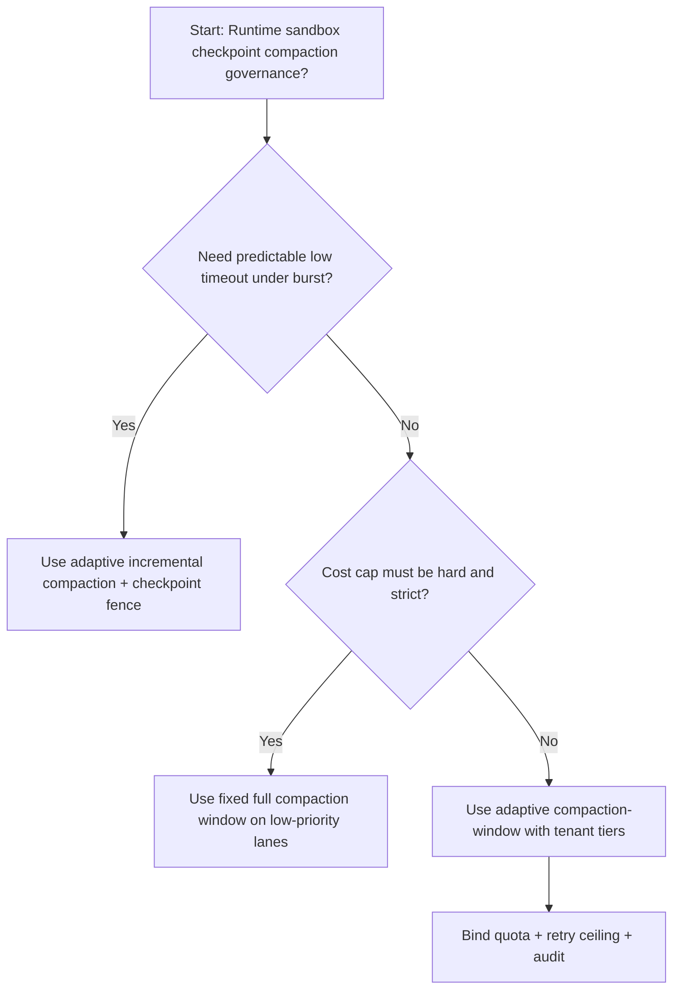
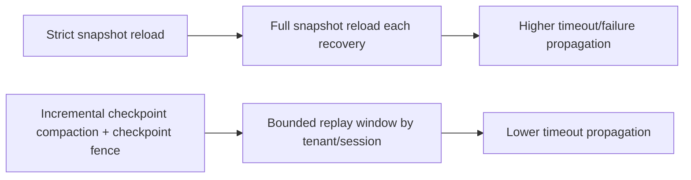
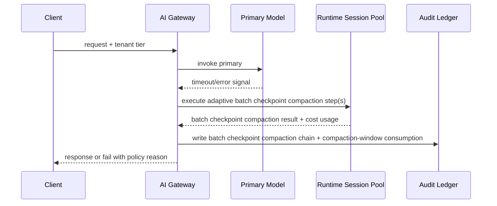

# Agent Runtime 检查点压缩频率选型 FAQ（Fixed Full Compaction Window 策略 vs Adaptive Incremental Compaction + Checkpoint Fence 策略）

## 1) 核心结论（先给负责人）
- **多租户 Agent Runtime 沙箱生产默认应选 Adaptive Incremental Compaction + Checkpoint Fence 策略**，不建议长期采用一刀切 Fixed Full Compaction Window。
- **Fixed Full Compaction Window 在会话恢复高并发阶段更容易把短期恢复抖动放大为用户侧失败或超时**，导致成功率和尾延迟同时恶化。
- **Runtime 沙箱检查点压缩必须联动租户配额、重试上限和观测告警**，否则排序链路会变成不可控成本放大器。

## 2) Q1 / Q2 / Q3（术语先通俗解释）
- **Fixed Full Compaction Window 策略**：每次恢复都从完整快照重载，恢复链路简单但恢复延迟和 I/O 峰值更高。
- **Adaptive Incremental Compaction + Checkpoint Fence 策略**：以增量压缩恢复为主，结合检查点栅栏保证一致性与回放可审计。

### Q1：为什么 Fixed Full Compaction Window 在高并发更容易放大失败？
第一性原理：会话恢复存在突发重放与状态修复；如果每次都重载完整快照，会把慢会话恢复阻塞扩散到全局，触发队列堆积与超时放大。

### Q2：什么时候可以短期采用 Fixed Full Compaction Window？
低价值请求、容错要求低、且更看重固定成本上限时可短期采用。

### Q3：最小安全闭环是什么？
请求分级 -> 增量日志恢复预算分配 -> 准入门禁 -> 回放审计 -> 恢复窗口再校准。

## 3) Mermaid（决策树 / 路径对比 / 时序）
### 3.1 选型决策树

### 3.2 路径对比图

### 3.3 运行时序图

## 4) 选型决策矩阵
| 维度 | Fixed Full Compaction Window 策略 | Adaptive Incremental Compaction + Checkpoint Fence 策略 |
|---|---|---|
| 实现复杂度 | 低 | 中 |
| 超时风险控制 | 中-低 | 高 |
| 成本可控性 | 高（静态） | 中-高（动态） |
| 多租户可持续性 | 中 | 高 |
| 生产默认建议 | 仅低优先级通道 | 长期默认 |

## 5) 数据证据与可复算算例（含 n/分母/来源）
> 本节百分比为 `synthetic_assumed` 假设算例（hypothetical），用于机制比较；生产机制认证保持 `not_measured`。  
> 合同字段见：`workshops/azure-agent-infra/evidence/cycle-468-benchmark.json` 的 `percentage_contract`。  

- 指标 A（Primary-only 超时率）  
  - 定义：`n_primary_only_timeout / n_runtime_requests_observed`  
  - 值：`286/2600 = 11.0%`（`synthetic_assumed`）  
  - 路径：`percentage_contract.fixed_full_compaction_timeout_rate`
- 指标 B（Adaptive incremental compaction 超时率）  
  - 定义：`n_adaptive_incremental_compaction_timeout / n_runtime_requests_observed`  
  - 值：`146/2600 = 5.6%`（`synthetic_assumed`）  
  - 路径：`percentage_contract.adaptive_incremental_compaction_timeout_rate`
- 指标 C（恢复增益，百分点）  
  - 定义：`(n_recovered_adaptive_incremental_compaction - n_recovered_fixed_full_compaction) / n_runtime_requests_observed`  
  - 值：`(2435-2314)/2600 = 4.7` 个百分点（`synthetic_assumed`）  
  - 路径：`percentage_contract.incremental_compaction_recovery_gain_pts`

## 6) 生产 Checklist（上线前必须打勾）
- [ ] Runtime 沙箱检查点压缩策略具备版本、灰度和回滚路径
- [ ] 租户分层、预算消耗与重试上限可观测可审计
- [ ] 超时事件、恢复链路与失败回放可按租户追踪
- [ ] 指标全部标注 `synthetic_assumed`、分母与单位；生产机制认证保持 `not_measured`
