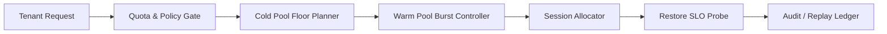

# Agent Runtime Cold-Pool Sizing Selection FAQ (Fixed Small Cold Pool vs Adaptive Cold/Warm Pool)

## 1) Core conclusions
- **Production multi-tenant deployments should default to adaptive cold/warm pool sizing with restore budgets**, not long-term fixed small cold pools.
- **Fixed small cold pools amplify queue overflow and cold-start pressure during bursts**, increasing tail latency and retry churn.
- **Cold-pool sizing governance must be coupled with tenant quotas, gateway policy, and replay audit loops** to optimize both cost and reliability.

## 2) Q1 / Q2 / Q3 (plain terms first)
- **Fixed small cold pool**: static cold capacity; predictable cost, weak burst resilience.
- **Adaptive cold/warm pool**: dynamically adjusts cold vs warm pool proportions based on traffic and health signals.

### Q1: Why is a fixed small cold pool risky in production?
First principle: startup demand is bursty; static cold capacity creates queue concentration and magnifies cold-start pressure.

### Q2: When is a fixed small cold pool acceptable?
Short-lived single-tenant workloads with low volatility, relaxed recovery targets, and strict budget constraints.

### Q3: What is the minimum safe cold-pool sizing control loop?
Tenant quota -> cold-pool floor policy -> warm-pool burst budget -> session allocator -> restore SLO probe -> replay audit ledger.

## 3) Mermaid (runtime cold-pool sizing governance loop)

## 4) Decision matrix
| Dimension | Fixed small cold pool | Adaptive cold/warm pool |
|---|---|---|
| Implementation complexity | Low | Medium-High |
| Burst resilience | Low | High |
| Overflow control ability | Low-Medium | High |
| Cost elasticity | Medium | High |
| Default production fit | Short transitional phase | Multi-tenant long-running workloads |

## 5) Evidence contract + recomputable examples (n/denominator/source)
> Percentages in this section are `synthetic_assumed` hypothetical examples for mechanism comparison; production mechanism validation remains `not_measured`.  
> Contract fields: `workshops/azure-agent-infra/evidence/cycle-430-benchmark.json` -> `percentage_contract`.

- Metric A (overflow rate, fixed small cold pool)  
  - Formula: `n_overflow_fixed_small_pool / n_sessions_observed`  
  - Value: `288/2400 = 12.0%` (`synthetic_assumed`)  
  - Path: `percentage_contract.fixed_small_pool_overflow_rate`
- Metric B (overflow rate, adaptive cold/warm pool)  
  - Formula: `n_overflow_adaptive_pool / n_sessions_observed`  
  - Value: `86/2400 = 3.6%` (`synthetic_assumed`)  
  - Path: `percentage_contract.adaptive_pool_overflow_rate`
- Metric C (warm-restore success gain, percentage points)  
  - Formula: `(n_restore_success_adaptive - n_restore_success_fixed) / n_sessions_observed`  
  - Value: `(2140-1938)/2400 = 8.4 percentage points` (`synthetic_assumed`)  
  - Path: `percentage_contract.warm_restore_gain_pts`

## 6) Production checklist
- [ ] Cold-pool floor and warm-burst policy are versioned with rollout and rollback controls
- [ ] Tenant quota and burst gates are enforced at gateway level
- [ ] Restore budget, queue metrics, and replay audit are traceable
- [ ] Metrics are tagged `synthetic_assumed` with denominator and units; production validation remains `not_measured`
